# 🚆 JalanLuhh

> A transit discovery web app for Klang Valley commuters. Pick an MRT, LRT, KTM or BRT line, open any station, and see the mosques, malls, parks, hospitals and attractions within walking distance. It also estimates fares and finds the stations closest to you.


---

## 📖 Table of Contents

- [Overview](#-overview)
- [Features](#-features)
- [Tech Stack](#-tech-stack)
- [Architecture](#-architecture)
- [User Flow](#-user-flow)
- [Data Model](#-data-model)
- [Frontend Components](#-frontend-components)
- [Feature Flows](#-feature-specific-flows)
- [Project Structure](#-project-structure)
- [Roadmap](#-roadmap)
- [License](#-license)

---

## 🧭 Overview

Most transit apps tell you how to get to a station. JalanLuhh starts from the other end: it shows what's around each station once you arrive. Every stop on a line has a list of nearby places (masjid, temples, churches, malls, parks, hospitals, schools, gyms and food spots), each with its walking distance, a short description and a one-tap **Open in Maps** link.

The app was originally called **JalanKit**. Right now it's a frontend-only, installable Progressive Web App with a Workbox service worker. All the station and amenity data is bundled as typed TypeScript, and personal data (favourites, theme) is kept in `localStorage`. The `backend/` folder is a placeholder for a planned API.

**Current coverage**

| Metric | Value |
|---|---|
| Transit lines listed | 13 (MRT, LRT, Monorail, BRT, KTM, ERL) |
| Lines with full station data | 1 (**MRT Putrajaya Line**, 36 stations from Kwasa Damansara to Putrajaya Sentral) |
| Places mapped | 48 across 8 categories |
| Other lines | Shown as *Coming Soon* cards with official station counts |

**Type:** `Solo`
**Brand:** `Luhh Series`
**Built with:** Independent (scaffolded with Lovable, then restructured and redesigned by hand)
**Theme:** SDG 11, Sustainable Cities & Communities

---

## ✨ Features

- ✅ Browse all 13 Klang Valley rail and BRT lines, grouped by MRT / LRT / Other
- ✅ Line detail page with a vertical station timeline, plus category chips per stop
- ✅ Search stations **or** amenity names within a line
- ✅ Multi-select category filter (Mosque, Temple, Church, Attraction, Mall, Park, Hospital, Education, Fitness, Food)
- ✅ Station detail page listing nearby places with walking distance and description
- ✅ Previous / next station navigation along the line
- ✅ "Navigate to Station" and per-place "Open in Maps" (Google Maps search deep links)
- ✅ Native share sheet via the Web Share API
- ✅ Favourites for stations and places, saved in `localStorage`, with a dedicated Favourites page
- ✅ Fare calculator: pick a line, origin and destination, and passenger type (Adult / Student / Senior / OKU / Child) to get an estimated fare, travel time, distance and stop count
- ✅ Nearby Stops: browser geolocation plus Haversine distance to list the 5 closest stations within 3 km
- ✅ Light / dark theme toggle (follows the system setting on first visit)
- ✅ Installable PWA via `vite-plugin-pwa`: generated web manifest (standalone, portrait, 192/512 px and maskable icons, `#1967D2` theme colour)
- ✅ Workbox service worker with auto-update: precaches the app shell (JS, CSS, HTML, icons, fonts) and caches Google Fonts with CacheFirst, so the app and its bundled station data keep working offline
- ✅ Install page that hooks into `beforeinstallprompt`, with manual steps for iOS Safari
- ✅ Responsive layout with a collapsible mobile nav
- 🚧 Station data for the remaining 12 lines *(cards show "Coming Soon")*
- 🚧 Line service status widget (operating hours, peak/off-peak frequency, facilities) *(`LineStatus` component is built but not mounted on any page)*
- 💡 Backend API for stations, amenities and crowd-sourced place submissions *(currently a Google Form link)*
- 💡 Cross-line journeys with interchanges and transfer-aware fares
- 💡 Live arrivals from open GTFS-Realtime feeds
- 💡 Map view of stations and amenities
- 💡 Bus (RapidKL / feeder) coverage

---

## 🛠 Tech Stack

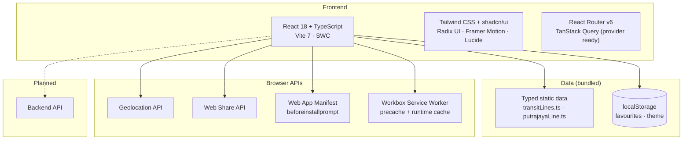

| Layer | Technology |
|---|---|
| Framework | React 18 + TypeScript |
| Build tool | Vite 7 with `@vitejs/plugin-react-swc` |
| Routing | React Router v6 |
| UI | Tailwind CSS · shadcn/ui (Radix UI primitives) · Lucide icons · Plus Jakarta Sans |
| Animation | Framer Motion |
| Server state | TanStack React Query (provider wired, ready for the API) |
| Data | Typed static TypeScript modules |
| Persistence | `localStorage` (favourites, theme) |
| Geo | Browser Geolocation API + Haversine formula |
| PWA | `vite-plugin-pwa` · Workbox service worker (auto-update) · Web App Manifest · install prompt handling |
| Backend | 🚧 Planned |

---

## 📌 Architecture

### High-level Architecture

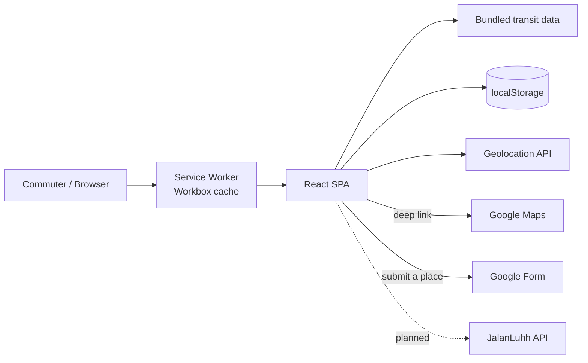

### Frontend Layers

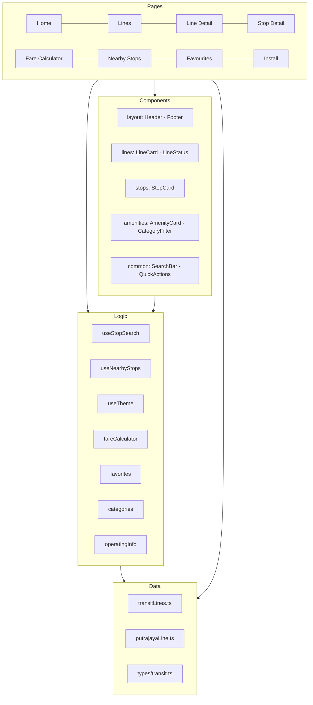

---

## 👤 User Flow

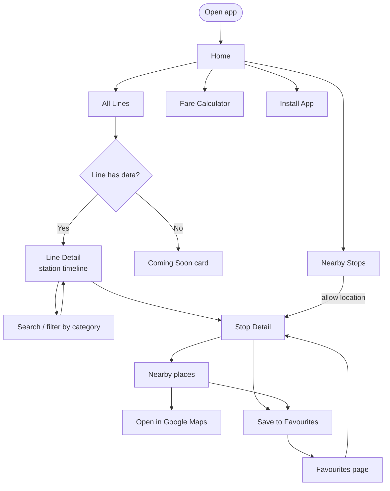

### Page Map

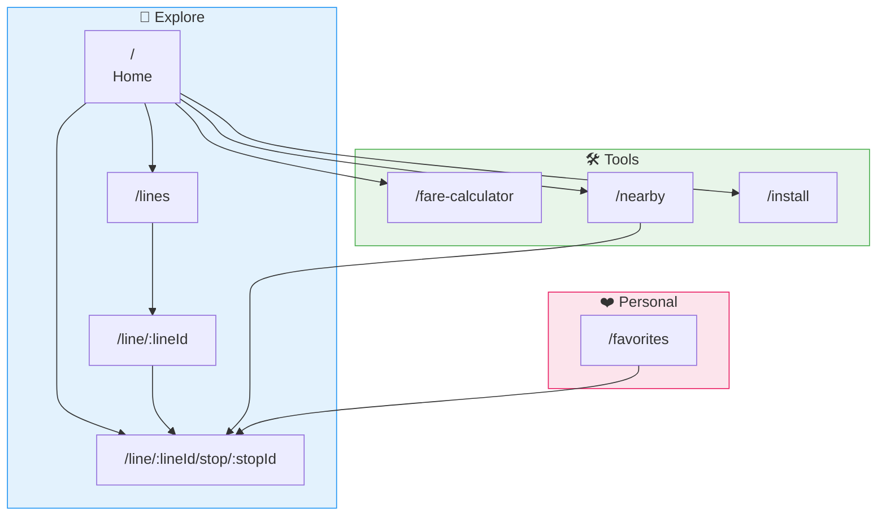

---

## 🗄️ Data Model

There's no database yet. The domain is modelled with TypeScript interfaces in `types/transit.ts`, and the data sits in typed modules. The diagram below shows how those types relate. A future backend would most likely adopt the same shape.

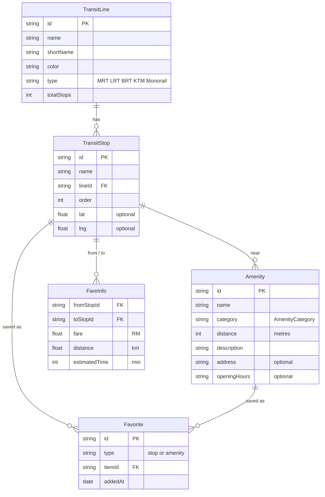

### Amenity Categories

| Category | Places mapped | Examples |
|---|---|---|
| 🛍 Mall / Shopping | 12 | The Exchange TRX, AEON Metro Prima, Intermark Mall |
| ✨ Attraction | 11 | Istana Budaya, National Art Gallery, Ilham Gallery |
| 🕌 Mosque | 5 | Asy-Syakirin Mosque, Masjid IJN |
| 🌳 Park | 5 | KLCC Park, TRX City Park, Taman Titiwangsa |
| 🏥 Hospital | 5 | Hospital Kuala Lumpur, IJN, Putrajaya Hospital |
| 💪 Fitness | 5 | Anytime Fitness, WynSports |
| 🎓 Education | 3 | Perpustakaan Negara, UTAR |
| 🛕 Temple | 2 | Wat Meh Liew, Sri Lingeshwarar Temple |
| ⛪ Church · 🍜 Food | 0 | Categories defined, data pending |

### Client-side Storage

| Key | Contents |
|---|---|
| `jalanluhh_favorites` | Array of `Favorite` objects (stops and amenities) |
| `jalanluhh_theme` | `"light"` or `"dark"` |

---

## 🧩 Frontend Components

### Component Tree

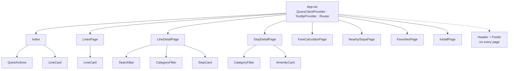

### Key Components and Hooks

| Name | Purpose |
|---|---|
| `Header` | Sticky glass nav, theme toggle, mobile menu |
| `LineCard` | Line badge in line colour, type pill, stop count, "Coming Soon" state |
| `StopCard` | Timeline node with stop number, category chips, amenity count, favourite toggle |
| `AmenityCard` | Category icon, walking distance, description, Open in Maps, favourite toggle |
| `CategoryFilter` | Multi-select chip filter with clear action |
| `SearchBar` | Rounded search input used on line detail |
| `QuickActions` | Shortcut tiles to Fare Calculator, Nearby Stops and Install |
| `LineStatus` | Operating hours, peak/off-peak frequency, facilities *(built, not yet mounted)* |
| `useStopSearch` | Memoised filtering by stop name, amenity name and selected categories |
| `useNearbyStops` | Requests geolocation, runs a Haversine search over station coordinates, returns the top 5 |
| `useTheme` | Persists light/dark preference and toggles the `dark` class |
| `fareCalculator` | Distance-based fare estimate with concession rates |
| `favorites` | `localStorage` CRUD for saved stops and places |

---

## ⚙️ Feature-specific Flows

### Stop Search and Category Filter

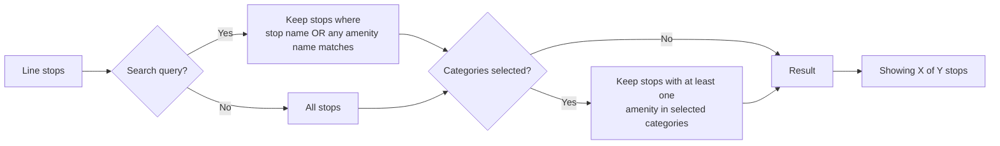

### Fare Estimation

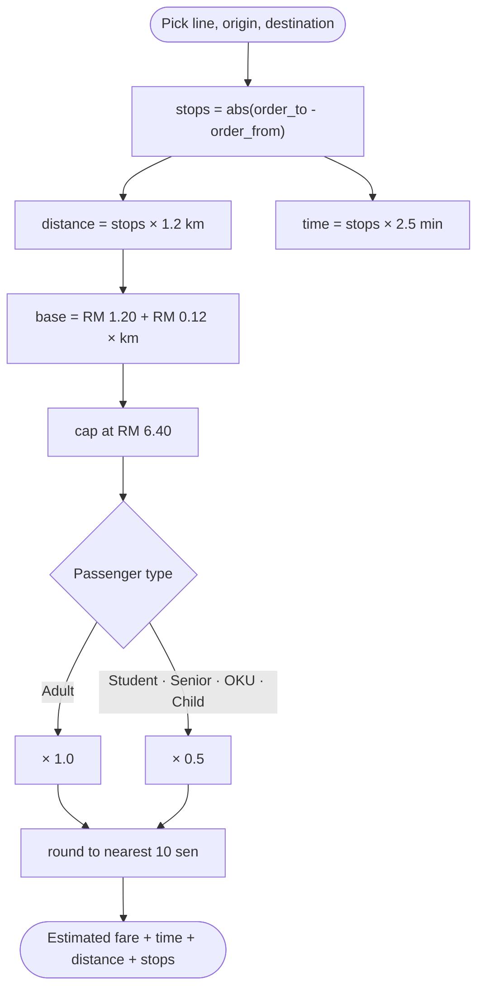

> Fares are estimates that approximate distance-based pricing, so the UI tells users to check official sources. For example, Kwasa Damansara to Tun Razak Exchange (21 stops) on a student concession comes out to **RM 2.10**, ~53 min, 25.2 km.

### Nearby Stops

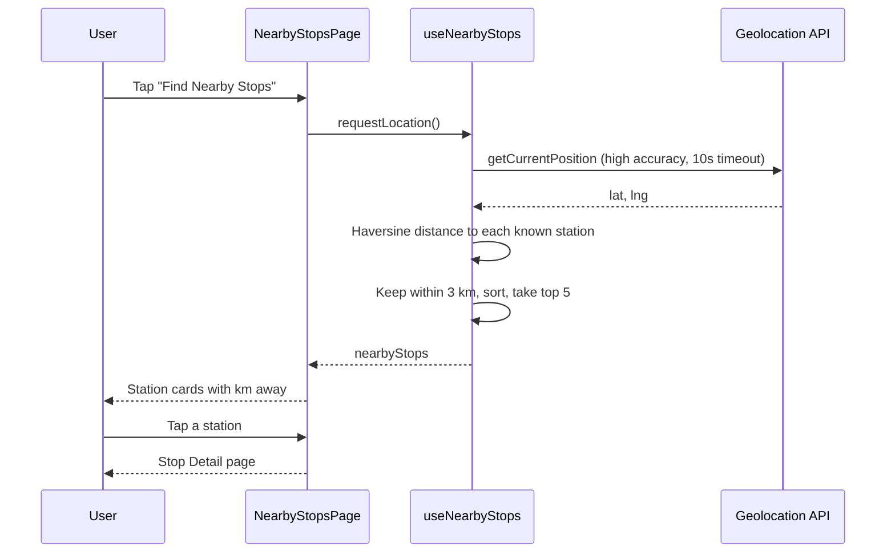

### Favourites

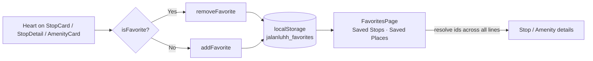

### PWA and Offline

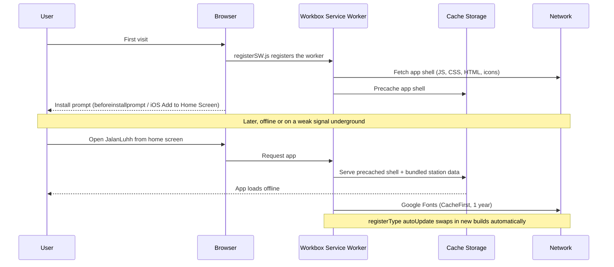

---

## 📁 Project Structure

```
JalanLuhh/
├── backend/
│   └── README.md            Placeholder for the planned API
│
└── frontend/
    ├── public/
    │   ├── manifest.json    Static web manifest
    │   └── pwa-*.png        PWA icons (192 / 512)
    ├── vite.config.ts       Vite + VitePWA (manifest, Workbox caching)
    └── src/
        ├── pages/
        │   ├── home/        Landing, stats, popular stops
        │   ├── lines/       All lines + line detail timeline
        │   ├── stops/       Stop detail + nearby stops
        │   ├── fare/        Fare calculator
        │   ├── favorites/   Saved stops and places
        │   ├── install/     PWA install guide
        │   └── error/       404
        ├── components/
        │   ├── layout/      Header, Footer
        │   ├── common/      SearchBar, QuickActions, NavLink
        │   ├── lines/       LineCard, LineStatus
        │   ├── stops/       StopCard
        │   ├── amenities/   AmenityCard, CategoryFilter
        │   └── ui/          shadcn/ui primitives
        ├── data/            transitLines.ts, putrajayaLine.ts
        ├── hooks/           useStopSearch, useNearbyStops, useTheme
        ├── lib/             fareCalculator, favorites, categories, operatingInfo
        └── types/           transit.ts
```

---

## 🗺 Roadmap

- [x] Feature-based project structure (pages / components / hooks / lib / data)
- [x] Custom transit-inspired design system with light and dark themes
- [x] All 13 lines listed with type grouping
- [x] Full MRT Putrajaya Line dataset (36 stations, 48 places)
- [x] Station timeline with search and category filters
- [x] Stop detail with nearby places, maps deep links and share
- [x] Favourites for stops and places
- [x] Fare calculator with concession types
- [x] Geolocation-based Nearby Stops
- [x] Installable PWA (manifest, icons, install page)
- [x] Workbox service worker for offline access and auto-updates
- [x] Rebrand from JalanKit to JalanLuhh
- [ ] Station and amenity data for MRT Kajang, LRT Kelana Jaya / Ampang / Sri Petaling, Monorail, KTM, ERL and BRT
- [ ] Mount `LineStatus` on line pages
- [ ] Backend API and database for stations, amenities and submissions
- [ ] In-app "Submit a Place" form with moderation
- [ ] Cross-line routing with interchanges
- [ ] Live arrivals via open GTFS-Realtime data
- [ ] Interactive map view
- [ ] Bus coverage

---

## 📄 License

MIT © 2025 Siti Nursyaqirah
