# 💬 KacipLuhh

> Temporary chat rooms with no login: kacip, settle, hilang. Create a room, share one link, sort things out with the geng, and the room deletes itself. No new WhatsApp group needed.


---

## 📖 Table of Contents

- [Overview](#-overview)
- [Features](#-features)
- [Tech Stack](#-tech-stack)
- [Architecture](#-architecture)
- [User Flow](#-user-flow)
- [Identity & Token Flow](#-identity--token-flow)
- [Storage (Redis ERD)](#-storage-redis-erd)
- [API Structure](#-api-structure)
- [Frontend Components](#-frontend-components)
- [Feature Flows](#-feature-specific-flows)
- [Security & Privacy](#-security--privacy)
- [Project Structure](#-project-structure)
- [Roadmap](#-roadmap)
- [License](#-license)

---

## 🧭 Overview

KacipLuhh is a short-lived, end-to-end encrypted web chat room for quick group discussions that don't need to stay around. The classic use case: planning a surprise gift for someone who is already in your main group chat. You create a room, pick how long it lives (6 to 48 hours), share the link, and everyone joins with just a nickname. When the timer runs out, Redis deletes everything on its own.

There are no accounts and no SQL database. Identity comes from **HMAC-signed capability tokens** saved in `localStorage`, and all room state sits in **Redis keys with a TTL**. Messages are encrypted in the browser with **AES-256-GCM**. The key travels in the URL `#fragment`, which browsers never send to the server, so the server only stores and relays ciphertext.

**Type:** `Solo`
**Brand:** `Luhh Series`
**Built with:** Independent

---

## ✨ Features

### Rooms
- ✅ Create a room in seconds: name, lifetime (6 / 12 / 24 / 48 h), accent colour, optional passcode, optional max users (2–50)
- ✅ Two links on creation: a **share link** (carries the E2EE key in the `#k=` fragment) and a private **owner link**
- ✅ Join with only a nickname. Nicknames are unique per room, and a passcode prompt appears when the room has one
- ✅ Room auto-deletes through Redis TTL, so no cron job or cleanup worker is needed
- ✅ Live countdown in the header that turns amber in the last 10 minutes, plus a server "expiring soon" warning
- ✅ Owner page: extend by +6 / +12 / +24 h (remaining time capped at 48 h), or close the room early
- ✅ Six accent colours that theme the bubbles, links and presence dots

### Chat
- ✅ Real-time messaging over Socket.io (WebSocket transport only)
- ✅ End-to-end encryption with AES-256-GCM via the Web Crypto API and a fresh random IV per message
- ✅ Reply to a message (quoted preview, resolved on the client)
- ✅ Emoji reactions 👍 ❤️ 😂 😮 😢 🎉 (server-side allow-list)
- ✅ Typing indicator ("Farah tengah taip...")
- ✅ Clickable links in messages
- ✅ Encrypted polls (2–5 options). The question and options are encrypted the same way as messages, and you can change your vote
- ✅ Online / offline list. Offline users drop off after 5 minutes
- ✅ Join / leave system messages
- ✅ Scroll-to-bottom button
- ✅ Chat history reloads (decrypted on the client) when you reconnect

### Notifications & UX
- ✅ Sound ping toggle 🔔/🔕 made with the Web Audio API (no audio files)
- ✅ Unread count in the tab title, e.g. `(3) KacipLuhh`
- ✅ Browser notification when the tab is hidden. It never shows message content, only "new message"
- ✅ BM / EN language toggle for the core UI strings
- ✅ Privacy Policy and Terms pages that mention PDPA 2010

### Operator / Moderation
- ✅ In-room **Report** modal. Reports are stored for 7 days, with an optional webhook ping (Discord-style JSON)
- ✅ `/admin` page protected by an admin secret: list reports and force-close rooms

### PWA
- ✅ Web app manifest + service worker (network-first for pages, cache-first for hashed assets, never caches API or socket traffic)
- ✅ "Install App" prompt and an offline banner
- 🚧 App icons (the manifest points to `icon-192.png` / `icon-512.png`, which aren't committed yet)

### In progress / ideas
- 🚧 **Owner pin & kick**: the UI is wired and the socket handlers exist, but the room socket authenticates with the member token, so the server's `role === 'owner'` check never passes yet. Today a pin only shows locally
- 🚧 **Live "room closed / expired" push**: the client already listens for `room:deleted`, but the server doesn't emit it yet. Users see the "Bilik dah hilang ✌️" screen the next time the page loads
- 🚧 Polls, replies and reactions after a refresh (history currently brings back plain messages only. Reactions and typing are broadcast and never stored)
- 🚧 Image attachments
- 💡 Heartbeat sweep to mark silent clients offline (today offline is triggered on disconnect)
- 💡 Atomic poll voting (Redis `WATCH`/Lua) so near-simultaneous votes can't overwrite each other
- 💡 Socket-level rate limiting (REST endpoints are already rate limited)
- 💡 Full offline PWA support

---

## 🛠 Tech Stack

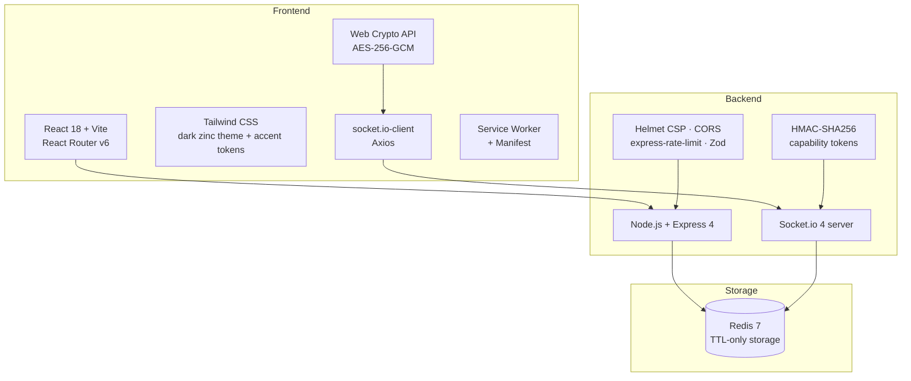

| Layer | Technology | Why |
|---|---|---|
| Frontend | React 18 + Vite | Lightweight SPA, and a chat app doesn't need SSR |
| Routing | React Router v6 | Share, join, room, owner and admin routes |
| Styling | Tailwind CSS | Utility-first dark UI with per-room accent colour |
| Real-time | Socket.io 4 (WebSocket only) | Rooms, broadcast and auto-reconnect out of the box |
| Encryption | Web Crypto API (AES-256-GCM) | Built into the browser, no crypto library to ship |
| Backend | Node.js + Express 4 (ES modules) | Event-driven and a natural fit for sockets |
| Validation | Zod | Schema checks on create / join / extend |
| Security | Helmet (CSP + HSTS), CORS, express-rate-limit | Hardening the small REST surface |
| Storage | Redis 7 via ioredis | Ephemeral data with native TTL expiry |
| Dev | Docker Compose | Redis + backend + Vite dev server |
| Target hosting | Vercel (FE) · Render (BE) · Upstash Redis | Free tiers are enough for an MVP |

---

## 📌 Architecture

### High-level Architecture

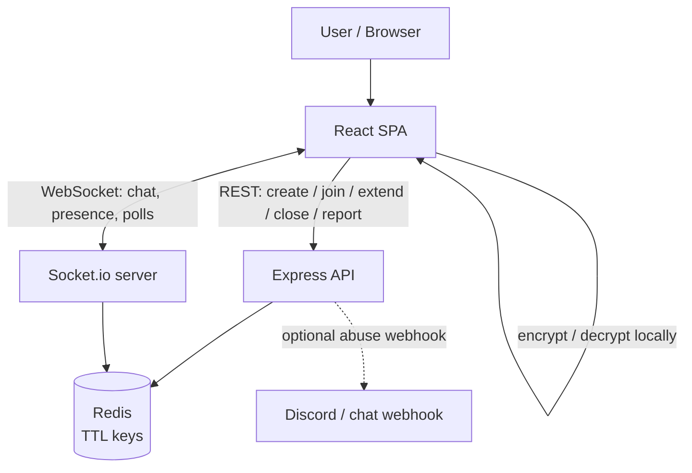

### System Architecture

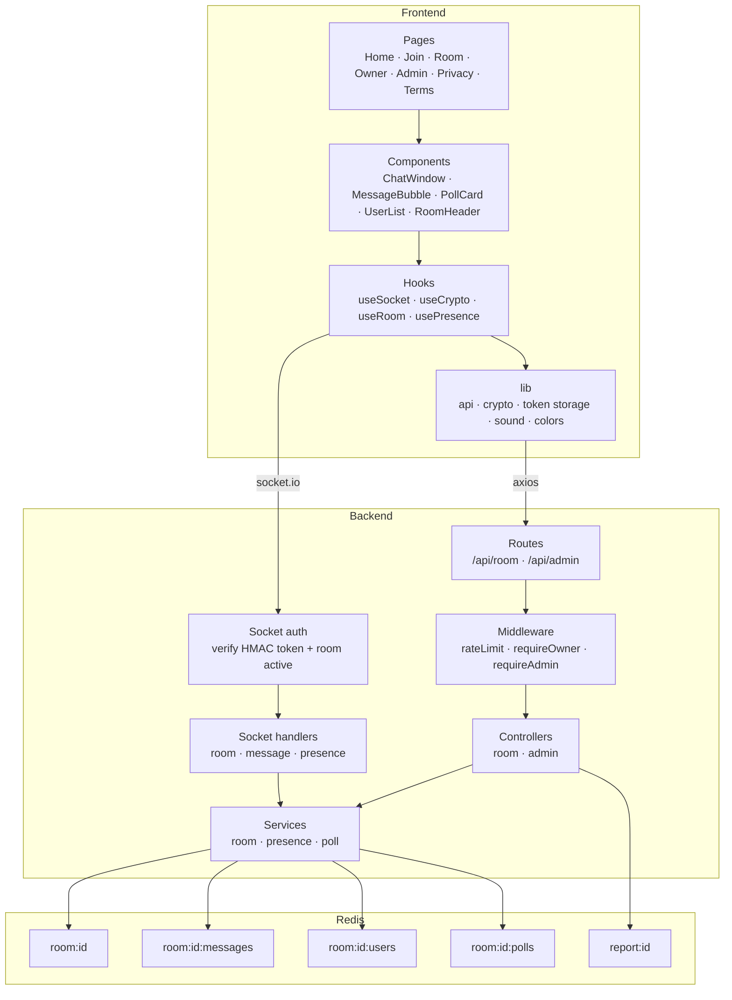

---

## 👤 User Flow

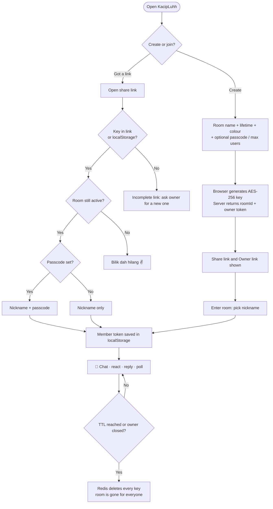

### Page Map

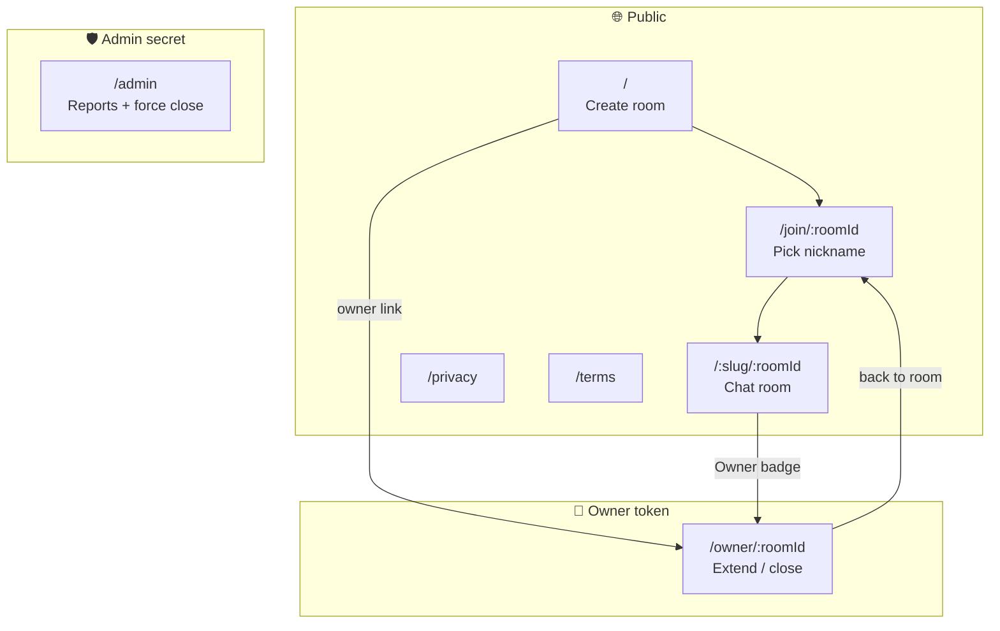

---

## 🔑 Identity & Token Flow

There are no user accounts. Every capability is a signed token kept in `localStorage`, scoped to a single room.

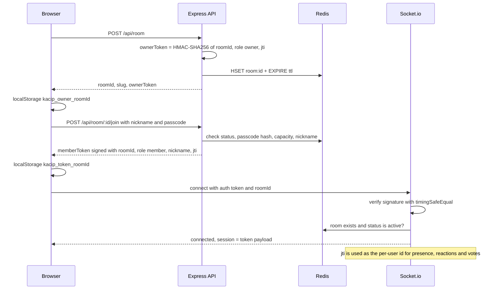

### Token Types

| Token | Payload | Where it lives | Grants |
|---|---|---|---|
| Owner token | `roomId`, `role: owner`, `jti` | `localStorage` + owner link `?token=` (stripped from the URL on load) | `POST /extend`, `DELETE /room/:id`, owner UI |
| Member token | `roomId`, `role: member`, `nickname`, `jti` | `localStorage` | Socket connection to that one room |
| Room key | 256-bit AES key (base64url) | URL `#k=` fragment → `localStorage` | Decrypting messages and polls |
| Admin secret | Static env secret | `x-admin-secret` header | `/api/admin/*` |

---

## 🗄️ Storage (Redis ERD)

Redis is the only datastore. Every room key shares the room's TTL, so when the room expires all of its data expires with it.

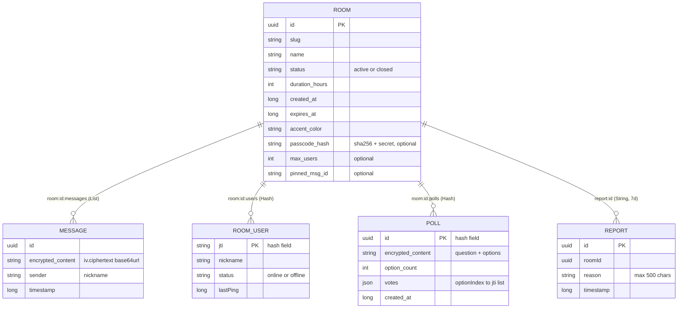

| Key | Type | TTL | Notes |
|---|---|---|---|
| `room:{id}` | Hash | room lifetime (6–48 h) | Metadata. Closing sets `status=closed` and the TTL to 60 s |
| `room:{id}:messages` | List | room lifetime | Ciphertext only, capped at 500 messages per room |
| `room:{id}:users` | Hash | room lifetime | Presence keyed by token `jti` |
| `room:{id}:polls` | Hash | room lifetime | Encrypted poll body + vote lists |
| `report:{id}` | String (JSON) | 7 days | Abuse reports for the admin page |

---

## 🔌 API Structure

### API Overview

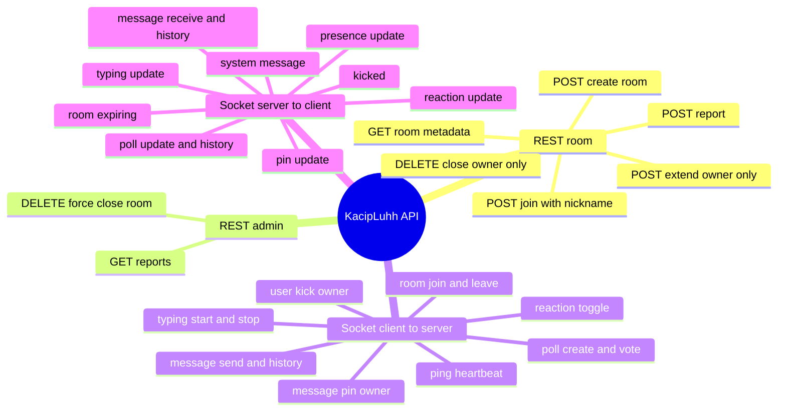

### REST Endpoints

| Method | Path | Guard | Rate limit | Purpose |
|---|---|---|---|---|
| `POST` | `/api/room` | — | 5 / hour / IP | Create a room (`name`, `duration`, `passcode?`, `maxUsers?`, `accentColor?`) |
| `GET` | `/api/room/:id` | — | global | Room metadata (`hasPasscode`, `expiresAt`, `accentColor`, …) |
| `POST` | `/api/room/:id/join` | passcode if set | 20 / 10 min | Returns a member token |
| `POST` | `/api/room/:id/extend` | owner token | 10 / hour | `hours` ∈ {6, 12, 24}, remaining time capped at 48 h |
| `DELETE` | `/api/room/:id` | owner token | global | Close early |
| `POST` | `/api/room/:id/report` | — | 5 / 10 min | Store report + optional webhook |
| `GET` | `/api/admin/reports` | `x-admin-secret` | global | Newest-first report list |
| `DELETE` | `/api/admin/room/:id` | `x-admin-secret` | global | Force close |
| `GET` | `/health` | — | global | Liveness check |

Global limit: 100 requests / minute / IP. JSON bodies are capped at 16 KB.

---

## 🧩 Frontend Components

### Component Tree

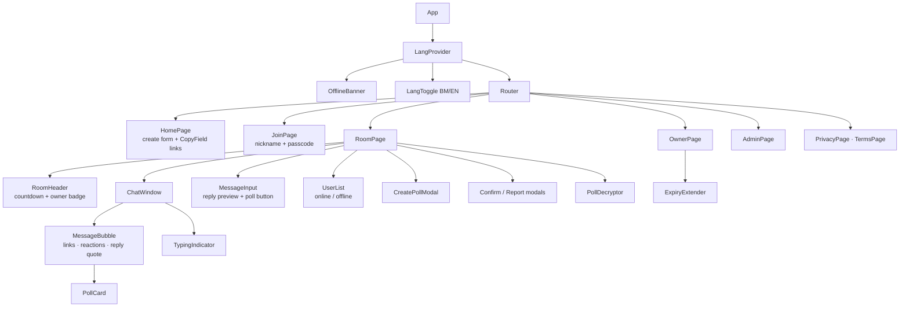

### Key Hooks & Libraries

| Module | Responsibility |
|---|---|
| `useSocket` | Opens the socket with `{ token, roomId }`, sends a 10 s heartbeat, and keeps callbacks in refs to avoid stale closures |
| `useCrypto` | Pulls the key from `#k=`, strips it from the URL with `history.replaceState`, imports it as a `CryptoKey`, and exposes `encrypt`/`decrypt` |
| `useRoom` / `usePresence` | Room metadata fetch and the user-list state |
| `lib/crypto.js` | `generateRoomKey`, `encryptMessage` → `iv.ciphertext` (base64url), `decryptMessage` |
| `lib/token.js` | Per-room `localStorage` helpers for key, member token, owner token and nickname |
| `lib/sound.js` | Synthesised 880→660 Hz ping with a persisted mute toggle |

---

## ⚙️ Feature-specific Flows

### Room Creation Flow

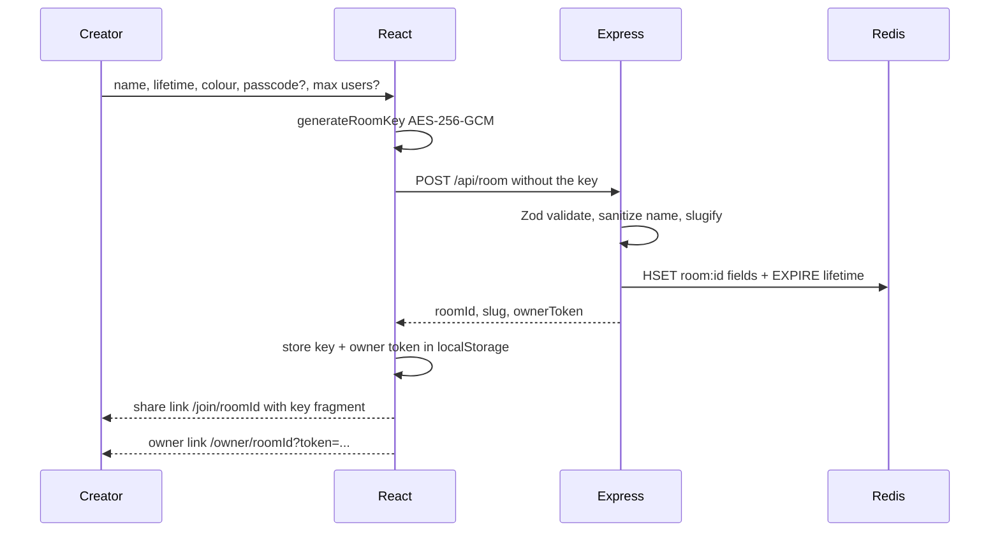

### Chat & E2EE Flow

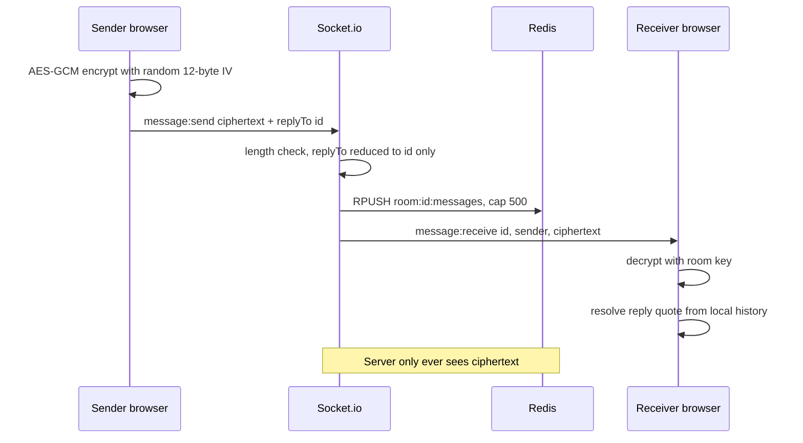

### Presence Flow

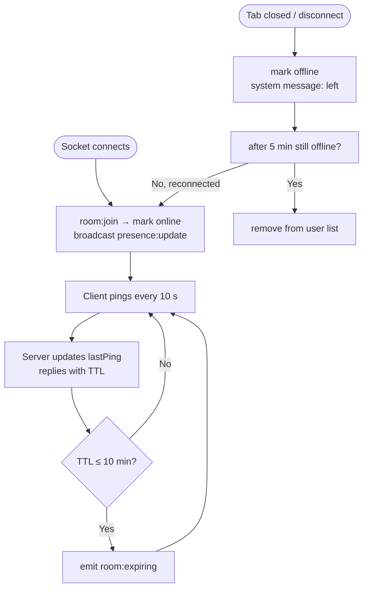

### Expiry & Extension Flow

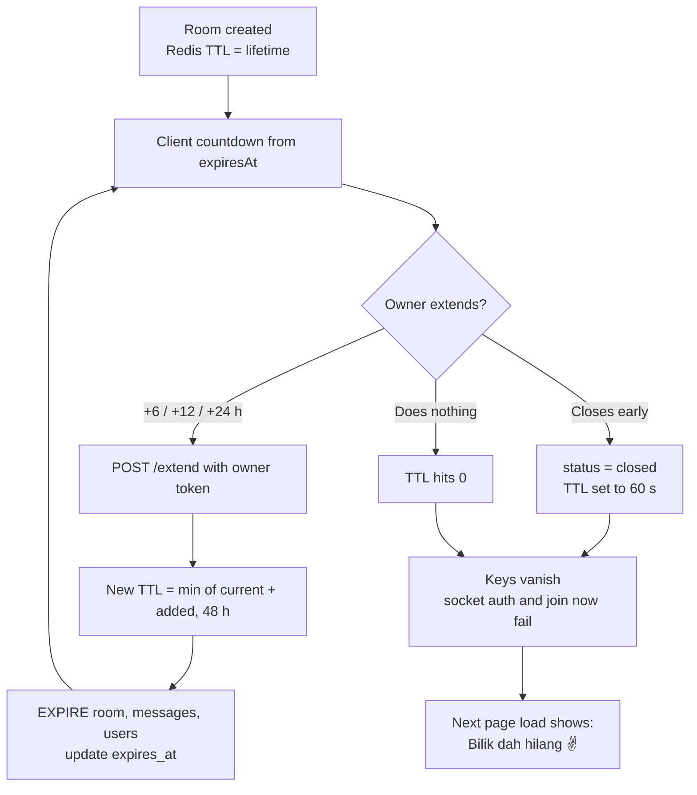

### Encrypted Poll Flow

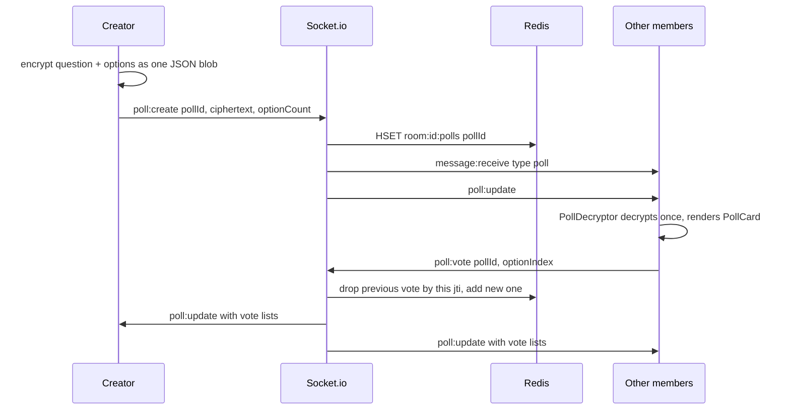

### Moderation Flow

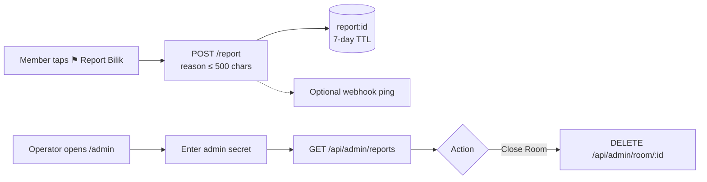

---

## 🔐 Security & Privacy

Privacy is the whole point of KacipLuhh, so most of the design choices come back to it.

### Threat Model

| Threat | Mitigation in code |
|---|---|
| Server / DB reads messages | AES-256-GCM in the browser. The key sits in the URL fragment and `localStorage` and is never sent in any request or socket payload |
| Redis dump or leak | Content and poll text are ciphertext, and everything expires within 48 h (reports within 7 days) |
| Key leaking via URL bar / history | `#k=` and `?token=` are removed right away with `history.replaceState` |
| Token forgery | HMAC-SHA256 signature checked with `crypto.timingSafeEqual` |
| Cross-room token reuse | Every token carries `roomId`, which is checked on REST owner routes and the socket handshake |
| Guessing room IDs | Room IDs are UUID v4 |
| Uninvited joiners | Optional passcode, stored only as `sha256(passcode + TOKEN_SECRET)` |
| Spam / brute force | `express-rate-limit` on create, join, extend, report + a global limit |
| Oversized payloads | 16 KB JSON limit, 5,000-char socket content cap, 500 messages per room, Zod schemas |
| XSS → key theft | React escaping, Helmet CSP on the API, strict CSP + `X-Frame-Options: DENY` in `vercel.json`, room/nickname sanitising |
| Tampered replies / reactions | `replyTo` cut down to a UUID, emoji allow-list, UUID regex on IDs |
| Abuse / illegal content | Report → Redis → optional webhook → admin force-close |

### E2EE Key Handling

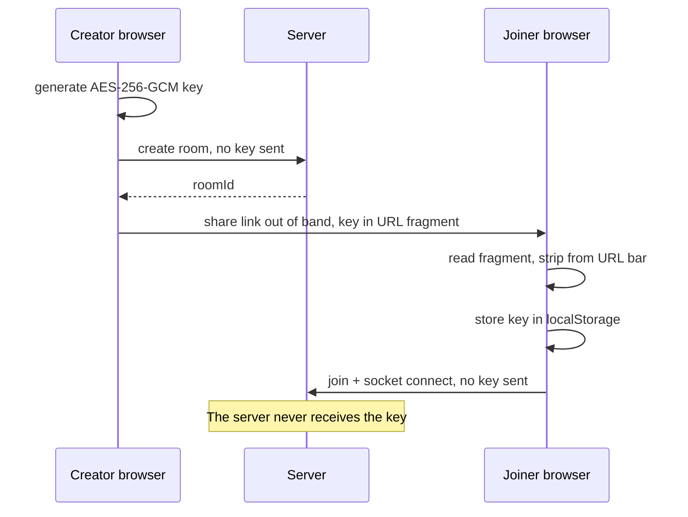

> **Decisions worth noting**
> - AES-**GCM** (authenticated), not CBC, so tampered ciphertext fails to decrypt.
> - Every message gets its own random 96-bit IV.
> - It fails closed: if encryption fails, nothing is sent and there's no plaintext fallback.

### Honest Limitations

- Nicknames, room names, timestamps and the sender of each message are **metadata the server can see**. Only the content is encrypted.
- Anyone holding the full share link can read the room. That's the trade-off of link-based keys.
- The admin secret compare is a plain string compare, and report listing uses `KEYS report:*`. Both are fine at MVP scale and are on the hardening list.

---

## 📁 Project Structure

```
KacipLuhh/
├── docker-compose.yml          redis + backend + vite dev server
├── backend/                    Node.js + Express + Socket.io
│   ├── Dockerfile
│   └── src/
│       ├── app.js              Helmet CSP, CORS, JSON limit, routes, error handler
│       ├── server.js           HTTP server + Socket.io (websocket transport)
│       ├── controllers/        room.controller.js · admin.controller.js
│       ├── services/           room · presence · poll (all Redis)
│       ├── routes/             room.routes.js · admin.routes.js
│       ├── middleware/         token (owner) · admin secret · rate limits
│       ├── socket/
│       │   ├── index.js        handshake auth (HMAC token + room active)
│       │   └── handlers/       room.js · message.js · presence.js
│       └── lib/                redis.js · token.js (HMAC sign / verify)
└── frontend/                   React 18 + Vite + Tailwind
    ├── vercel.json             security headers + SPA rewrite
    ├── public/                 manifest.json · sw.js · privacy/terms · security.txt
    └── src/
        ├── pages/              Home · Join · Room · Owner · Admin · Privacy · Terms
        ├── components/
        │   ├── chat/           ChatWindow · MessageBubble · MessageInput · PollCard · CreatePollModal · TypingIndicator
        │   ├── room/           RoomHeader · UserList · ExpiryExtender
        │   └── ui/             Button · Input · LangToggle · OfflineBanner
        ├── hooks/              useSocket · useCrypto · useRoom · usePresence · useOnlineStatus · useInstallPrompt
        ├── lib/                api · crypto · token · sound · colors
        ├── i18n/               bm.js · en.js · t() helper
        └── context/            LangContext
```

---

## 🗺 Roadmap

- [x] Room create / join with nickname-only identity
- [x] Real-time chat over Socket.io
- [x] AES-256-GCM end-to-end encryption
- [x] Redis TTL auto-expiry + owner extend / close
- [x] Passcode, capacity limit, accent colour
- [x] Replies, reactions, typing indicator, clickable links
- [x] Encrypted polls
- [x] Presence with offline clean-up
- [x] Sound toggle, unread tab count, browser notifications
- [x] BM / EN toggle
- [x] Report + admin moderation page
- [x] PWA manifest, service worker, install prompt, offline banner
- [ ] Owner role on the room socket so pin / kick work across clients
- [ ] Server-pushed `room:deleted` on close and expiry
- [ ] Persist replies, reactions and poll messages in history
- [ ] Atomic poll votes + socket rate limiting
- [ ] App icons for the PWA
- [ ] Image attachments
- [ ] Full offline PWA support
- [ ] Deploy (Vercel + Render + Upstash)

---

## 📄 License

MIT © 2026 Luhh Series · Source on [GitHub](https://github.com/snsyaqirah/KacipLuhh)
