# 🍛 KenduriLuhh

> AI-powered multi-agent system for smart catering operations. Seven AI agents with kampung personas negotiate a menu, price it at Pasar Borong rates, audit the budget, plan the logistics and hand you a quotation or shopping list.


---

## 📖 Table of Contents

- [Overview](#-overview)
- [Features](#-features)
- [Tech Stack](#-tech-stack)
- [Architecture](#-architecture)
- [User Flow](#-user-flow)
- [Session Lifecycle](#-session-lifecycle)
- [Data Model](#-data-model)
- [API Structure](#-api-structure)
- [Frontend Components](#-frontend-components)
- [Feature Flows](#-feature-specific-flows)
- [Project Structure](#-project-structure)
- [Roadmap](#-roadmap)
- [License](#-license)

---

## 🧭 Overview

KenduriLuhh takes a few event details (event type, pax, budget, date, venue, dietary notes) and has a team of AI agents plan the whole kenduri. Each agent has its own role and persona. **Tok Penghulu** chairs the meeting, **Mak Tok** plans the menu, **Tokey Pasar** prices ingredients at wholesale rates, **Bendahari** audits the budget and can reject it, **Abang Lorry** plans the T-3 to T-0 logistics, and **Pemantau** runs a final risk check. You watch them negotiate live, message by message, and get structured results at the end.

If Bendahari says the plan is **GAGAL** (over budget), the team loops back: Mak Tok proposes a cheaper menu, Tokey Pasar re-prices it, and Bendahari audits again. Nobody has to step in.

There are two modes:
- **Katering Pro** is for catering businesses. It adds overhead, labour, transport and a profit margin, and produces a downloadable **PDF quotation**.
- **Rewang DIY** is for families running a gotong-royong kenduri. It counts ingredient cost only and produces a **shopping list** with a per-head budget.

All agents run on Azure OpenAI GPT-4o, orchestrated by Microsoft AutoGen 0.4's `SelectorGroupChat`. Five curated JSON knowledge bases (Malaysian dishes, Pasar Borong prices, suppliers, rempah blends, halal rules) feed the agents through a lightweight TF-IDF retriever. Everything works in English and Bahasa Malaysia.

**Type:** `Hackathon`, built for the **Code; Without Barriers Hackathon 2026** (iNextLabs problem statement) 🏆 **2nd place**
**Brand:** `Luhh Series`
**Built with:** Solo build by Syaqirah

---

## ✨ Features

- ✅ **7-agent negotiation:** Pelanggan → Tok Penghulu → Mak Tok → Tokey Pasar → Bendahari → Abang Lorry → Pemantau → Tok Penghulu (`SELESAI`)
- ✅ **LLM-driven speaker selection** using a custom `SelectorGroupChat` prompt with strict rules (no repeat speakers, mandatory budget audit, force-close after 20 messages)
- ✅ **Budget rejection loop:** a `GAGAL`/`FAILED` verdict sends the menu back for one cheaper revision, a re-price and a re-audit
- ✅ **Two modes:** Katering Pro (quotation + margin) and Rewang DIY (shopping list, no labour cost)
- ✅ **Bilingual EN / BM:** a hard language banner sits at the top of every agent's system prompt
- ✅ **Live SSE streaming:** each agent message is pushed as it is produced, with a pulsing status chip for the agent that is speaking
- ✅ **RAG over 5 knowledge bases:** stdlib TF-IDF retriever picks the top 8 chunks from 13 dishes, 22 ingredients, 5 suppliers, 5 rempah blends and 6 halal rules. A collapsible "Knowledge Base Retrieval" bubble shows what was retrieved
- ✅ **Stock awareness:** ingredients marked `low_stock` / `order_required` show up as ⚠️ flags with their lead time
- ✅ **Weather-aware logistics:** RedahLuhh API → Tomorrow.io → Open-Meteo → seasonal-risk fallback, injected into Abang Lorry's prompt
- ✅ **Structured audit trail:** every message is classified server-side (`MENU_PROPOSAL`, `PRICE_REPORT`, `BUDGET_AUDIT` …) with extracted key outputs and an APPROVED/REJECTED status
- ✅ **Results panel:** quotation card or shopping list, Recharts budget breakdown, waste-reduction KPI, T-3 → T-0 logistics timeline, halal badge
- ✅ **Decision Flow** and **Audit Log** tabs that trace the negotiation node by node, with an expandable JSON view
- ✅ **PDF export** (jsPDF): A4 quotation for Katering, printable checklist for Rewang
- ✅ **Emergency guest spike:** add +30 / +50 / +100 pax (or a custom number) and the agents re-negotiate from scratch
- ✅ **Session history:** the last 10 sessions are saved in localStorage and can be replayed read-only
- ✅ **Supply route card:** nearest Pasar Borong → venue drive time and traffic through an Azure Maps proxy (key stays server-side), plus current weather from Open-Meteo
- ✅ **Prompt-injection filter** on every free-text field, plus Pydantic validation (10–5000 pax, future dates only)
- ✅ **Data notebooks:** paste a recipe and GPT-4o turns it into a `menus.json` entry. A second notebook pulls data.gov.my PriceCatcher prices into `ingredients.json`
- 🚧 Final summary panel reads the **first** Bendahari report, so after a rejection loop the quotation card can still show the rejected figures *(the Decision Flow and Audit Log tabs show the right outcome)*
- 🚧 Health endpoint still lists the original 5 agents *(Pelanggan and Pemantau were added later)*
- 💡 Redis-backed sessions *(the in-memory store has a TTL and is described as "Redis-ready")*
- 💡 Persistent bookings and a catering-business dashboard
- 💡 Part of the wider **PlanLuhh** wedding-planning ecosystem

---

## 🛠 Tech Stack

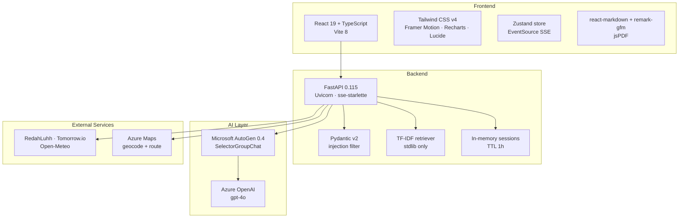

| Layer | Technology |
|---|---|
| Agent framework | Microsoft AutoGen 0.4 (`autogen-agentchat`, `autogen-ext[azure]`) |
| LLM | Azure OpenAI GPT-4o (`gpt-4o-2024-11-20`, deployment `gpt-4o-kenduri`) |
| Orchestration | `SelectorGroupChat` + `TextMentionTermination("SELESAI")` OR `MaxMessageTermination(24)` |
| API server | FastAPI 0.115 + Uvicorn |
| Streaming | Server-Sent Events via `sse-starlette` |
| Validation | Pydantic v2 + pydantic-settings, regex prompt-injection filter |
| Retrieval | Hand-rolled TF-IDF over chunked JSON knowledge bases |
| Session store | In-memory dict with TTL |
| Weather | RedahLuhh API → Tomorrow.io → Open-Meteo → seasonal estimate |
| Maps | Azure Maps Search + Route (server-side proxy) |
| Frontend | React 19 + TypeScript + Vite 8 |
| Styling | Tailwind CSS v4, Playfair Display + Inter |
| State | Zustand |
| Animation / Charts | Framer Motion · Recharts |
| PDF | jsPDF |
| Data tooling | Jupyter notebooks (Azure OpenAI recipe extractor, PriceCatcher scraper) |
| Testing | pytest + pytest-asyncio |

---

## 📌 Architecture

### High-level Architecture

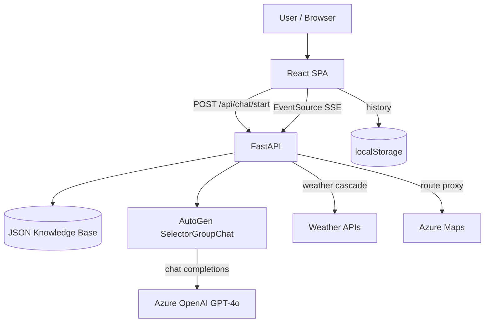

### System Architecture

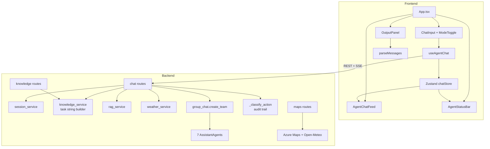

### Agent Roster

| Agent | Persona | Job | Signature output |
|---|---|---|---|
| 👤 **Pelanggan** | Customer intake desk | Validates the request and flags budget/pax/date risks | `INTAKE STATUS: CONFIRMED` |
| 👴🏽 **Tok Penghulu** | Village head, chairperson | Opens the case, hands over, writes the final summary | `SELESAI` |
| 👵🏽 **Mak Tok** | 40-year Malay & Indian-Muslim cuisine veteran | Menu + metric quantities + prep time + halal check | Numbered menu |
| 🛒 **Tokey Pasar** | Pasar Borong Selayang/Pudu supplier | Wholesale prices, substitutes, stock flags | `TOTAL INGREDIENT COST: RM …`, `⚠️ MAHAL` |
| 💰 **Bendahari** | Strict but fair treasurer | Cost formula, verdict, per-head cost, waste reduction | `LULUS` / `GAGAL` |
| 🚛 **Abang Lorry** | Catering lorry driver | T-3 → T-0 schedule, 3AM market run, weather risk | Timeline |
| 🔍 **Pemantau** | Risk monitor | Budget / halal / timeline / inventory / weather check | `READY TO PROCEED` |

---

## 👤 User Flow

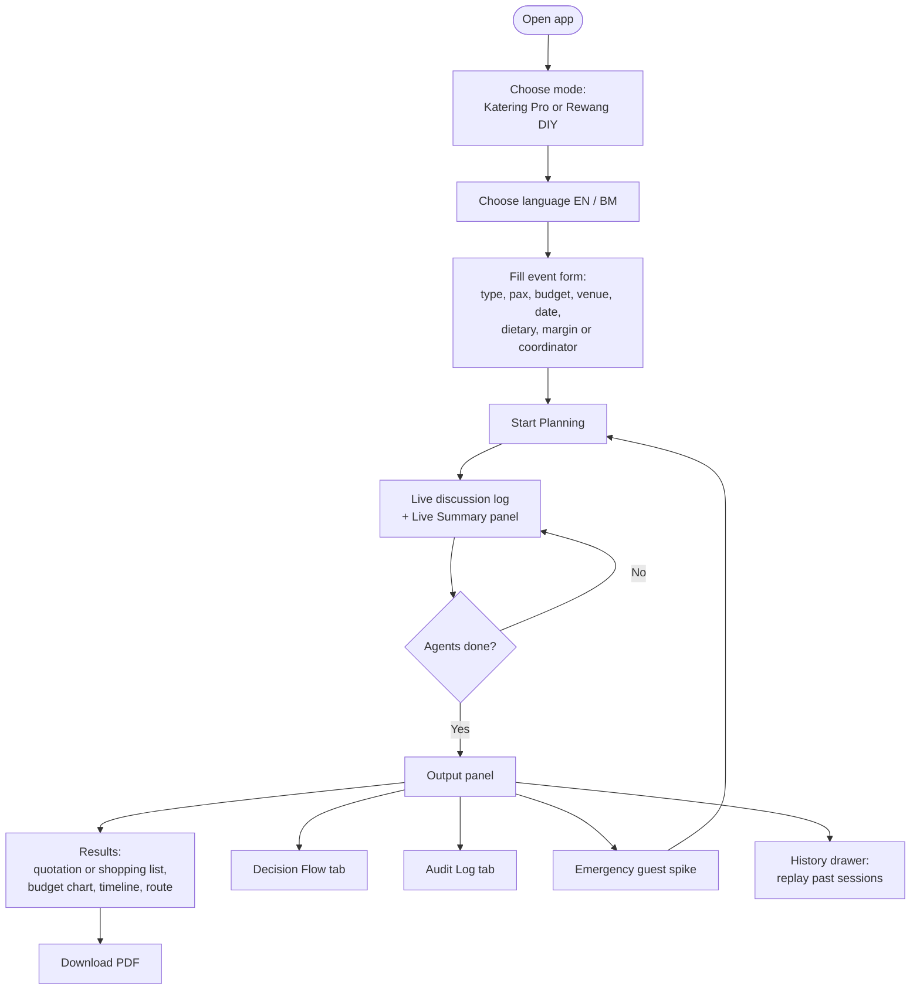

### Screen Map

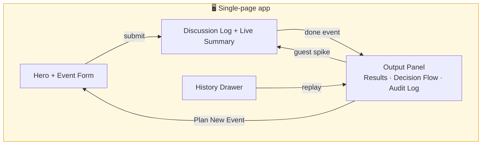

---

## 🔐 Session Lifecycle

There are no user accounts. Each planning run is an anonymous session that lives in backend memory for one hour.

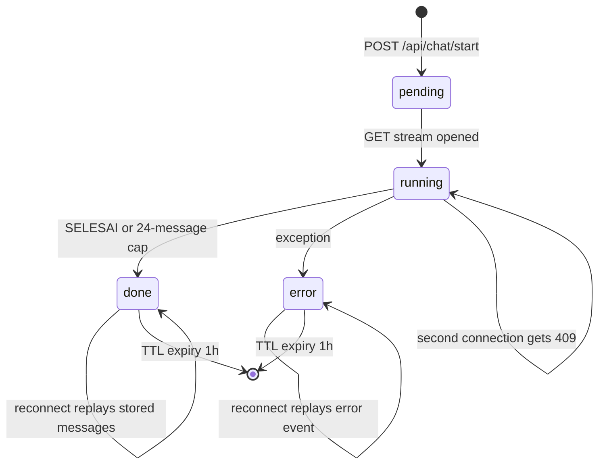

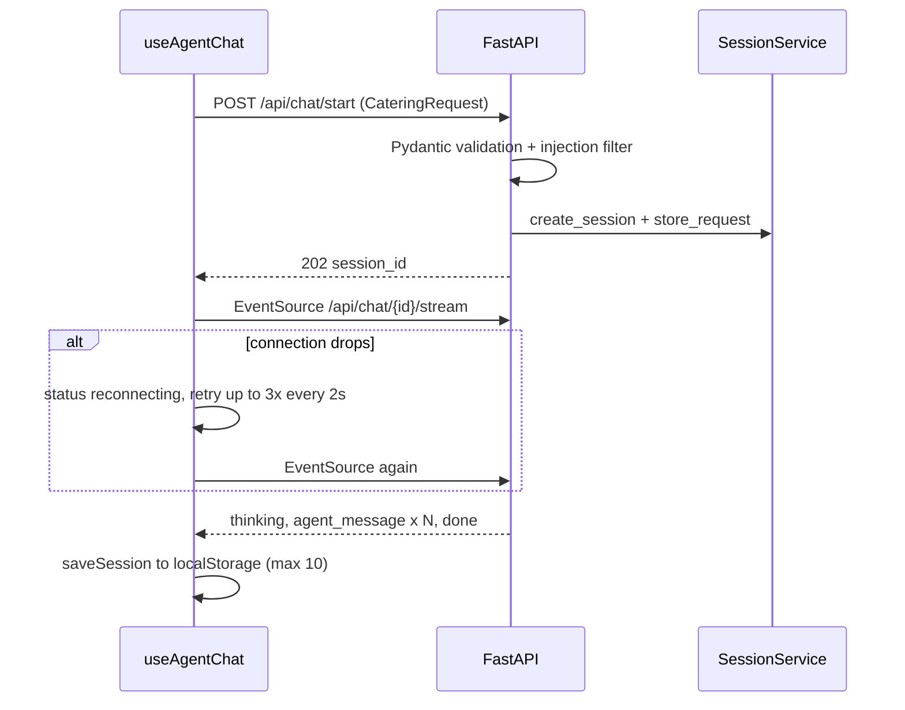

---

## 🗄️ Data Model

There is no database. Reference data lives in five JSON knowledge-base files, sessions live in memory, and history lives in the browser.

### Knowledge Base

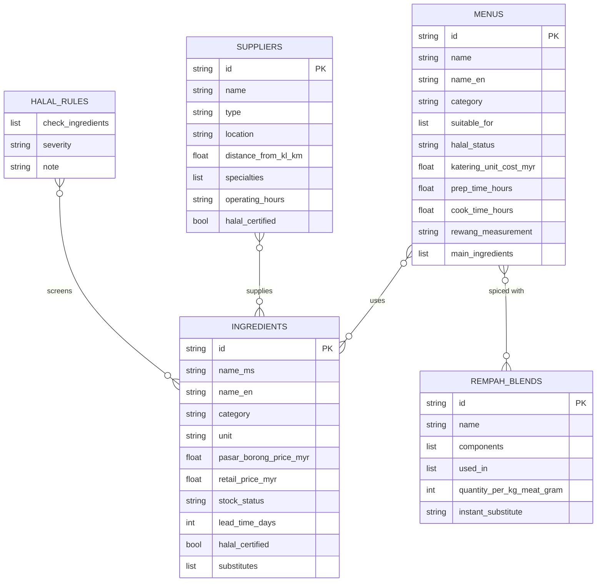

### Runtime State

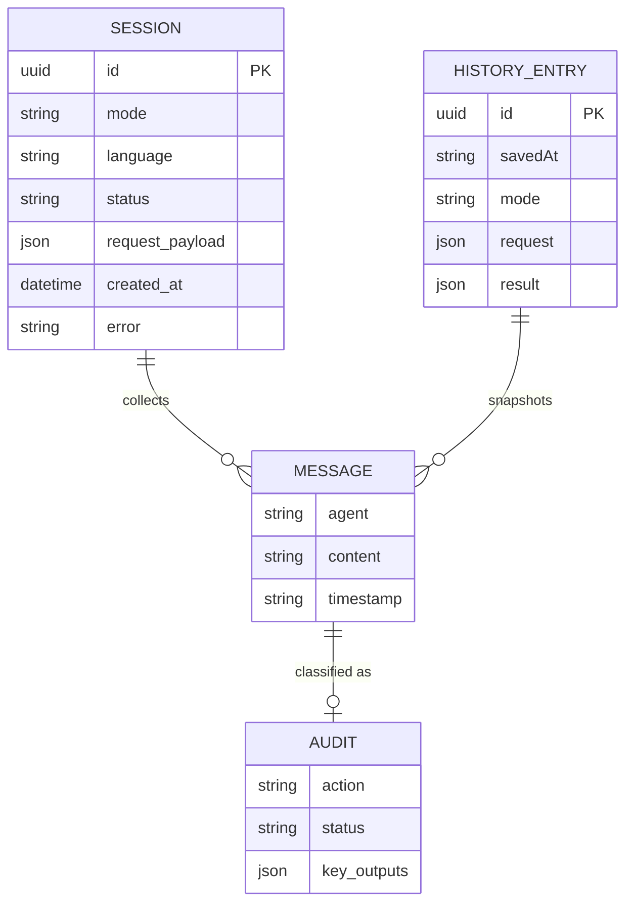

| Store | Where | Contents |
|---|---|---|
| `menus.json` | Backend KB | 13 Malaysian dishes with per-pax catering cost, prep/cook time, rewang measurement |
| `ingredients.json` | Backend KB | 22 ingredients with Pasar Borong vs retail price, stock status, substitutes |
| `suppliers.json` | Backend KB | 5 suppliers with location, specialties, halal status |
| `rempah_ratus.json` | Backend KB | 5 spice blends with ratios per kg of meat |
| `halal_checklist.json` | Backend KB | 6 rules with trigger ingredients + 10 safe ingredients |
| `_sessions` | Backend memory | Session status, request payload, messages + audit entries (TTL 1h) |
| `kenduri_history` | Browser localStorage | Last 10 completed sessions with a parsed result summary |

---

## 🔌 API Structure

### API Overview

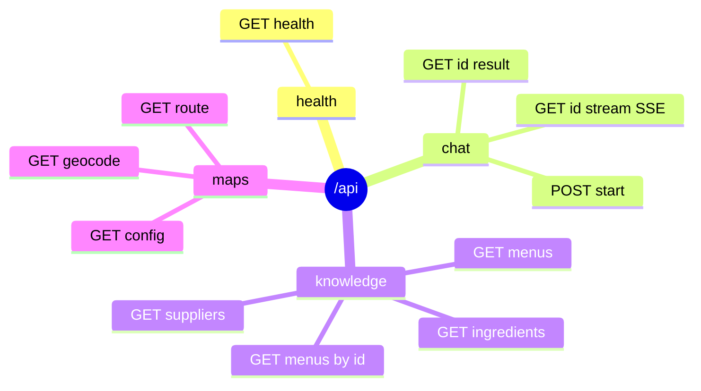

| Group | Endpoints |
|---|---|
| System | `GET /api/health` |
| Agent chat | `POST /api/chat/start` · `GET /api/chat/{id}/stream` (SSE) · `GET /api/chat/{id}/result` |
| Knowledge base | `GET /api/knowledge/menus?event_type=` · `GET /api/knowledge/menus/{menu_id}` · `GET /api/knowledge/ingredients?category=` · `GET /api/knowledge/suppliers` |
| Azure Maps proxy | `GET /api/maps/config` · `GET /api/maps/geocode?query=` · `GET /api/maps/route?destination=` |

### SSE Event Shapes

| `type` | Payload |
|---|---|
| `thinking` | `content` (formatted RAG block), `chunks`, `sources[]` |
| `agent_message` | `agent`, `content`, `timestamp`, `audit { action, status, key_outputs }` |
| `done` | `total_messages`, `token_count` (≈ chars ÷ 4) |
| `error` | `message` |

### Request/Response Flow

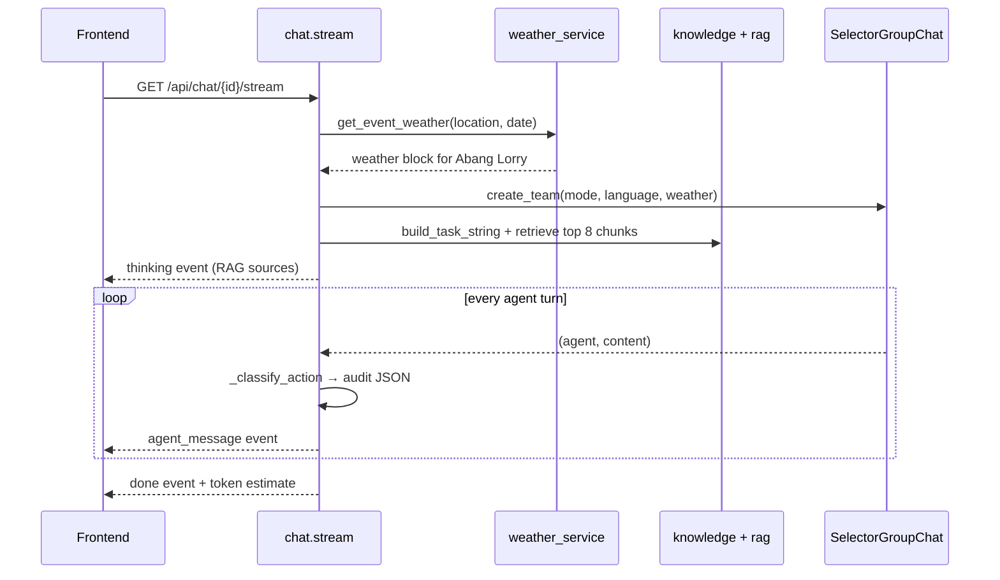

---

## 🧩 Frontend Components

### Component Tree

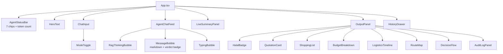

### Key Components

| Component | Purpose |
|---|---|
| `useAgentChat` | Starts a session, opens the EventSource, retries 3x on drop, saves history |
| `chatStore` | Zustand store: messages, status, typing agent, done agents, RAG thinking, token count |
| `ChatInput` | Event form with mode + language toggles and client-side validation |
| `AgentChatFeed` | Animated message bubbles with markdown, red/green Bendahari verdict badges, RAG bubble |
| `AgentStatusBar` | Seven persona chips that pulse while an agent is speaking and tick when it is done |
| `LiveSummaryPanel` | Running budget, pax, proposed menu and an "agents reviewing budget" warning |
| `parseMessages` | Regex parser that turns agent text into budget, logistics, menu and shopping-list data |
| `QuotationCard` / `ShoppingList` | Mode-specific result card with PDF export |
| `BudgetBreakdown` | Recharts horizontal bars + cost table + waste-reduction KPI |
| `LogisticsTimeline` | Expandable T-3 → T-0 vertical timeline |
| `RouteMap` | Supply route, drive time, traffic and venue weather |
| `DecisionFlow` | Horizontal node chain of key agent decisions |
| `AuditLogPanel` | Collapsible list of audit entries with raw JSON |
| `HistoryDrawer` | Past sessions with replay / delete / clear all |

---

## ⚙️ Feature-specific Flows

### Multi-Agent Orchestration

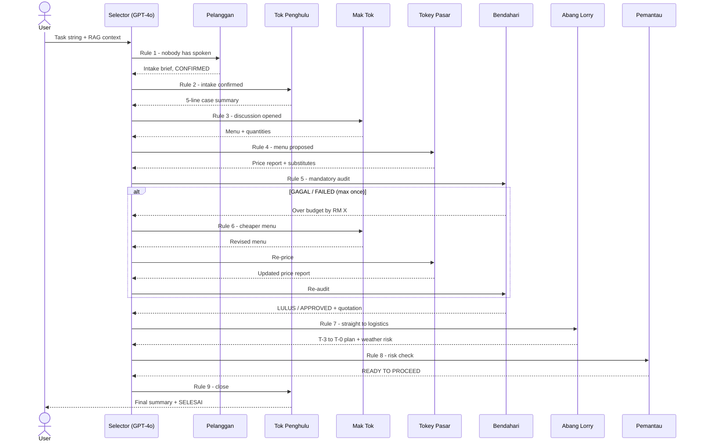

### Speaker Selection Rules

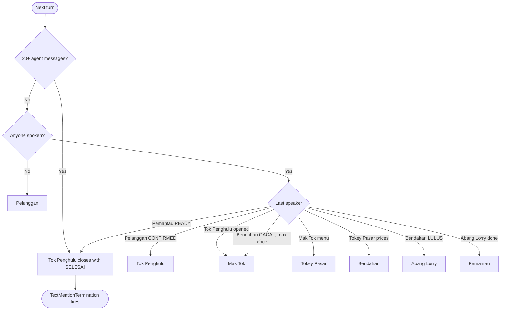

> Safety nets: `allow_repeated_speaker=False`, a silence rule in every specialist agent's prompt (no replies to praise or cheerleading), Tok Penghulu's strict closing rules, and a hard `MaxMessageTermination(24)` on top of the `SELESAI` text trigger.

### Bendahari Costing Formula

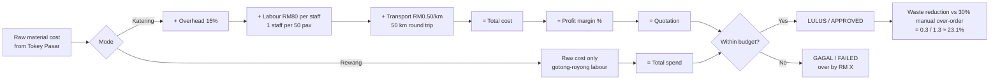

### RAG Retrieval

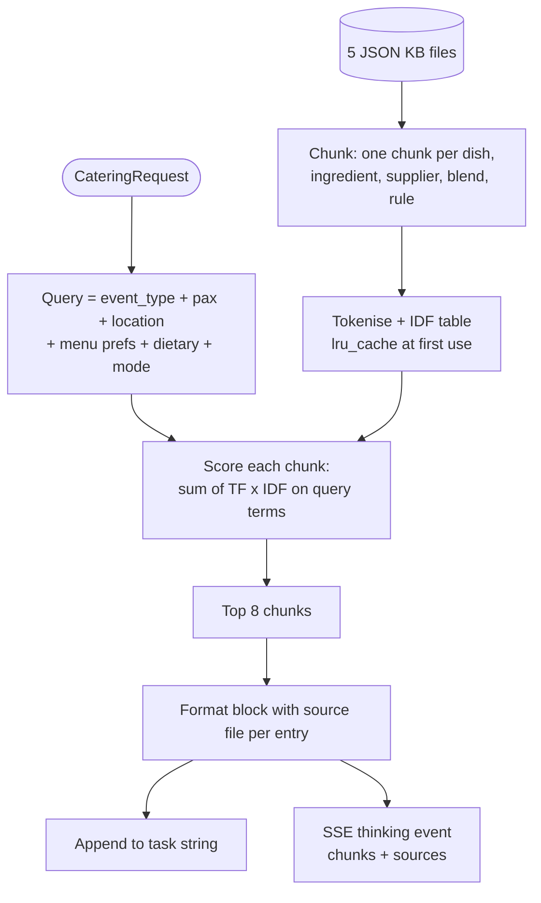

### Weather Intelligence Cascade

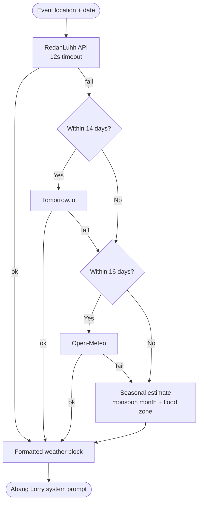

### Emergency Guest Spike

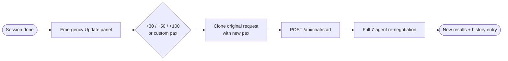

---

## 📁 Project Structure

```
KenduriLuhh/
├── architecture.html / .png     Architecture diagram
├── notebooks/
│   ├── add_menu_item.ipynb      Recipe text → GPT-4o → menus.json
│   └── fama_price_scraper.ipynb data.gov.my PriceCatcher → ingredients.json
│
├── backend/
│   ├── requirements.txt
│   ├── tests/                   Models, knowledge service, weather service
│   └── app/
│       ├── main.py              FastAPI app, CORS, routers
│       ├── config.py            Pydantic settings
│       ├── agents/
│       │   ├── base_agent.py    All 7 system prompts + language banner + silence rule
│       │   ├── group_chat.py    SelectorGroupChat + selector prompt + stream helper
│       │   └── pelanggan.py, tok_penghulu.py, mak_tok.py, tokey_pasar.py,
│       │       bendahari.py, abang_lorry.py, pemantau.py
│       ├── api/routes/          health, chat (SSE + audit), knowledge, maps
│       ├── services/            knowledge, rag, session, weather
│       ├── models/              Request (validation + injection filter) / response schemas
│       └── knowledge_base/      menus, ingredients, suppliers, rempah_ratus, halal_checklist
│
└── frontend/src/
    ├── App.tsx                  Layout, hero, live summary panel
    ├── components/              ChatInput, ModeToggle, AgentChatFeed, AgentStatusBar,
    │                            DecisionFlow, AuditLogPanel, HistoryDrawer
    │   └── outputs/             OutputPanel, QuotationCard, ShoppingList, BudgetBreakdown,
    │                            LogisticsTimeline, RouteMap, HalalBadge
    ├── hooks/                   useAgentChat (SSE), useHistory (localStorage)
    ├── store/                   chatStore (Zustand)
    ├── utils/                   parseMessages, generatePdf
    └── types/                   Shared TypeScript types
```

---

## 🗺 Roadmap

- [x] 5 core agents with distinct personas and role boundaries
- [x] SelectorGroupChat orchestration with a hardened selector prompt
- [x] Budget rejection → menu revision loop
- [x] JSON knowledge base + TF-IDF RAG
- [x] SSE live streaming + reconnect logic
- [x] Katering Pro and Rewang DIY modes
- [x] EN / BM language enforcement
- [x] Quotation / shopping list, budget chart, logistics timeline, halal badge
- [x] PDF export
- [x] Pelanggan (intake) and Pemantau (risk) agents
- [x] Inventory stock simulation + token counter
- [x] Weather cascade (RedahLuhh / Tomorrow.io / Open-Meteo / seasonal)
- [x] Azure Maps supply route card
- [x] Decision Flow + JSON audit trail
- [x] Session history + emergency guest spike
- [x] Data notebooks for menus and PriceCatcher prices
- [ ] Use the latest Bendahari verdict in the results panel
- [ ] Redis session store
- [ ] Persistent bookings + catering business accounts
- [ ] Integrate into the PlanLuhh wedding-planning platform

---

## 📄 License

MIT. Built for the Code; Without Barriers Hackathon 2026 by Siti Nursyaqirah · Source on [GitHub](https://github.com/snsyaqirah/KenduriLuhh)
