# 🚀 PlanLuhh

> An all-in-one wedding planner built for Malaysian couples: budget, vendors, hantaran, aturcara, guest list, e-jemputan with RSVP, seating and honeymoon, from akad nikah to bertandang.


---

## 📖 Table of Contents

- [Overview](#-overview)
- [Features](#-features)
- [Tech Stack](#-tech-stack)
- [Architecture](#-architecture)
- [User Flow](#-user-flow)
- [Auth Flow](#-auth--session-flow)
- [Database](#-database-erd)
- [API Structure](#-api-structure)
- [Frontend Components](#-frontend-components)
- [Feature Flows](#-feature-specific-flows)
- [Project Structure](#-project-structure)
- [Roadmap](#-roadmap)
- [License](#-license)

---

## 🧭 Overview

PlanLuhh is a private planning dashboard for the whole Malay wedding journey. A typical wedding here is not one event but three: the **akad nikah**, the **majlis sanding** at the bride's side, and the **bertandang** at the groom's side. Each has its own date, venue, colour theme and minute-by-minute aturcara. PlanLuhh models that directly, and adds the things generic planners don't have: a dulang-by-dulang **hantaran tracker**, a **nikah document checklist**, a phase-based checklist pre-filled with local tasks (Kursus Pra-Perkahwinan, ujian HIV, Tok Kadi), and a mobile-first **e-jemputan** that guests open, RSVP to and sign in the guestbook.

The backend is a FastAPI service with SQLAlchemy and Alembic on PostgreSQL. Auth uses JWTs in HttpOnly cookies. Money fields (budget, vendor prices, honeymoon costs, cash gifts) are encrypted at rest with Fernet. The React frontend talks to it through a Vite proxy and generates a full **Journey Book** PDF in the browser.

**Type:** `Solo`
**Brand:** `Luhh Series`
**Built with:** Independent

---

## ✨ Features

- ✅ Email signup in 3 steps (email + name + currency → 6-digit OTP → set password), login, forgot/reset password via OTP
- ✅ JWT access + refresh tokens in HttpOnly, SameSite=Lax cookies
- ✅ **Mission Control** dashboard: countdown ("124 hari lagi"), total pax, total paid ("Total Damage"), RSVP rate, confirmed vendor categories, checklist progress
- ✅ Wedding settings for three majlis: Akad Nikah, Sanding Pihak Perempuan, Sanding Pihak Lelaki (date, time, venue, colour theme), plus parents' names for the e-card
- ✅ **Budget tracker**: 13 categories, estimated vs actual vs paid, budget ceiling and usage bar, PDF + Excel export
- ✅ **Vendor manager**: 13 categories, status pipeline (Prospect → Contacted → Booked → Deposit Paid → Fully Paid → Completed), contract flag, side-by-side compare panel
- ✅ **Moodboard**: colour swatches, image URLs or uploads, across 11 categories including Pelamin and Henna
- ✅ **Documents Hub**: preset nikah document checklist per side (groom / bride / both) with expiry dates and reminders
- ✅ **Schedule** for pre-wedding appointments (merisik, kursus, fitting, photoshoot, raptai)
- ✅ **Rundown / Aturcara**: minute-by-minute script per majlis with PIC
- ✅ **Checklist**: 34 preset Malaysian wedding tasks across 6 phases, one click to seed
- ✅ **Guest list**: side, pax, VIP flag, RSVP status, meal preference, PDF + Excel export
- ✅ **Menu**: dish list by course with quantities, halal / vegetarian flags and confirmation status
- ✅ **Hantaran tracker**: items for both sides by dulang number, status flow (Belum Beli → Dah Beli → Sudah Gubah → Siap), cost totals, and a warning when the dulang count is even (adat says odd)
- ✅ **E-Invitation builder** in 5 steps: pick one of 20 preset designs (Floral / Tradisional) or upload your own 9:16 slides, envelope, card text, settings, share
- ✅ **Public e-jemputan** at `/i/:slug`: envelope opening, love-story timeline, RSVP, guestbook, Waze / Google Maps, contacts, gift list + DuitNow QR, add-to-Google-Calendar, YouTube music
- ✅ **RSVP dashboard** with response filters and guestbook moderation (wishes show by default; toggle to hide, or delete)
- ✅ **Seating**: tables with capacity, assign attending guests, capacity bars
- ✅ **Gift registry + gifts received** (physical, cash, e-wallet), thank-you tracking
- ✅ **Honeymoon planner**: destination, dates, budget, bookings by category with booking refs
- ✅ **Journey Book PDF**: whole-wedding summary rendered client-side with @react-pdf/renderer
- ✅ Fernet encryption at rest for all money fields, soft deletes and an audit log on key writes
- 🚧 Collaborators (partner / admin / viewer): the backend endpoint and table exist, but there is no invite UI and role checks are not enforced per module
- 🚧 Gift "claim" from the public page: the registry shows `claimed / target`, but there is no claim endpoint yet
- 🚧 Silent token refresh: a refresh cookie is issued, but there is no `/auth/refresh` endpoint yet
- 🚧 Rate limiting: SlowAPI is wired into the app, but no route has a limit applied yet
- 🚧 Vendor document upload and vendor reviews: API exists, not surfaced in the UI
- 💡 Link public RSVPs to guest-list entries automatically
- 💡 Responsive dashboard layout (the public invitation is mobile-first; the planner is desktop-first)
- 💡 Reminder emails for due payments and upcoming appointments

---

## 🛠 Tech Stack

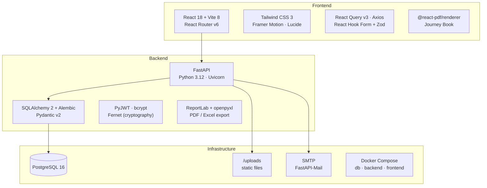

| Layer | Technology |
|---|---|
| Frontend | React 18.3, Vite 8 (`@vitejs/plugin-react-oxc`), React Router 6 |
| UI | Tailwind CSS 3, Framer Motion, Lucide React, react-hot-toast |
| Data / Forms | React Query v3, Axios (cookie credentials), React Hook Form + Zod, date-fns |
| PDF (client) | @react-pdf/renderer 4 (Journey Book) |
| Backend | FastAPI 0.115, Uvicorn, Pydantic v2 + pydantic-settings |
| ORM / Migrations | SQLAlchemy 2.0, Alembic (11 migrations) |
| Database | PostgreSQL 16 |
| Auth | PyJWT (HS256) in HttpOnly cookies, bcrypt password hashing, email OTP |
| Encryption | Fernet (`cryptography`) for money fields |
| Exports (server) | ReportLab (PDF), openpyxl (Excel) |
| Email | FastAPI-Mail over SMTP |
| Containers | Docker Compose (postgres, FastAPI, Vite dev server) |

---

## 📌 Architecture

### High-level Architecture

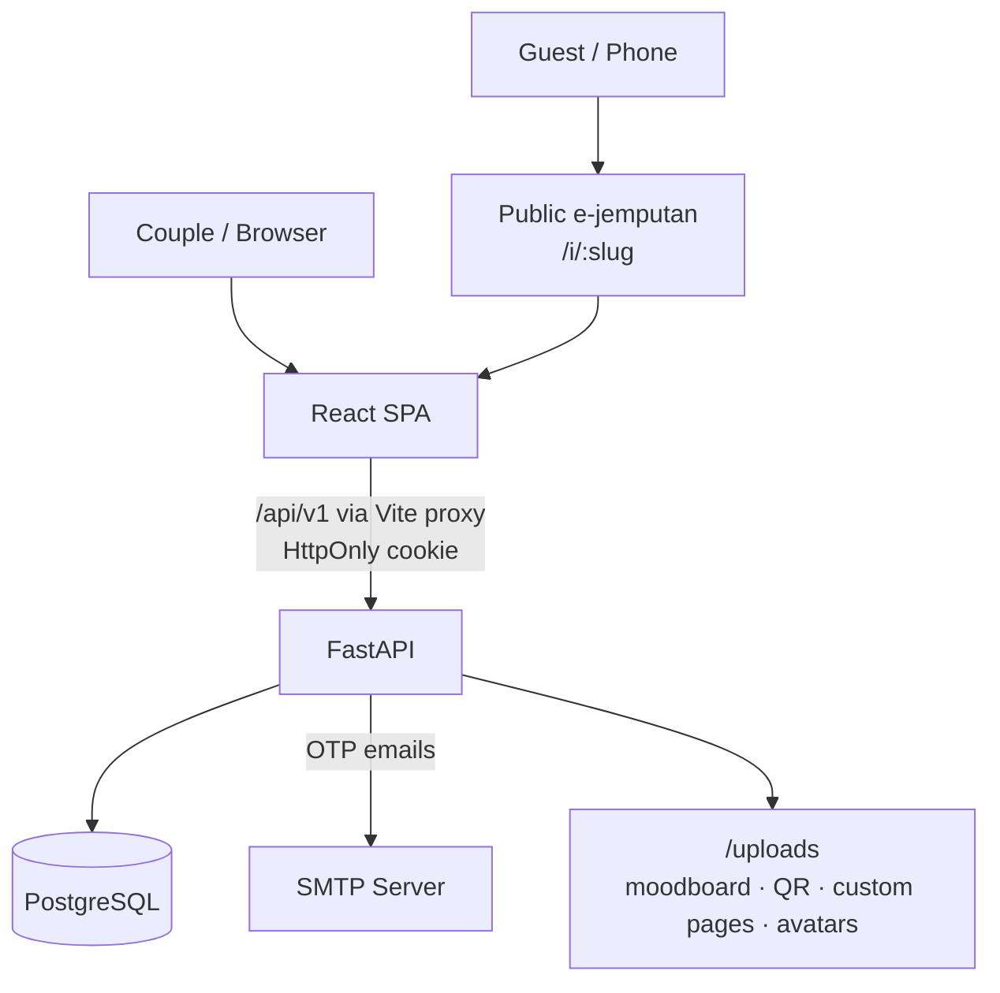

### System Architecture

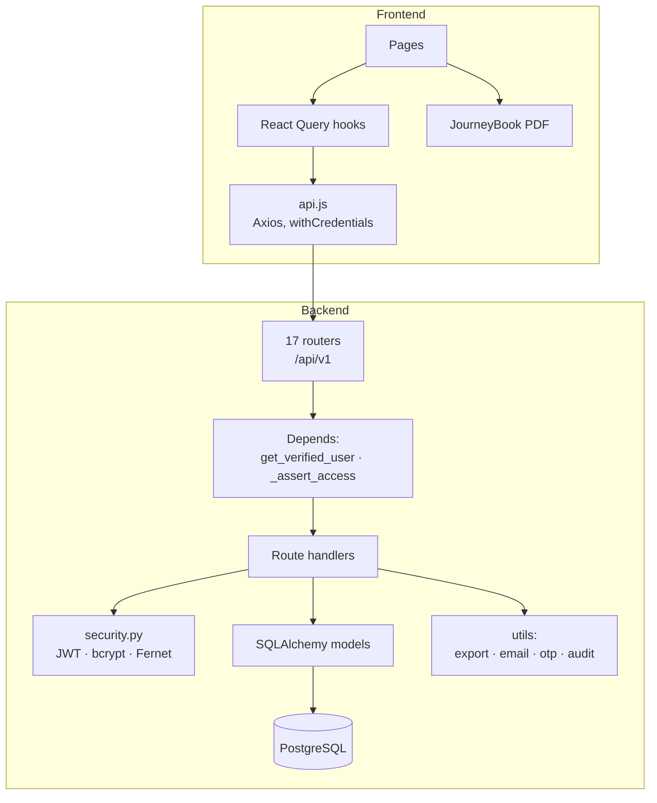

---

## 👤 User Flow

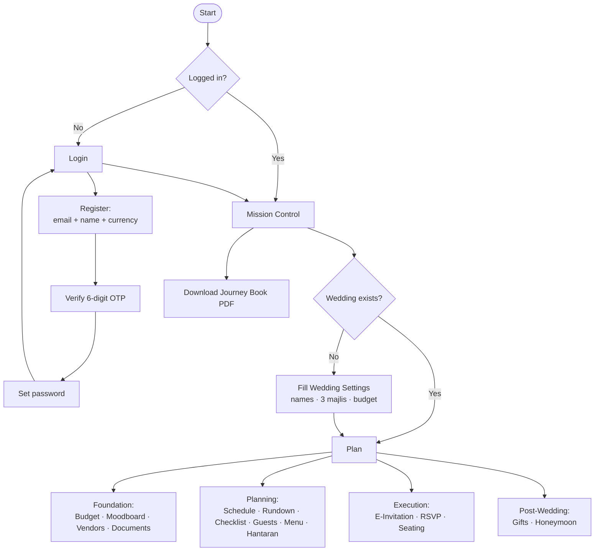

### Page Map

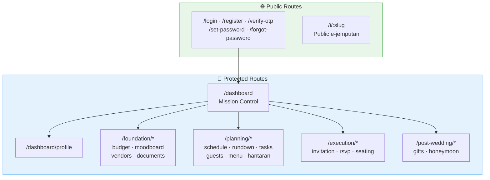

---

## 🔐 Auth & Session Flow

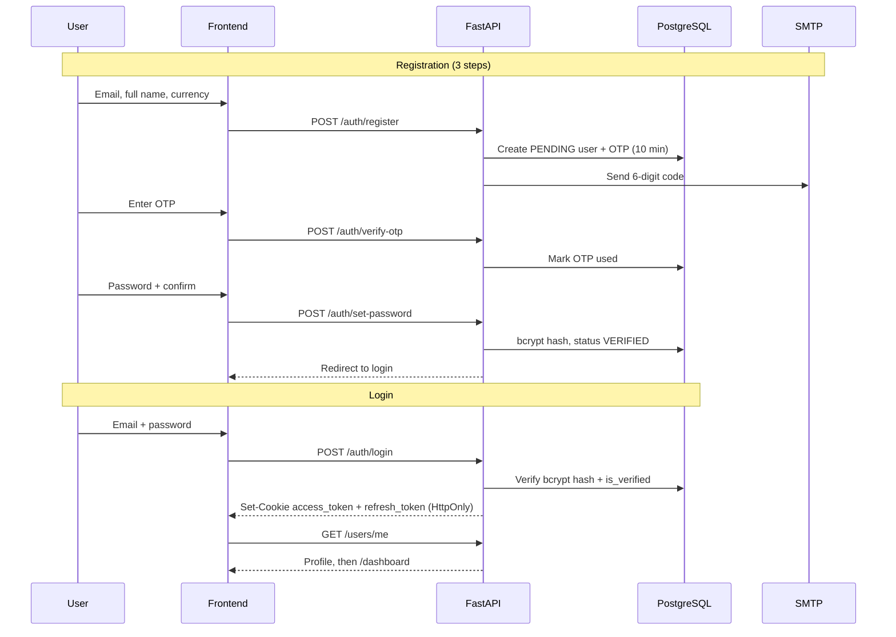

### Token Lifecycle

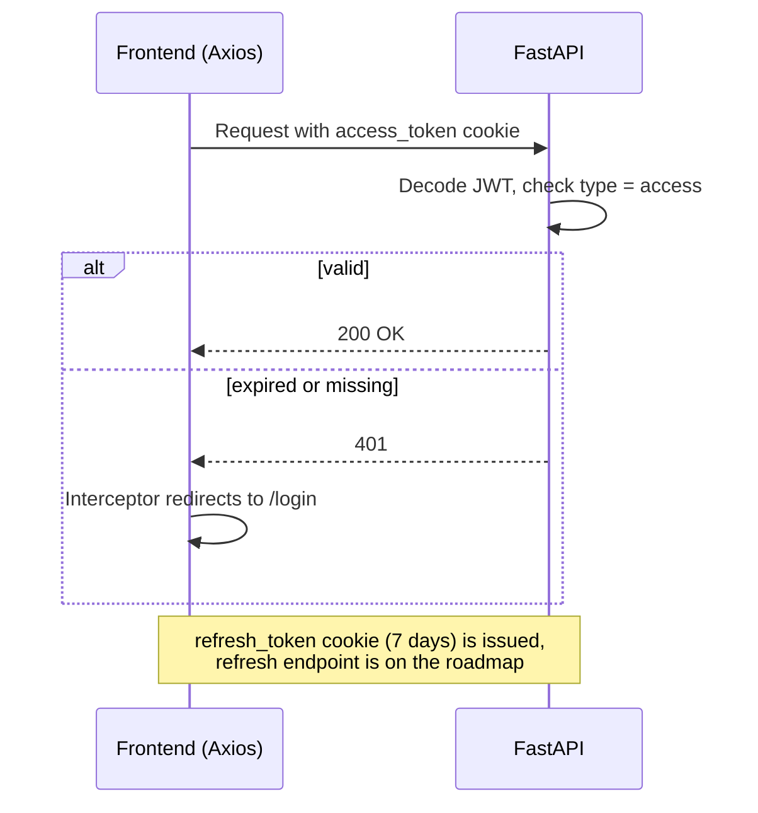

---

## 🗄️ Database (ERD)

### Core ERD

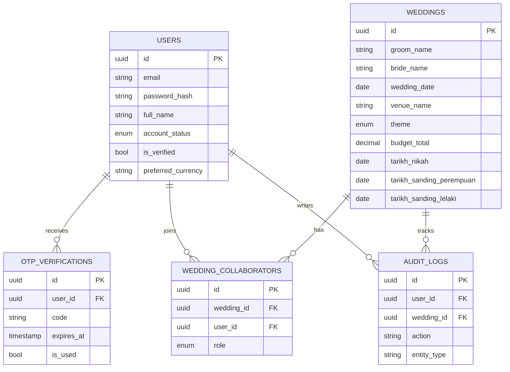

### Planning ERD

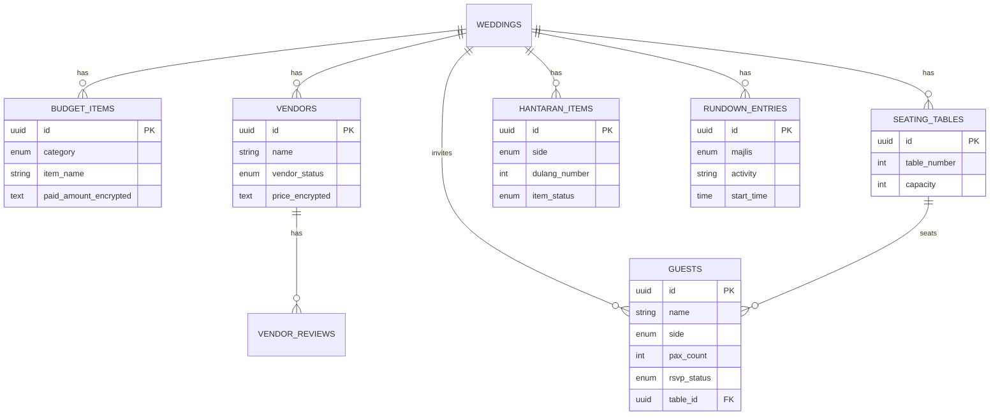

### Invitation & Post-Wedding ERD

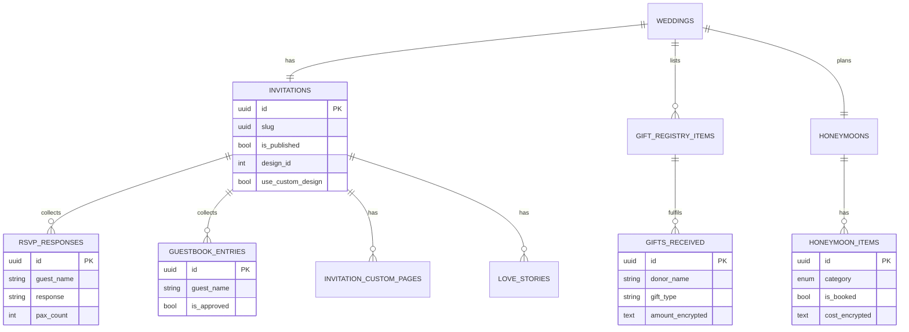

### Database Schema Overview

| Table | Purpose | Key Relations |
|---|---|---|
| `users` | Account, profile, preferred currency | — |
| `otp_verifications` | 6-digit email codes (signup + reset) | → `users` |
| `weddings` | Couple names, parents, 3 majlis dates/venues, budget ceiling | — |
| `wedding_collaborators` | User ↔ wedding with role (GROOM / BRIDE / ADMIN / VIEWER) | → `weddings`, `users` |
| `budget_items` | Encrypted estimated / actual / paid per category | → `weddings` |
| `vendors` | Vendor pipeline, encrypted price / deposit / balance | → `weddings` |
| `vendor_documents`, `vendor_reviews` | Contracts / invoices, ratings | → `vendors` |
| `guests` | Guest list, pax, RSVP, VIP, table | → `weddings`, `seating_tables` |
| `seating_tables` | Table number, name, capacity | → `weddings` |
| `tasks` | Phase-based checklist | → `weddings` |
| `document_checklist_items` | Nikah documents per side, expiry + reminder | → `weddings` |
| `event_schedules` | Pre-wedding appointments | → `weddings` |
| `rundown_entries` | Aturcara per majlis | → `weddings` |
| `hantaran_items` | Dulang items per side + status | → `weddings` |
| `menu_items` | Dishes, quantity, halal / veg flags | → `weddings` |
| `moodboards` | Inspiration images and colour swatches | → `weddings` |
| `invitations` | E-card config, slug, publish flag, design / envelope / card JSON | → `weddings` |
| `love_stories`, `contact_persons`, `gallery_photos` | Invitation sections | → `invitations` |
| `invitation_custom_pages` | Uploaded 9:16 slides (max 20) | → `invitations` |
| `rsvp_responses`, `guestbook_entries` | Public guest submissions | → `invitations` |
| `gift_registry_items`, `gifts_received` | Wishlist and received gifts (encrypted amount) | → `weddings` |
| `honeymoons`, `honeymoon_items` | Trip plan, encrypted budget and costs | → `weddings` |
| `audit_logs` | CREATE / UPDATE / DELETE trail | → `users`, `weddings` |

---

## 🔌 API Structure

All routes live under `/api/v1`. Almost everything is scoped to a wedding (`/weddings/{id}/...`) and checked against `wedding_collaborators`.

### API Overview

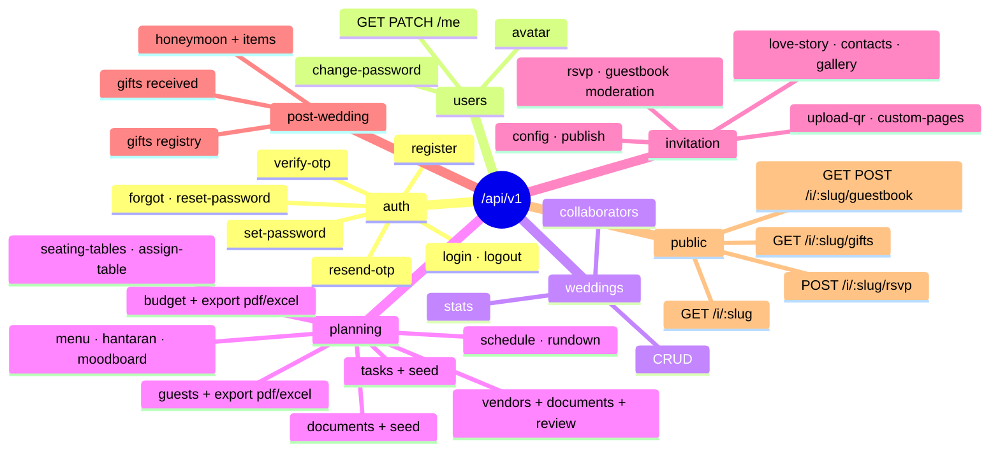

| Group | Endpoints |
|---|---|
| Auth | `POST /auth/register`, `/verify-otp`, `/set-password`, `/login`, `/logout`, `/resend-otp`, `/forgot-password`, `/reset-password` |
| Users | `GET/PATCH /users/me`, `POST /users/me/change-password`, `POST /users/me/avatar` |
| Weddings | `GET/POST /weddings`, `GET/PATCH/DELETE /weddings/{id}`, `GET /weddings/{id}/stats`, `POST /weddings/{id}/collaborators` |
| Module CRUD | `/weddings/{id}/budget`, `/vendors`, `/guests`, `/tasks`, `/documents`, `/schedule`, `/rundown`, `/menu`, `/hantaran`, `/moodboard`, `/seating-tables` |
| Exports | `GET /weddings/{id}/budget/export/{pdf,excel}`, `GET /weddings/{id}/guests/export/{pdf,excel}` |
| Invitation (owner) | `/weddings/{id}/invitation` (+ `/publish`, `/love-story`, `/contacts`, `/gallery`, `/upload-qr`, `/custom-pages`, `/rsvp`, `/guestbook`) |
| Post-wedding | `/weddings/{id}/gifts/registry`, `/gifts/received`, `PUT /honeymoon`, `/honeymoon/items` |
| Public | `GET /i/{slug}`, `POST /i/{slug}/rsvp`, `GET/POST /i/{slug}/guestbook`, `GET /i/{slug}/gifts` |

### Request/Response Flow

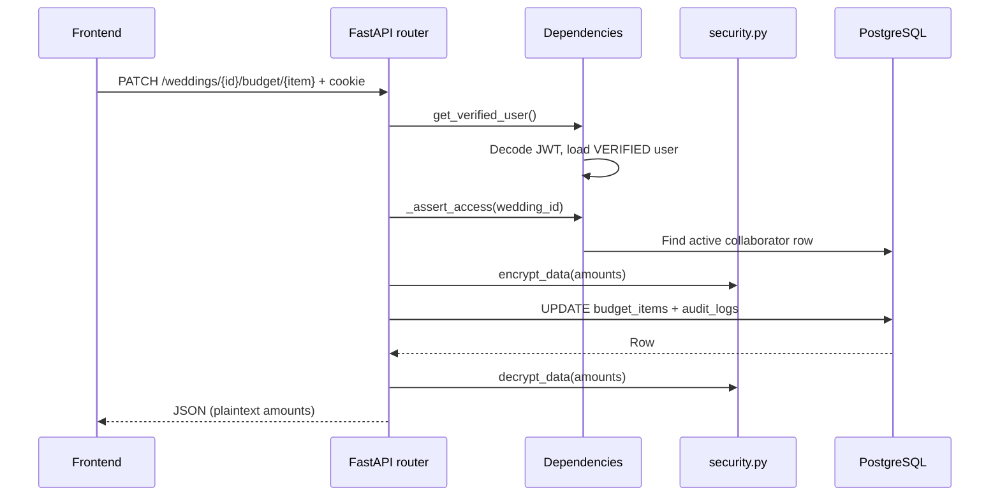

---

## 🧩 Frontend Components

### Component Tree

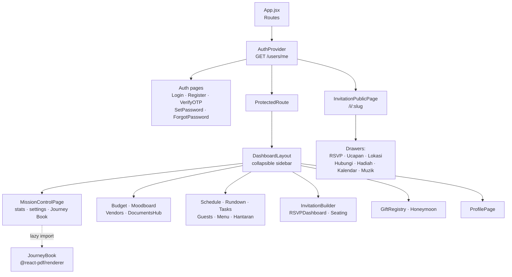

### Key Components

| Component | Purpose |
|---|---|
| `AuthContext` | Loads the current user from `/users/me`, exposes `login` / `logout` |
| `ProtectedRoute` | Spinner while loading, redirect to `/login` if no user |
| `DashboardLayout` | Sidebar grouped into Foundation / Planning / Execution / Post-Wedding, collapsible |
| `MissionControlPage` | Countdown, stat cards, progress bars, wedding settings form, Journey Book button |
| `InvitationBuilderPage` | 5-step builder (design, envelope, card text, settings, share) with custom slide upload and DuitNow QR upload |
| `InvitationPublicPage` | Envelope intro, story timeline, custom slide viewer, floating action bar with drawers |
| `JourneyBook` | Multi-section PDF: overview, budget, vendors, guests, checklist, rundown, hantaran, menu |
| `api.js` | Axios instance on `/api/v1` with cookies and a 401 → `/login` interceptor |

---

## ⚙️ Feature-specific Flows

### E-Invitation Publish & RSVP Flow

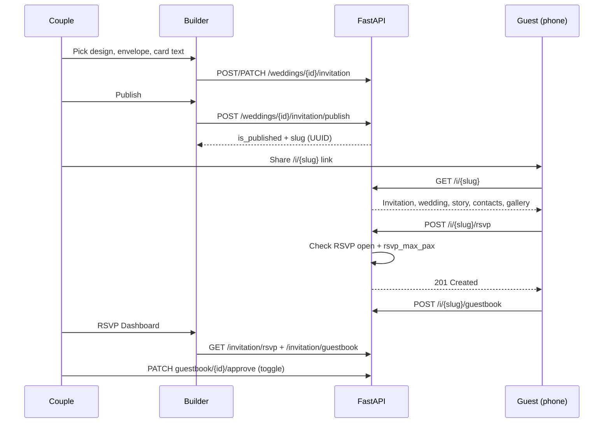

### Custom Design Upload Flow

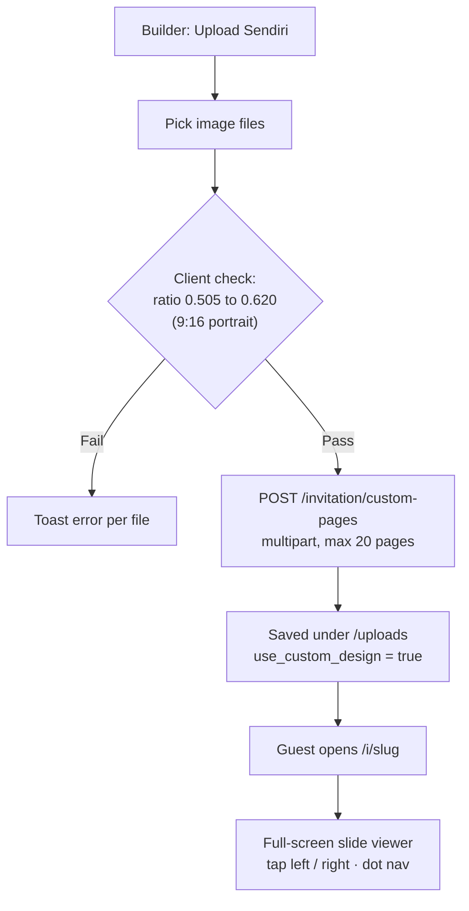

### Hantaran Tracker

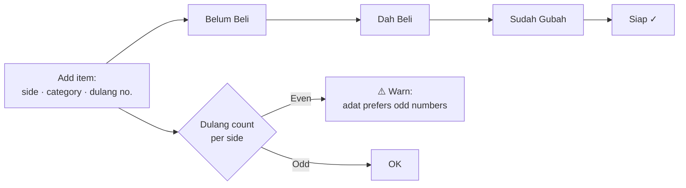

### Budget & Encryption

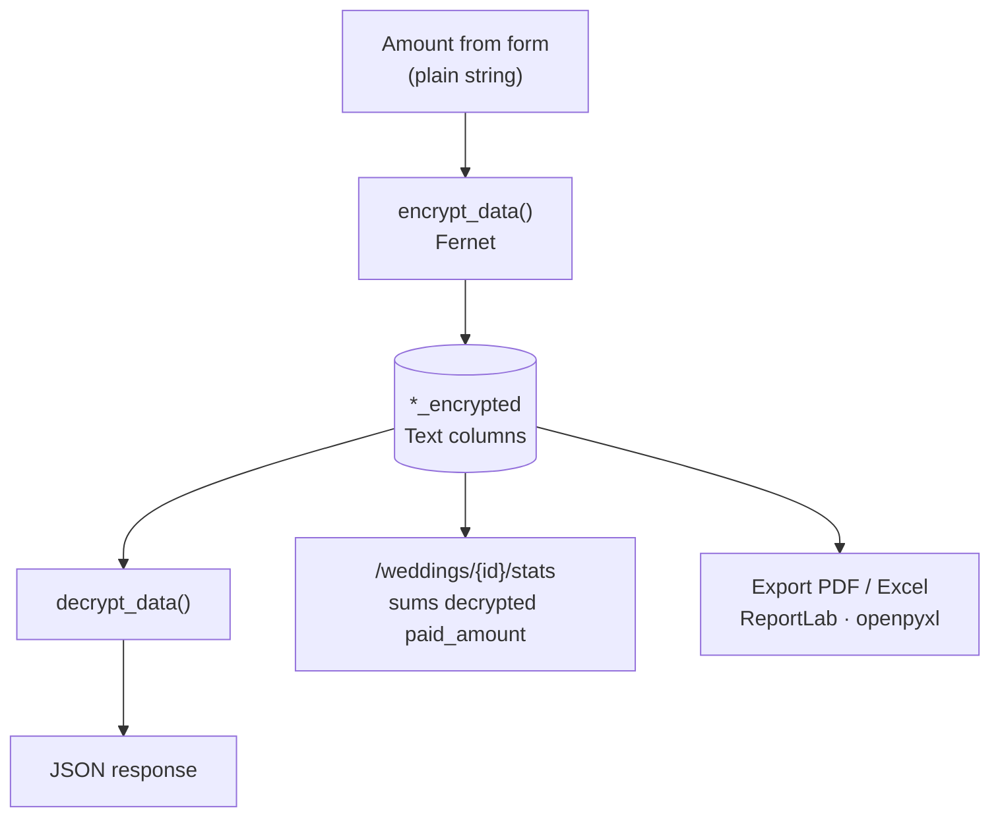

### Role & Permission Matrix

What the backend enforces today:

| Action | ADMIN / GROOM / BRIDE | VIEWER |
|---|---|---|
| View and edit wedding modules | ✅ | ✅ *(any active collaborator passes `_assert_access`)* |
| Delete wedding | ✅ | ❌ |
| Add / change collaborators | ✅ | ❌ |
| Publish e-invitation | ✅ | ✅ *(not role-checked yet)* |

> The wedding creator becomes ADMIN. Finer-grained roles per module are on the roadmap.

---

## 📁 Project Structure

```
PlanLuhh/
├── docker-compose.yml          db (postgres:16) · backend · frontend
├── DOCS.md                     Long-form product notes
│
├── backend/
│   ├── Dockerfile              python:3.12-slim
│   ├── alembic/versions/       11 migrations
│   └── app/
│       ├── main.py             FastAPI app, CORS, /uploads, router registration
│       ├── core/               config · database · deps (auth, access) · security (JWT, bcrypt, Fernet)
│       ├── models/             20 model files (29 tables)
│       ├── schemas/            Pydantic request / response models
│       ├── routers/            auth, users, wedding, budget, vendors, guests, tasks,
│       │                       documents, schedule, rundown, menu, hantaran, moodboard,
│       │                       seating, invitation, gift, honeymoon
│       └── utils/              email · otp · export (PDF / Excel) · audit
│
└── frontend/
    ├── Dockerfile              node:23-alpine, Vite dev server
    ├── vite.config.js          /api proxy → backend
    └── src/
        ├── App.jsx             Route table
        ├── context/            AuthContext
        ├── components/         dashboard/DashboardLayout · pdf/JourneyBook · shared/ProtectedRoute
        ├── pages/auth/         Login, Register, VerifyOTP, SetPassword, ForgotPassword
        ├── pages/dashboard/    One page per module + Profile
        ├── pages/invitation/   InvitationPublicPage
        ├── data/               invitationDesigns.js (20 preset designs)
        ├── assets/img/         Floral + Tradisional card backgrounds
        └── utils/api.js        Axios instance
```

---

## 🗺 Roadmap

- [x] Email OTP signup + JWT in HttpOnly cookies
- [x] Mission Control dashboard + wedding settings for 3 majlis
- [x] Budget tracker with PDF / Excel export
- [x] Vendor pipeline + compare panel
- [x] Moodboard, Documents Hub, Schedule, Rundown, Checklist
- [x] Guest list with PDF / Excel export, Menu, Hantaran tracker
- [x] E-invitation builder (20 presets + custom slides) and public page
- [x] RSVP dashboard + guestbook moderation
- [x] Seating, Gift registry, Honeymoon planner
- [x] Journey Book PDF (client-side)
- [x] Fernet encryption for money fields + audit log
- [ ] Token refresh endpoint + silent refresh
- [ ] Apply SlowAPI limits to auth and public routes
- [ ] Collaborator invite UI + per-module role checks
- [ ] Public gift claim endpoint
- [ ] Auto-match public RSVPs to the guest list
- [ ] Vendor documents + reviews in the UI
- [ ] Responsive planner layout for phones
- [ ] Payment / appointment reminder emails

---

## 📄 License

MIT © 2025 Siti Nursyaqirah · Source on [GitHub](https://github.com/snsyaqirah/PlanLuhh)
