# 🏍️ RedahLuhh

> Route weather checker for Malaysian riders — see the weather at every stretch of your route, not just the destination. *Redah tanpa ragu* (ride without doubt).


---

## 📖 Table of Contents

- [Overview](#-overview)
- [Features](#-features)
- [Tech Stack](#-tech-stack)
- [Architecture](#-architecture)
- [User Flow](#-user-flow)
- [Auth Flow](#-auth--session-flow)
- [Database](#-database-erd)
- [API Structure](#-api-structure)
- [Frontend Components](#-frontend-components)
- [Feature Flows](#-feature-specific-flows)
- [Deployment](#-deployment)
- [Project Structure](#-project-structure)
- [Roadmap](#-roadmap)
- [License](#-license)

---

## 🧭 Overview

RedahLuhh answers the question every Malaysian biker asks before a ride: *"Hujan tak kat tengah jalan nanti?"* You type an origin and destination (or let it detect your location), choose to leave now or at a set time, and the app gets up to three driving routes. It samples 3–7 waypoints along each route, works out when you will reach each one, and fetches the weather forecast for that place at that time.

Each route gets a weather score (green = 0, yellow = 1, red = 3 per waypoint). Routes are ranked driest first and labelled *Recommended*, *Driest Route*, *Fastest Route* or *Alternative N*. On the map, the polyline is coloured green, yellow or red section by section, with an emoji weather marker at each waypoint. A Summary tab shows the full breakdown and any active official warnings from MET Malaysia.

There are no user accounts. The main app is fully public, and nothing about your trip is stored. Supabase is used only for a community feedback wall, simple anonymous analytics, and a small admin dashboard for the developer.

**Type:** `Solo`
**Brand:** `Luhh Series`
**Built with:** Independent

---

## ✨ Features

- ✅ Weather at every sampled waypoint along the route (3–7 points, depending on route length), each with its own ETA
- ✅ Multi-route comparison: up to 3 routes from Google Routes API, ranked by weather score, ties broken by duration
- ✅ Route chips labelled *Recommended / Driest Route / Fastest Route / Alternative N*, with distance, duration and a safety badge
- ✅ Google Map with a green/yellow/red polyline per section and emoji markers (Start / Destination labelled)
- ✅ Summary tab: worst-condition banner, distance / duration / departure tiles, a status timeline dot strip, and per-waypoint weather cards (temp, rain %, wind, humidity, feels-like, ETA)
- ✅ Departure scheduler: *Leave now* or *Depart at* a set date and time, using hourly forecasts for future trips
- ✅ 5-provider weather cascade with automatic fallback: XWeather (road weather) → Meteoblue → Tomorrow.io (realtime for start and destination) → Open-Meteo → WeatherAPI
- ✅ Reality-check filter on rain readings, so model "phantom rain" doesn't turn a dry route red
- ✅ MET Malaysia official warnings (via api.data.gov.my) shown at the top of the summary
- ✅ **Go Now** mode: full-screen map, live GPS bike marker, Screen Wake Lock, auto weather refresh every 15 minutes
- ✅ Day/night map theme based on Malaysia time (light from 06:00 to 19:00)
- ✅ Auto-detects your location on load (browser geolocation + Google Geocoder), with a tip if location is blocked
- ✅ Places Autocomplete biased to Malaysia, clear buttons, and an origin/destination swap button
- ✅ Shows which weather provider is active, with toast alerts when a provider's quota runs out
- ✅ Backend status dot and a "warming up" notice for Render free-tier cold starts
- ✅ Floating feedback widget (bug / enhancement / general / testimonial; bugs need a suggested fix)
- ✅ Public community feedback wall with developer replies (`/feedback`)
- ✅ Admin dashboard (`/admin`): 7-day searches and page views chart, hide/restore feedback, reply to feedback
- ✅ Changelog page, PWA manifest with generated icons, sitemap, robots and bilingual (BM/EN) SEO metadata
- ✅ API rate limit (30 requests per minute per IP) and input validation on locations
- 🚧 MET Malaysia district-level forecasts *(service and reverse-geocode helper written, not yet wired into the cascade)*
- 💡 Saved / favourite routes
- 💡 Avoid-tolls and route preference options
- 💡 Push notifications when the weather changes mid-ride
- 💡 Offline support / service worker (only the manifest exists today)

---

## 🛠 Tech Stack

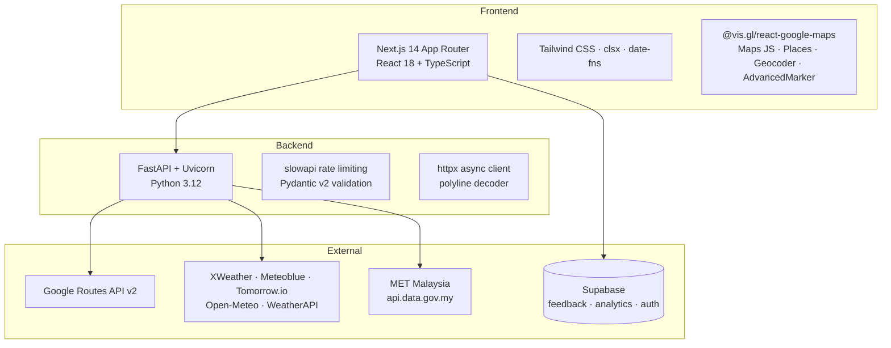

| Layer | Technology |
|---|---|
| Frontend | Next.js 14.2 (App Router), React 18, TypeScript |
| Styling | Tailwind CSS, clsx, custom keyframe animations |
| Maps | Google Maps JavaScript API via `@vis.gl/react-google-maps` (vector map, AdvancedMarker, Places Autocomplete, Geocoder) |
| Backend | FastAPI 0.115, Uvicorn, Pydantic v2, pydantic-settings |
| HTTP | httpx (async) |
| Routing | Google Routes API v2 (`computeRoutes`, traffic-aware, alternative routes) |
| Weather | XWeather, Meteoblue, Tomorrow.io, Open-Meteo, WeatherAPI |
| Warnings | MET Malaysia open data (`api.data.gov.my/weather/warning`) |
| Data / Auth | Supabase (Postgres + Auth), used from the browser with `@supabase/supabase-js` |
| Rate limiting | slowapi |
| Hosting | Vercel (frontend), Render (backend) |
| Containers | Dockerfiles for both apps + Docker Compose |

---

## 📌 Architecture

### High-level Architecture

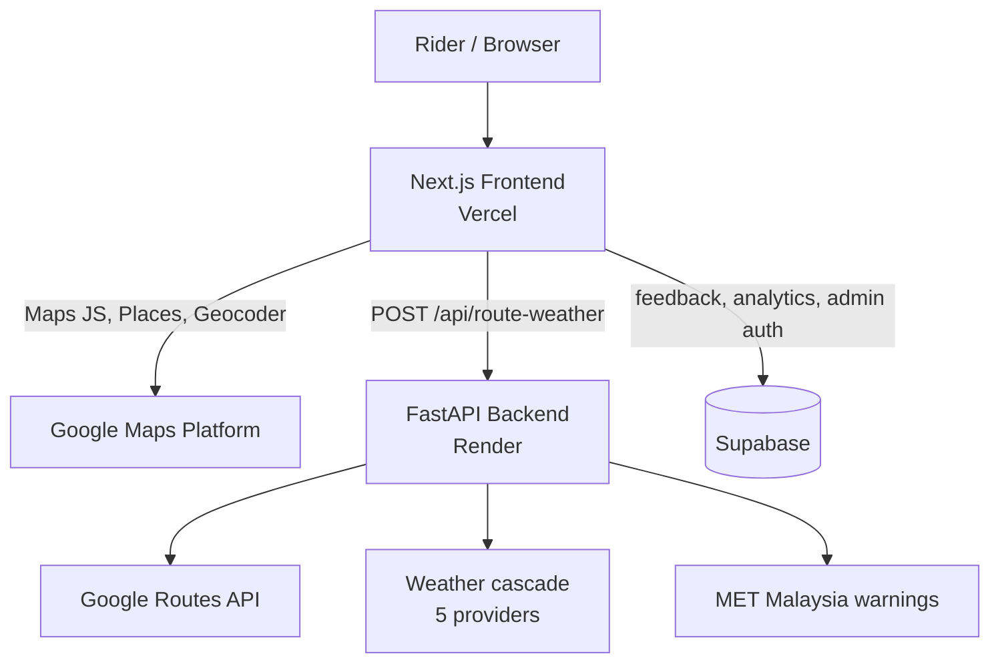

### System Architecture

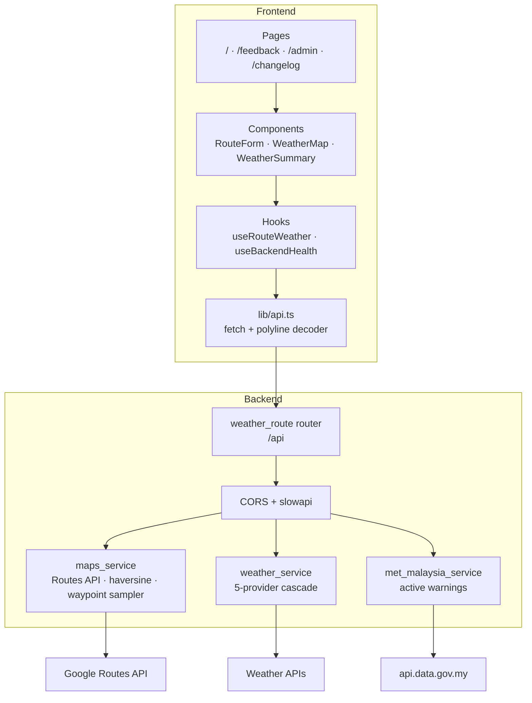

> API keys for Google Routes and the weather providers stay on the backend. The browser only holds the Google Maps JS key and the Supabase anon key.

---

## 👤 User Flow

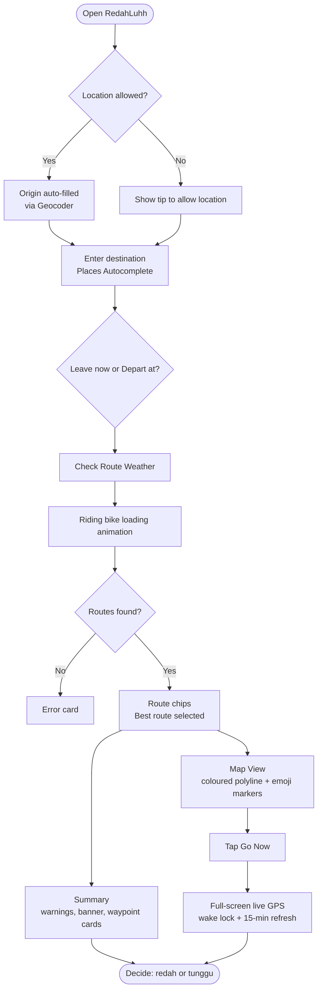

### Page Map

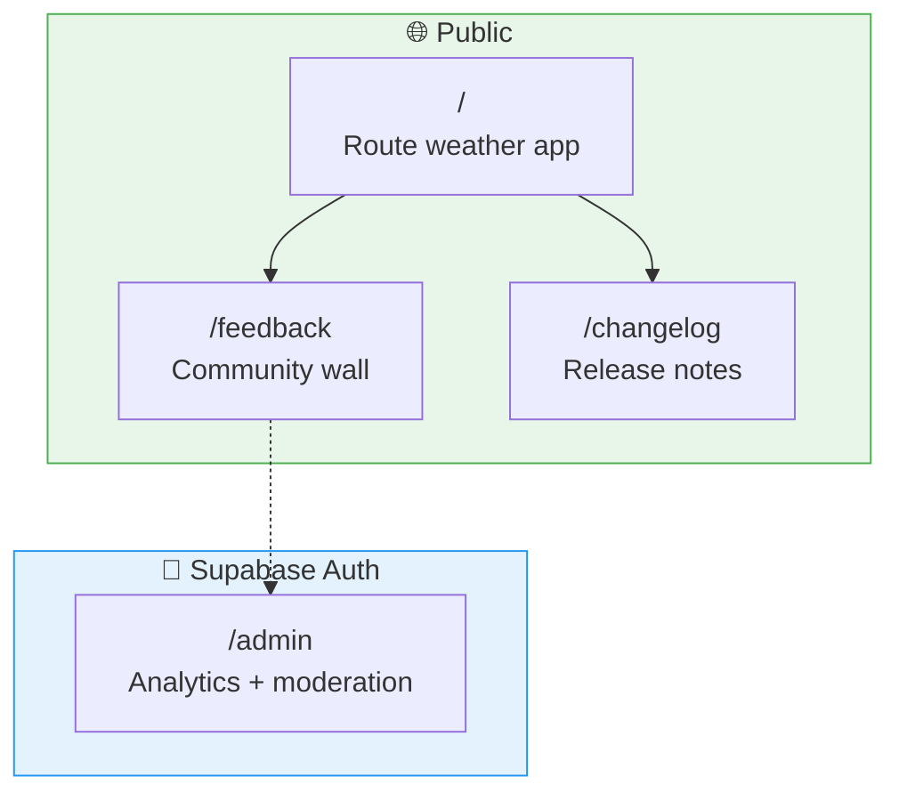

### Wireframe Overview

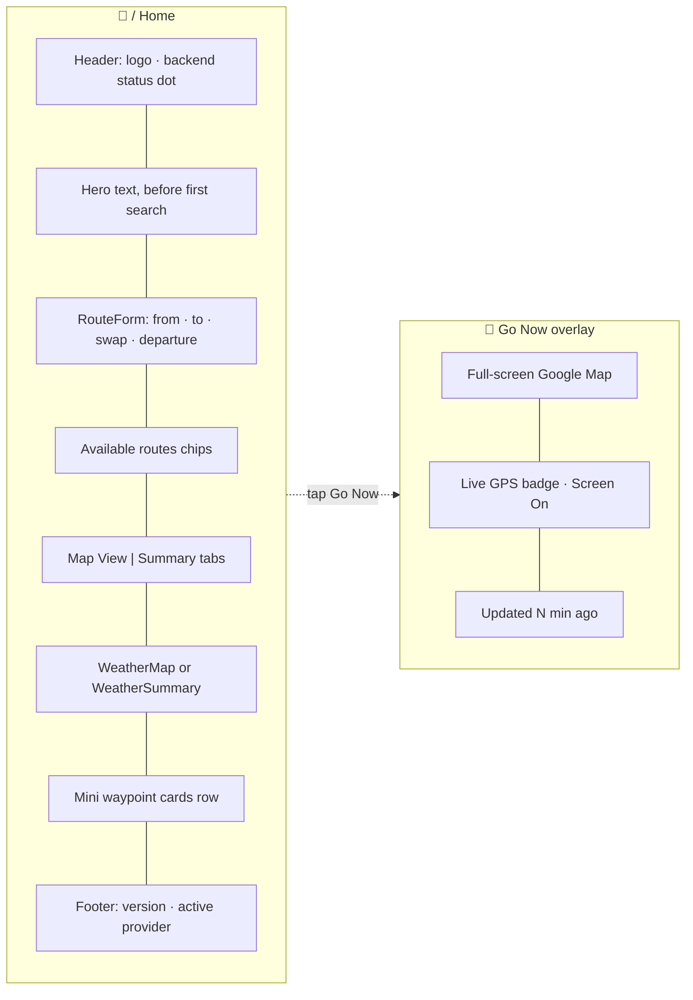

---

## 🔐 Auth & Session Flow

> Riders never log in. Only `/admin` needs a login, using Supabase email + password auth. The `isAdmin` flag in localStorage just stops the developer's own visits from being counted in analytics.

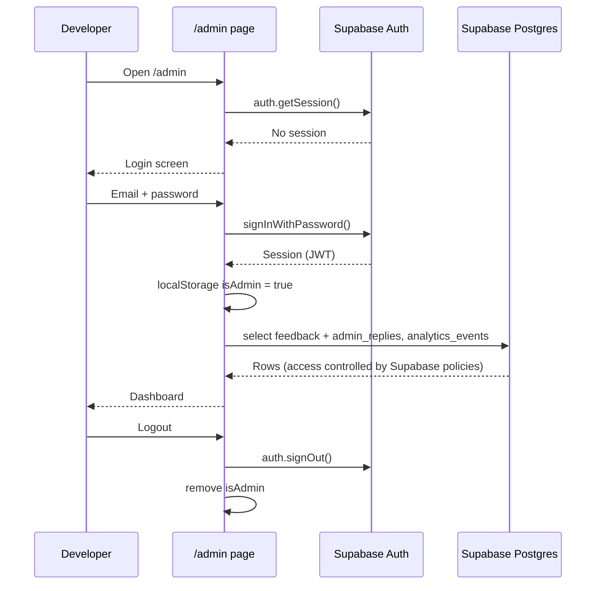

---

## 🗄️ Database (ERD)

> Supabase holds only the feedback and analytics data. Routes and weather are fetched live and never stored. The table shapes below come from the queries in the frontend code. The SQL schema itself is not in the repo.

### Core ERD

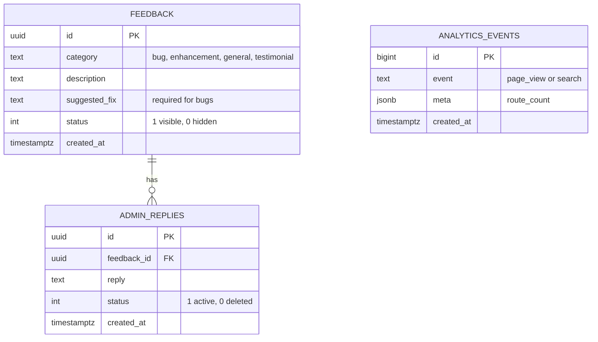

### Database Schema Overview

| Table | Purpose | Written by |
|---|---|---|
| `feedback` | Bug reports, enhancement ideas, general comments and testimonials | Anyone, via the feedback widget |
| `admin_replies` | Developer replies shown on the public wall (soft delete with `status`) | Admin dashboard |
| `analytics_events` | Anonymous `page_view` and `search` events for the 7-day chart | Home page (skipped for admin) |

---

## 🔌 API Structure

### API Overview

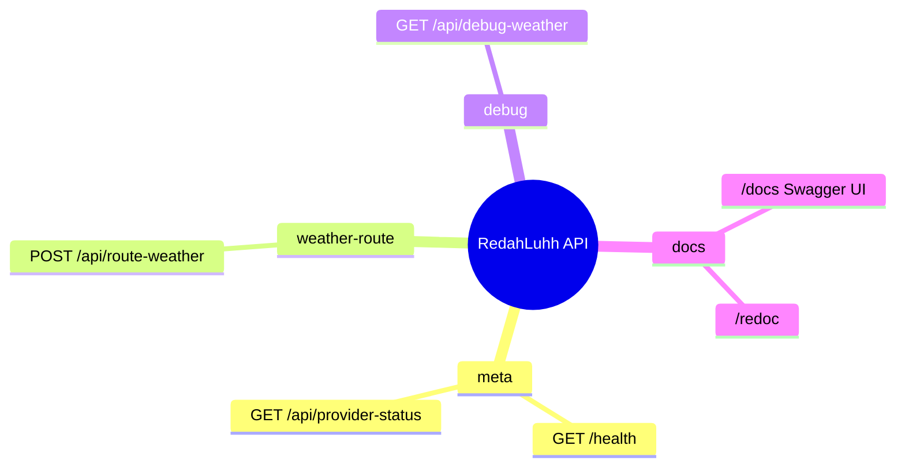

### Endpoint Reference

| Method | Endpoint | Description |
|---|---|---|
| `GET` | `/health` | Health check, used for the status dot and cold-start notice |
| `GET` | `/api/provider-status` | Active weather provider + per-provider quota-exhausted flags |
| `POST` | `/api/route-weather` | Main endpoint: `{ origin, destination, departure_time? }` → weather for all routes, ranked. Limited to 30 requests/min per IP |
| `GET` | `/api/debug-weather?lat=&lon=` | Developer helper that calls WeatherAPI for one coordinate |

### Request/Response Flow

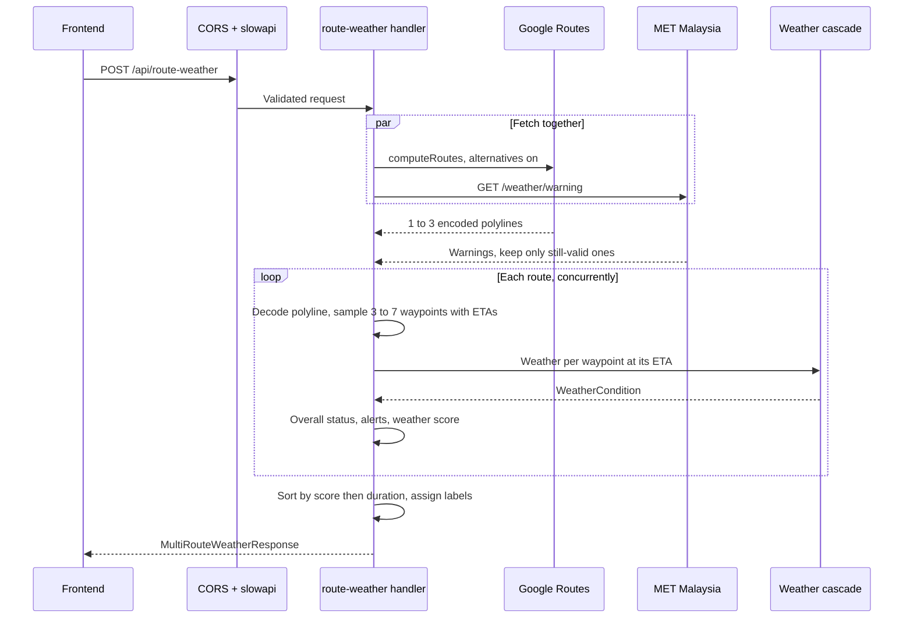

---

## 🧩 Frontend Components

### Component Tree

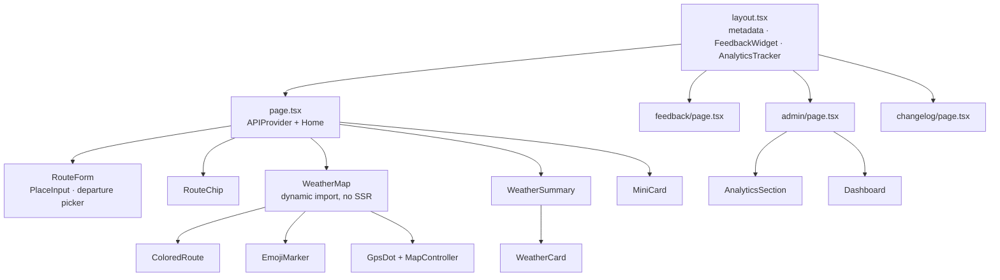

### Key Components

| Component | Purpose |
|---|---|
| `RouteForm` | Origin/destination inputs with Places Autocomplete, use-my-location, swap, and the Leave now / Depart at picker |
| `WeatherMap` | Google vector map with section-coloured polylines, emoji waypoint markers, legend, and Go Now mode (GPS follow, wake lock, 15-min refresh) |
| `WeatherSummary` | MET warnings, worst-condition banner, stat tiles, status timeline, waypoint cards, refresh button |
| `WeatherCard` | Weather details for one waypoint: temperature, condition, rain %, wind, humidity, feels-like, ETA |
| `FeedbackWidget` | Floating button + modal that writes to the Supabase `feedback` table |
| `AnalyticsTracker` | Logs one anonymous `page_view` per visit (skipped for admin) |
| `useRouteWeather` | Search state, selected route, refresh, `search` analytics event |
| `useBackendHealth` | Pings `/health` with a 35 s timeout to cover Render cold starts |

---

## ⚙️ Feature-specific Flows

### Weather Cascade Flow

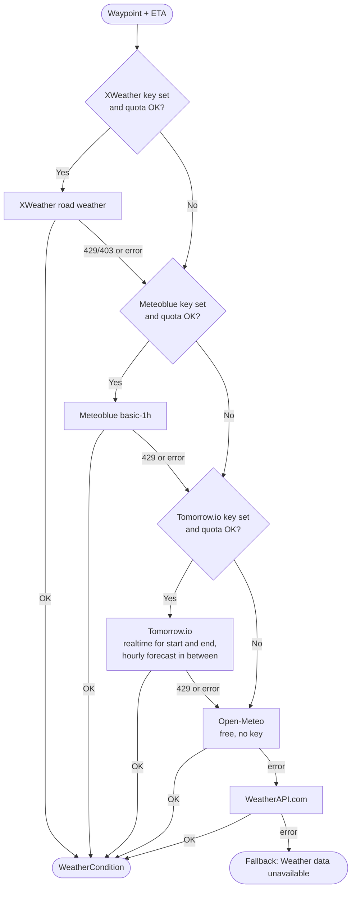

> Quota hits set module-level "exhausted" flags. `/api/provider-status` exposes these flags so the UI can show toasts and the active provider in the footer.

### Status Classification

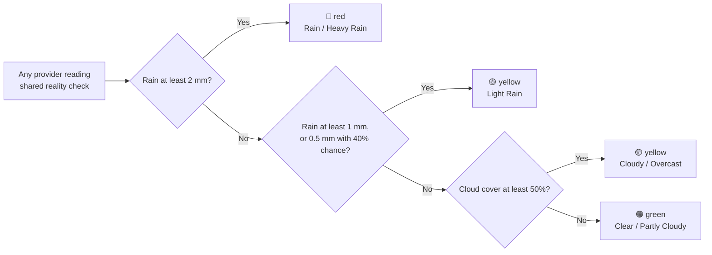

### Route Ranking Flow

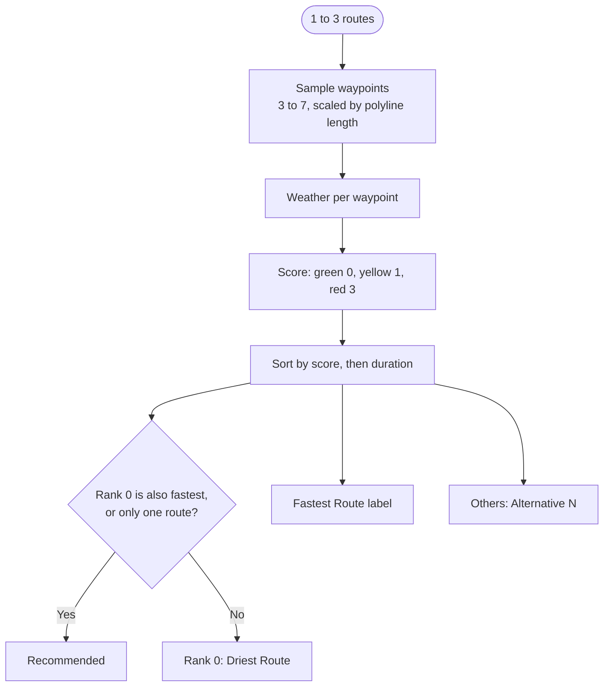

### Go Now Navigation Flow

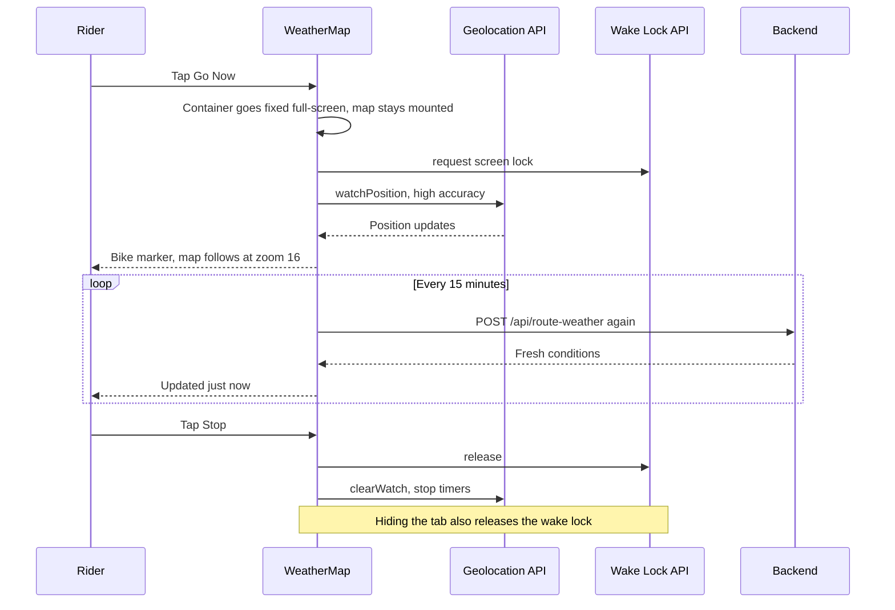

### Feedback Loop

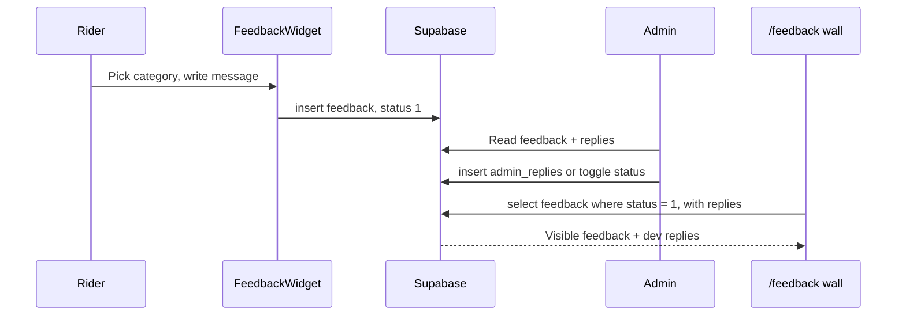

---

## ☁️ Deployment

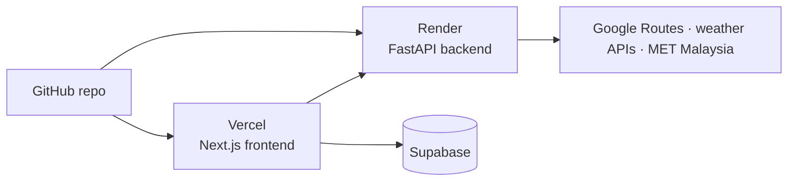

| Service | Platform | Notes |
|---|---|---|
| Frontend | Vercel | [redahluhh.vercel.app](https://redahluhh.vercel.app/) |
| Backend | Render | Free tier, so expect a ~30 s cold start (the UI shows a warm-up notice) |
| Data / Auth | Supabase | Feedback, analytics and admin login |

---

## 📁 Project Structure

```
RedahLuhh/
├── docker-compose.yml          backend :8000 + frontend :3000
│
├── backend/
│   ├── Dockerfile              python:3.12-slim + uvicorn
│   ├── requirements.txt
│   └── app/
│       ├── main.py             FastAPI app, CORS, slowapi, /health
│       ├── config.py           pydantic-settings (API keys, CORS origins)
│       ├── models/schemas.py   Request / response models + validation
│       ├── routers/
│       │   └── weather_route.py   route-weather, provider-status, debug
│       └── services/
│           ├── maps_service.py        Routes API, haversine, waypoint sampler
│           ├── weather_service.py     5-provider cascade + classifiers
│           └── met_malaysia_service.py  Warnings + district forecast
│
└── frontend/
    ├── Dockerfile
    └── src/
        ├── app/
        │   ├── page.tsx        Main app
        │   ├── layout.tsx      SEO metadata, widgets
        │   ├── feedback/       Community wall
        │   ├── admin/          Analytics + moderation
        │   ├── changelog/      Release notes
        │   ├── icons/[size]/   Edge-generated PWA icons
        │   ├── manifest.ts · robots.ts · sitemap.ts
        ├── components/         RouteForm, WeatherMap, WeatherSummary,
        │                       WeatherCard, FeedbackWidget, AnalyticsTracker
        ├── hooks/              useRouteWeather, useBackendHealth
        └── lib/                api.ts, supabase.ts, types.ts
```

---

## 🗺 Roadmap

- [x] Weather along the entire route, not just the destination (v0.1.0)
- [x] Google Routes API for Malaysian routing (v0.1.0)
- [x] Multi-route comparison with weather scoring (v0.2.0)
- [x] Colour-coded polyline + emoji waypoint markers (v0.2.0)
- [x] Departure time scheduler + hourly forecasts (v0.2.0)
- [x] 5-provider weather cascade with automatic fallback (v0.3.0)
- [x] MET Malaysia official warnings (v0.3.0)
- [x] Go Now full-screen GPS mode + screen wake lock (v0.3.0)
- [x] Day/night map theme + auto-detect location (v0.3.0)
- [x] Feedback wall + admin dashboard on Supabase (v0.3.0)
- [ ] Wire MET Malaysia district forecasts into the cascade
- [ ] Only show warnings relevant to the route (skip marine/shipping ones)
- [ ] Saved / favourite routes
- [ ] Avoid tolls / route preferences
- [ ] Push notifications for mid-ride weather changes
- [ ] Offline mode with a service worker

---

## 📄 License

No license file has been published yet, so all rights are reserved. © 2025 Siti Nursyaqirah · Source on [GitHub](https://github.com/snsyaqirah/RedahLuhh)
