# 🕌 SinggahLuhh

> Cari, jejak dan kongsi tempat solat. A community-driven app for finding masjid, surau and musolla in Malaysia, checking in by GPS, and sharing the little details that matter: is it sejuk, is there a Coway, is the parking a nightmare, any kucing oren?


---

## 📖 Table of Contents

- [Overview](#-overview)
- [Features](#-features)
- [Tech Stack](#-tech-stack)
- [Architecture](#-architecture)
- [User Flow](#-user-flow)
- [Auth Flow](#-auth--session-flow)
- [Database](#-database-erd)
- [API Structure](#-api-structure)
- [Frontend Components](#-frontend-components)
- [Feature Flows](#-feature-specific-flows)
- [Deployment](#-deployment)
- [Project Structure](#-project-structure)
- [Roadmap](#-roadmap)
- [License](#-license)

---

## 🧭 Overview

SinggahLuhh is a Malay-language PWA for Muslims on the move. Travellers, commuters and anyone stuck in traffic at Maghrib can look up nearby places to pray, see what the facilities are like, and check in when they get there. Everything is crowdsourced. Users add places, fill in the facilities, vote to verify listings, and post live updates like "saf penuh" or today's iftar menu.

Check-ins are geofenced with PostGIS: you have to be within 200 m of the masjid, or 500 m in Musafir mode. Each check-in earns reputation points, keeps a daily streak going and can unlock badges, so the app doubles as a personal "masjid passport". On top of that there are community boards for each masjid (announcements, events, lost and found, iftar reviews), prayer groups with invite codes, and a private log for Quran reading and sunat prayers.

The FastAPI backend is a thin service layer over Supabase. Supabase Auth handles accounts and email OTP. PostgREST, through the Supabase client, does the data access. PostGIS handles the distance and duplicate checks. The React frontend talks only to the FastAPI REST API.

**Type:** `Solo`
**Brand:** `Luhh Series`
**Built with:** Independent

---

## ✨ Features

**Discovery**
- ✅ Browse masjid / surau / musolla with type chips, text search (name + address) and 12 facility quick-filters (Iftar, Terawih, Aircon, Coway, Mesra OKU, Telekung Bersih, Parking Senang…)
- ✅ Leaflet + OpenStreetMap map with an emoji marker per place type, plus a "Lokasi Saya" locate button
- ✅ Detail page per place, reachable by slug or UUID, with photo gallery, facilities grid, live status and Google Maps directions link
- ✅ Homepage with public stats, featured verified places and a weekly **Trending** list

**Malaysian-flavoured facilities**
- ✅ Sejuk meter (Full AC / Sejuk Gila → Panas), Coway, kucing count, karpet vibe, talam gang
- ✅ Terawih rakaat (8 / 11 / 20 / 23), iftar type + menu, parking level, OKU / moto parking
- ✅ Telekung rating, toilet cleanliness + floor condition, wudhu seating, kids area, tahfiz, library
- ✅ Transit proximity (bas / LRT / MRT) and a tourist-friendly flag

**Check-ins & gamification**
- ✅ GPS check-in validated server-side with `ST_Distance`: 200 m normally, 500 m in Musafir mode
- ✅ 10 visit types (5 fardhu, Jumaat, Terawih, Iftar, Kuliah, general). One check-in per masjid + type + day, enforced by a unique index
- ✅ Points per visit type (Subuh / Jumaat / Terawih 15, Isyak 12, others 8–10), daily streak + longest streak
- ✅ Badges, reputation tiers (Jemaah Baru → Ahli Tetap → Penjaga Masjid → Tok Imam) and a leaderboard with a state filter
- ✅ "Jejak Saya" dashboard: stat tiles, badge passport, activity calendar, visit-type breakdown, favourite masjid, visit history

**Community & data quality**
- ✅ Add a place with Nominatim address search or the device GPS. Anything within 100 m of an existing listing is rejected as a duplicate
- ✅ Peer verification: 3 upvotes auto-verify a listing (+25 bonus to the creator). You can't vote on your own listing, and a downvote needs a reason
- ✅ Live updates (saf, parking, crowd level: 45 min TTL · iftar menu: 24 h TTL)
- ✅ Per-masjid announcements (pinnable), events, Lost & Found board (7-day expiry) and Iftar thread with star ratings
- ✅ Report wrong info. Admin panel for reports, feedback and QR moderation
- ✅ Photo upload to Supabase Storage (5 MB cap, 3 per user per masjid). TNG / DuitNow QR codes need 30+ reputation and admin approval before they show

**Personal**
- ✅ Bookmarks: "Disimpan" (saved) vs "Nak Pergi" (wishlist)
- ✅ Private notes per masjid (Nota Peribadi / diary)
- ✅ Ibadah Saya: Khatam Al-Quran log (surah/ayah ranges, juz) and a sunat prayer log (tahajjud, dhuha, witir, hajat…)
- ✅ Prayer groups / buddy pairs with 8-char invite codes, member list and a shared check-in feed
- ✅ PWA: installable, Workbox caching, install prompt, browser notification on check-in
- ✅ Floating feedback widget, FAQ, changelog, privacy policy and terms pages

**In progress / ideas**
- 🚧 New badge set (v3 seed: `first_checkin`, `visit_5`, `streak_7`…). They're in the DB, but the check-in service still awards only the original codes, and their requirement types don't match the API's badge schema yet
- 🚧 Admin edit/ban tooling (an `is_banned` check exists on create, but there's no UI yet)
- 💡 Nearby search sorted by the user's live location
- 💡 Ramadan mode (terawih tracker, iftar map)
- 💡 Admin analytics for masjid committees
- 💡 English / multi-language UI

---

## 🛠 Tech Stack

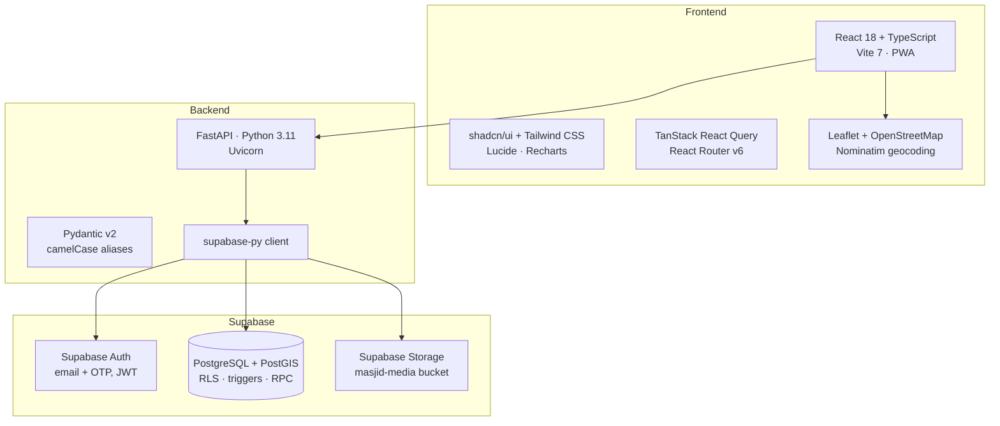

| Layer | Technology |
|---|---|
| Frontend | React 18 + TypeScript + Vite 7 |
| Routing / State | React Router v6 · TanStack React Query |
| UI | Tailwind CSS + shadcn/ui (Radix UI) · Lucide icons · Recharts |
| Maps | Leaflet 1.9 (CDN) + OpenStreetMap tiles · Nominatim search |
| PWA | vite-plugin-pwa (Workbox, auto-update) |
| Backend | FastAPI 0.115 · Uvicorn · Pydantic v2 / pydantic-settings |
| Data access | supabase-py 2.10 (PostgREST + Auth + Storage) |
| Database | Supabase PostgreSQL + PostGIS (`GEOGRAPHY(POINT, 4326)`) |
| Auth | Supabase Auth (email/password + email OTP verification) |
| Storage | Supabase Storage bucket `masjid-media` |
| Containers | Docker (backend + multi-stage frontend / nginx) |
| Testing | Vitest + Testing Library (frontend scaffold) |

---

## 📌 Architecture

### High-level Architecture

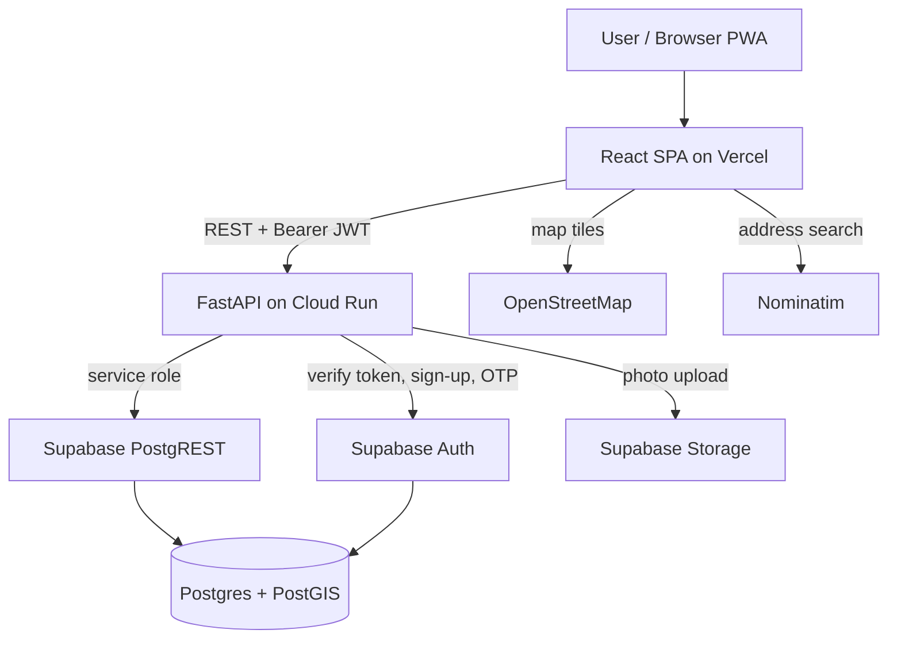

### System Architecture

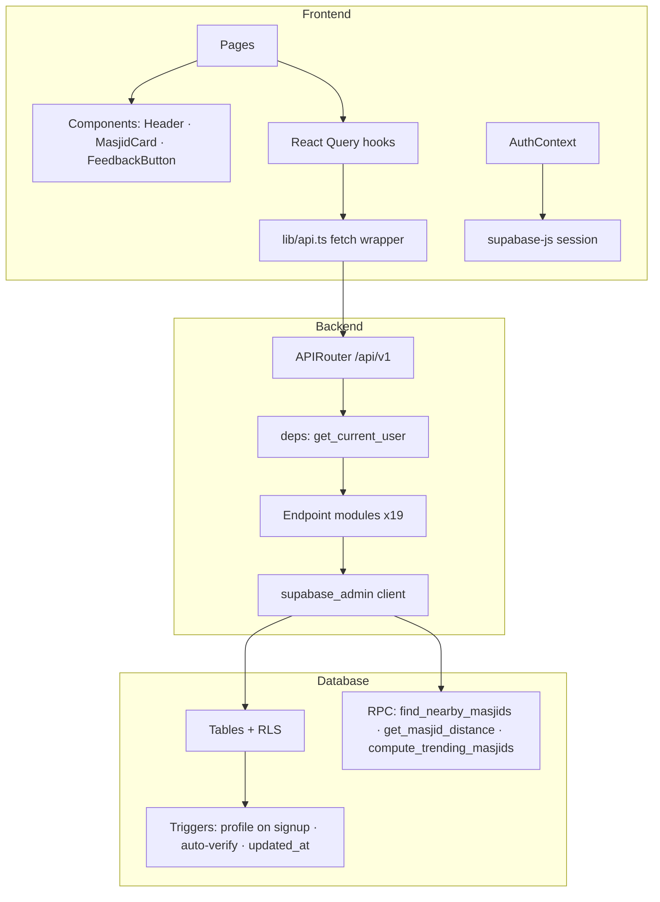

> Almost every endpoint uses the **service-role** Supabase client and checks ownership in Python (for example `created_by == current_user`). The RLS policies in the schema are a second line of defence for anything that reaches Postgres with the anon key.

---

## 👤 User Flow

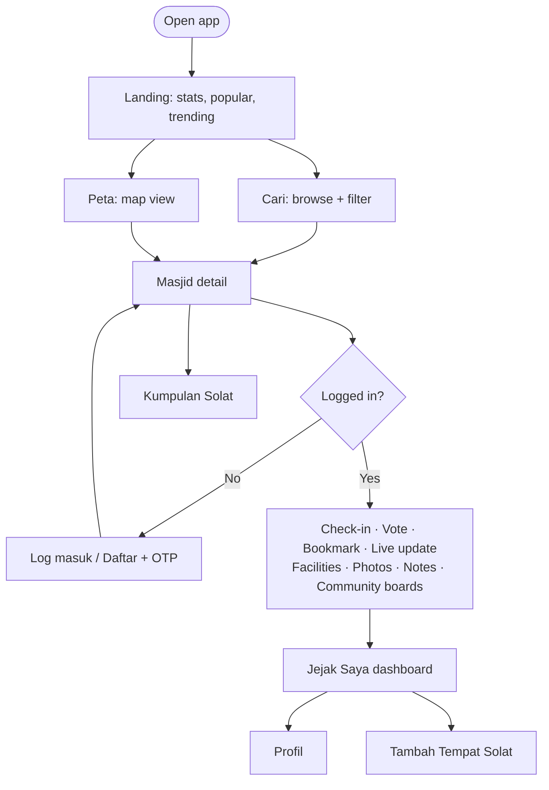

### Page Map

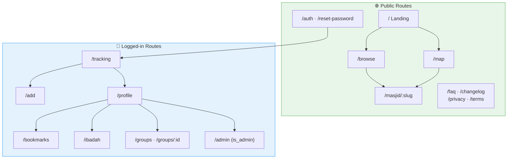

---

## 🔐 Auth & Session Flow

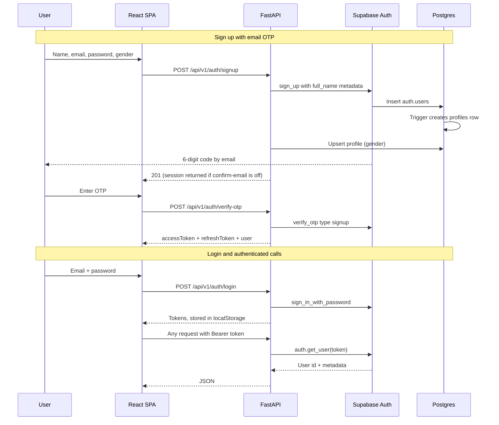

### Password Reset & Account

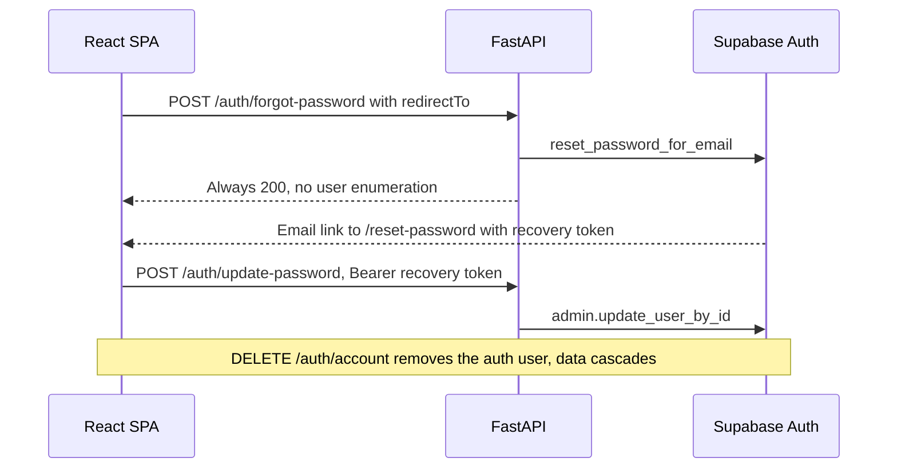

---

## 🗄️ Database (ERD)

### Core ERD

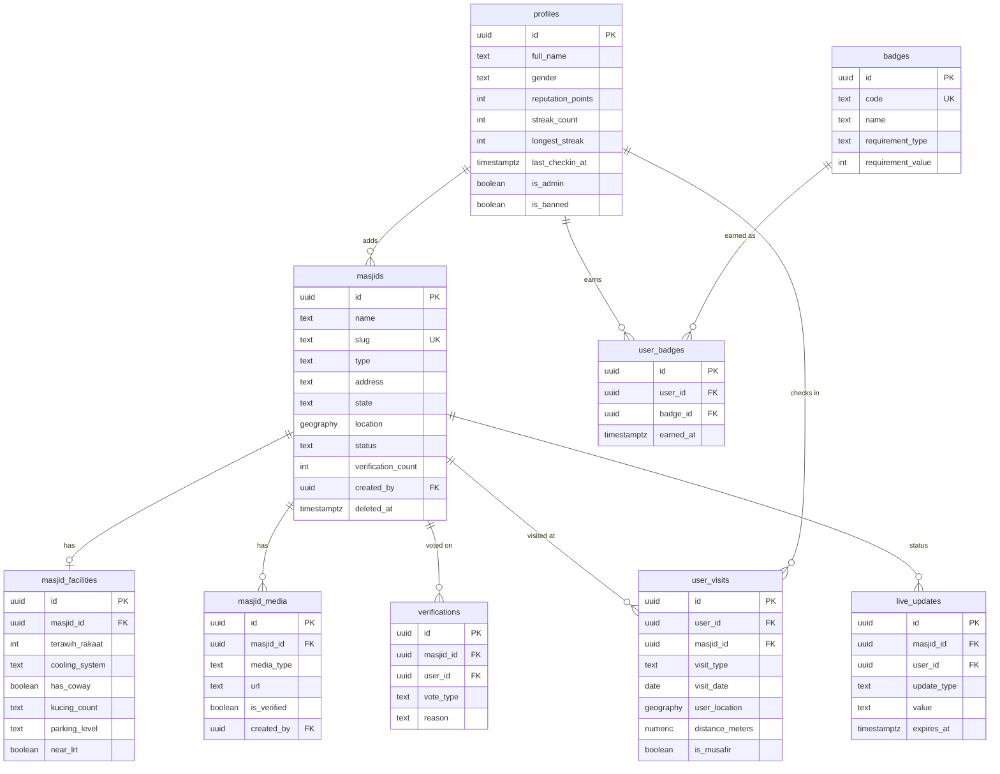

### Community & Personal ERD

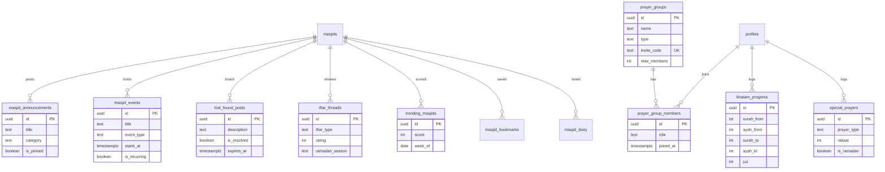

### Database Schema Overview

| Table | Purpose |
|---|---|
| `profiles` | Extends `auth.users`: name, gender, reputation, streaks, admin/ban flags. Created by a trigger on signup |
| `masjids` | Places (masjid / surau / musolla) with PostGIS location, slug, status `pending → verified` |
| `masjid_facilities` | One row per place with all the facility enums and flags |
| `masjid_media` | Photos and QR codes. QR rows stay hidden until an admin approves them |
| `user_visits` | Check-ins. Unique on `(user, masjid, visit_type, visit_date)` |
| `verifications` | Up/down votes. Unique per user per masjid |
| `live_updates` | Short-lived crowd/saf/parking/iftar status with `expires_at` |
| `badges` / `user_badges` | Badge catalogue and earned badges |
| `reports` · `feedback` | Moderation queue and app feedback |
| `masjid_announcements` · `masjid_events` · `lost_found_posts` · `iftar_threads` | Per-masjid community boards |
| `masjid_bookmarks` · `masjid_diary` · `khatam_progress` · `special_prayers` | Private, per-user data |
| `prayer_groups` · `prayer_group_members` | Groups / buddy pairs with invite codes |
| `trending_masjids` | Weekly scores filled by `compute_trending_masjids()` |

> **Postgres logic:** `find_nearby_masjids(lat, lng, radius)` and `get_masjid_distance(...)` wrap `ST_DWithin` / `ST_Distance` on a GiST-indexed geography column. `on_auth_user_created` creates the profile, and `trigger_auto_verify` recounts upvotes. Most tables are soft-deleted via `deleted_at`.

---

## 🔌 API Structure

### API Overview

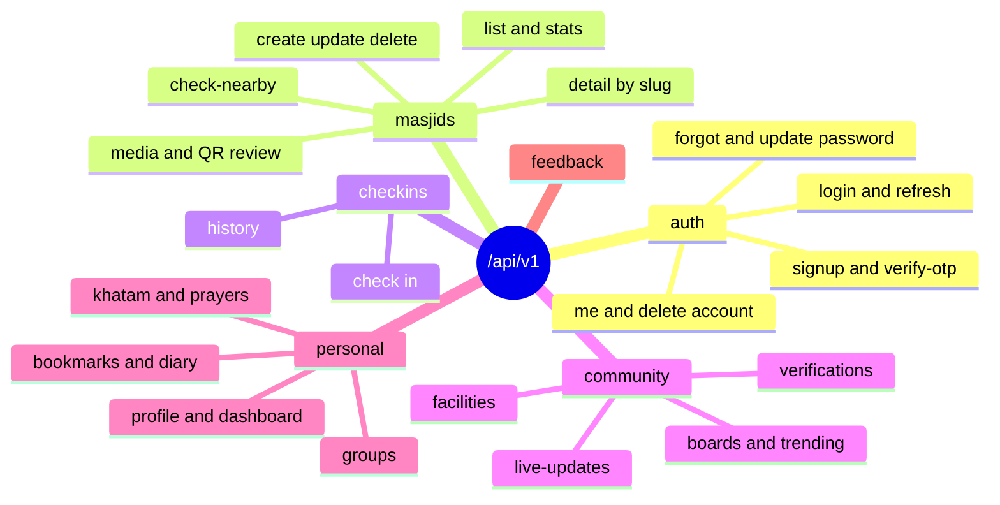

| Group | Endpoints |
|---|---|
| Auth | `POST /auth/{signup, verify-otp, resend-otp, login, refresh, logout, forgot-password, update-password}` · `GET /auth/me` · `DELETE /auth/account` |
| Masjids | `GET /masjids` (page, type, state, search) · `GET /masjids/stats` · `GET /masjids/{slug or id}` · `POST /masjids` · `PATCH/DELETE /masjids/{id}` · `POST /masjids/check-nearby` |
| Media | `GET/POST /masjids/{id}/media` · `POST .../media/upload` · `DELETE .../media/{mediaId}` · `GET /masjids/admin/pending-media` · `PATCH .../approve` · `DELETE .../reject` |
| Check-ins | `POST /checkins/` · `GET /checkins/history` |
| Verification | `POST /verifications/vote` · `GET /verifications/status/{id}` · `POST /verifications/report` · `GET /verifications/reports/{mine, all}` · `PATCH /verifications/reports/{id}` |
| Live / Facilities | `POST /live-updates/` · `GET /live-updates/{id}` · `GET /live-updates/options` · `GET/POST/PATCH /facilities/{id}` |
| Community | `/announcements` · `/events` · `/lost-found` (+ `/resolve`) · `/iftar` · `GET /trending` |
| Personal | `GET/PATCH /profile/me` · `GET /dashboard/{stats, badges, leaderboard}` · `/bookmarks` · `/diary` · `/khatam` · `/special-prayers` |
| Groups | `GET/POST /groups` · `POST /groups/join?invite_code=` · `GET /groups/{id}` · `DELETE /groups/{id}/leave` · `DELETE /groups/{id}` |
| Feedback | `POST /feedback` · `GET /feedback/admin` |

### Request/Response Flow

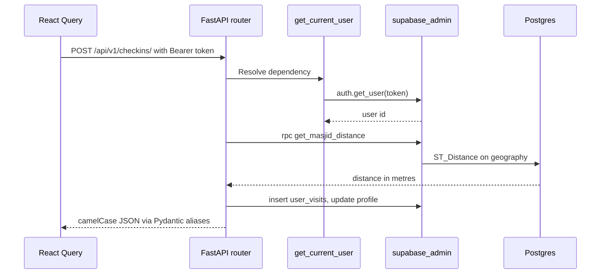

---

## 🧩 Frontend Components

### Component Tree

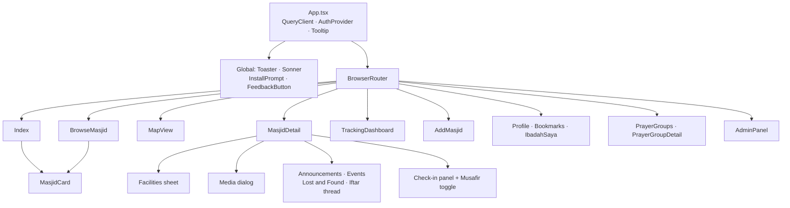

### Key Components

| Component / Module | Purpose |
|---|---|
| `lib/api.ts` | Typed fetch wrapper for all 19 API groups, bearer token from localStorage |
| `AuthContext` | User state from the supabase-js session + `authenticate()` after API login |
| `MasjidCard` | Cover photo, type + verified badges, feature chips (Iftar, Terawih, AC, Kucing) |
| `MasjidDetail` | The big one: gallery, facilities, live status, voting, boards, notes, check-in |
| `MapView` | Loads Leaflet from CDN, draws emoji markers, bottom card on select |
| `AddMasjid` | Nominatim search or GPS → lat/lng, 100 m duplicate pre-check, optional facilities |
| `TrackingDashboard` | Stat tiles, badge passport, calendar, breakdown bars, leaderboard |
| `lib/constants.ts` | Quick-filter tags and their predicate functions, visit types, Malaysian states |
| `lib/utils.ts` | Reputation tiers and progress, Title Case helper |
| `InstallPrompt` / `FeedbackButton` | PWA install banner and floating feedback form |

---

## ⚙️ Feature-specific Flows

### Check-in Flow

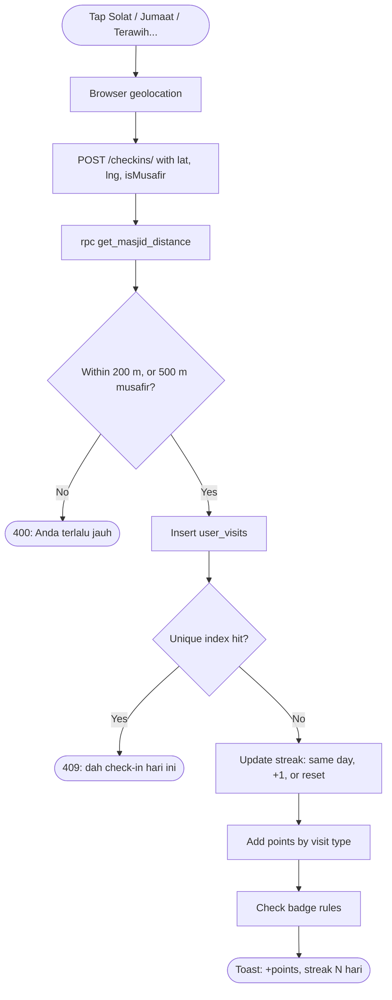

### Add Masjid & Verification

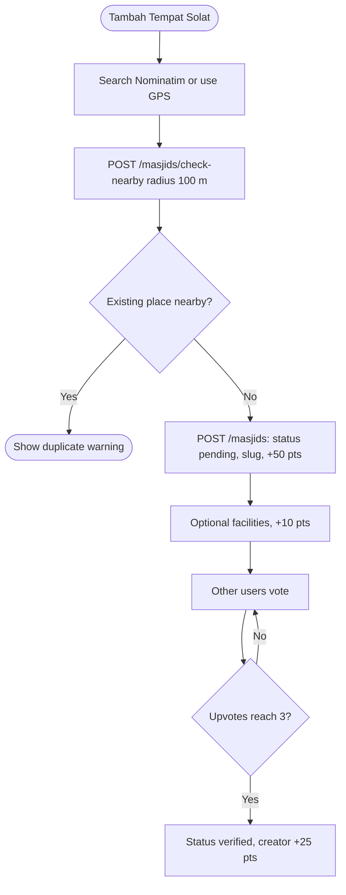

### Points & Tiers

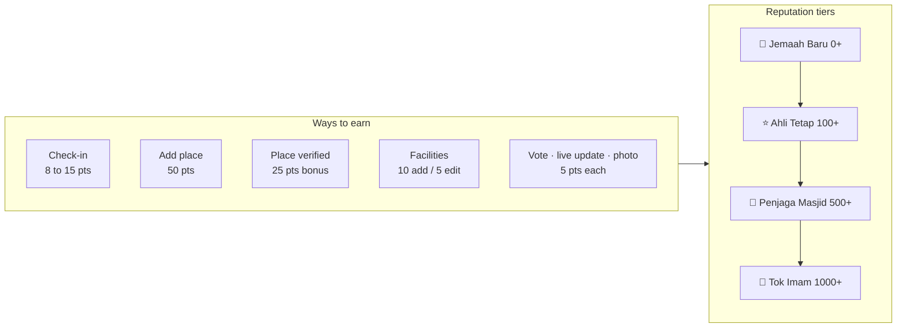

### Role & Permission Matrix

| Action | Guest | User | Owner of listing | Admin |
|---|---|---|---|---|
| Browse, map, detail, boards | ✅ | ✅ | ✅ | ✅ |
| Check-in, vote, live update, bookmark | ❌ | ✅ | ✅ *(no self-vote)* | ✅ |
| Add / edit facilities | ❌ | ✅ | ✅ | ✅ |
| Upload photos | ❌ | ✅ *(max 3 per masjid)* | ✅ | ✅ |
| Submit QR code | ❌ | 30+ reputation | 30+ reputation | ✅ |
| Edit / delete masjid | ❌ | ❌ | ✅ | ✅ |
| Review reports, QR, feedback | ❌ | ❌ | ❌ | ✅ |

---

## ☁️ Deployment

> **Status:** the public deployment (`singgahluhh.vercel.app`) is currently offline, and Vercel returns `DEPLOYMENT_NOT_FOUND`. The table below describes how the app is set up to deploy.

| Piece | Platform | Notes |
|---|---|---|
| Frontend | Vercel | SPA rewrite to `index.html`, PWA assets |
| Backend | Google Cloud Run | Built and deployed through `cloudbuild.yaml` (Artifact Registry → `gcloud run deploy`) |
| Database / Auth / Storage | Supabase | Postgres + PostGIS, Auth with email OTP, `masjid-media` bucket |
| Self-host option | Docker Compose | `docker-compose.prod.yml`: nginx-served frontend proxying `/api` to the backend |

---

## 📁 Project Structure

```
SinggahLuhh/
├── docker-compose.yml            Dev: backend + Vite frontend
├── docker-compose.prod.yml       Prod: nginx frontend + backend
├── cloudbuild.yaml               Cloud Build → Cloud Run
│
├── backend/
│   ├── Dockerfile
│   ├── supabase_schema.sql       Core tables, RLS, triggers, PostGIS helpers
│   ├── supabase_migrations_*.sql v2 RPCs, v3 gender + badges, slug
│   ├── feedback_table.sql
│   └── app/
│       ├── main.py               FastAPI app, CORS, /health
│       ├── core/                 config, supabase clients, auth deps
│       ├── schemas/              Pydantic models (CamelModel base)
│       └── api/v1/endpoints/     auth, masjids, checkin, verification,
│                                 live_updates, facilities, dashboard,
│                                 bookmarks, diary, khatam, special_prayers,
│                                 events, announcements, lost_found, iftar,
│                                 trending, prayer_groups, profile, feedback
│
└── frontend/
    ├── vite.config.ts            React SWC + VitePWA
    ├── nginx.conf · Dockerfile   Multi-stage dev / prod
    └── src/
        ├── pages/                19 route pages
        ├── components/           Header, Footer, MasjidCard, InstallPrompt,
        │                         FeedbackButton, ui/ (shadcn)
        ├── contexts/             AuthContext
        ├── lib/                  api.ts, supabase.ts, constants.ts, utils.ts
        └── types/                Shared TypeScript types
```

---

## 🗺 Roadmap

- [x] Browse, search, facility filters and map view
- [x] Add place with 100 m duplicate guard
- [x] GPS check-in with PostGIS geofence + Musafir mode
- [x] Reputation, streaks, badges, tiers, leaderboard
- [x] Community verification (3 upvotes)
- [x] Live updates with auto-expiry
- [x] Photo upload + admin-moderated QR codes
- [x] Announcements, events, lost & found, iftar thread
- [x] Bookmarks, private notes, Khatam + sunat prayer log
- [x] Prayer groups with invite codes
- [x] Weekly trending
- [x] PWA install + notifications
- [ ] Wire the v3 badge set into the check-in rules
- [ ] Sort by distance from the user's location
- [ ] Ramadan mode (terawih tracker, iftar map)
- [ ] Admin analytics for masjid committees
- [ ] Multi-language UI

---

## 📄 License

MIT © 2026 Siti Nursyaqirah · Luhh Series · Source on [GitHub](https://github.com/snsyaqirah/SinggahLuhh)
