# 📦 StockLuhh

> A smart household inventory tracker: low-stock alerts, expiry reminders, an auto-built shopping list, travel packing kits and spending analytics, all in RM.


---

## 📖 Table of Contents

- [Overview](#-overview)
- [Features](#-features)
- [Tech Stack](#-tech-stack)
- [Architecture](#-architecture)
- [User Flow](#-user-flow)
- [Database](#-database-erd)
- [API Structure](#-api-structure)
- [Frontend Components](#-frontend-components)
- [Feature Flows](#-feature-specific-flows)
- [Deployment](#-deployment)
- [Project Structure](#-project-structure)
- [Roadmap](#-roadmap)
- [License](#-license)

---

## 🧭 Overview

StockLuhh is a personal stock manager for the stuff you keep at home: toiletries, skincare, groceries, cleaning supplies, medicine and so on. It answers the everyday questions: *"Ada lagi tak shampoo?"*, *"Apa yang dah nak expired?"* and *"What do I need to buy this weekend?"*

Each item tracks its quantity, low-stock threshold, price, purchase/opened/expiry dates and a usage history. From those, the app works out:

- a **shopping list** of everything running low or finished,
- an **expiry tracker** that sorts items into expired / this week / within 30 days,
- **smart suggestions**: rule-based nudges such as "you'll finish this in ~4 days" or "this expires in 2 days",
- **travel kits** generated from items you've marked as travel essentials,
- **analytics**: a monthly report, a waste-based "health score" and spending by category.

The project started as **Stockee**, a Vite + React SPA. It was later migrated to **Next.js App Router** with **Route Handlers** as the API and **Drizzle ORM on Neon Postgres** for storage, and renamed StockLuhh.

**Type:** `Solo`
**Brand:** `Luhh Series`
**Built with:** Independent

---

## ✨ Features

- ✅ Dashboard with stat cards: total items/units, low stock, expiring within 30 days, inventory value (RM)
- ✅ Smart Suggestions: usage prediction, low stock, expiring within 14 days, and same-category substitutes when an item is finished
- ✅ Inventory CRUD with search and a 10-category filter (toiletries, skincare, haircare, dental, cleaning, grocery, snacks, beverages, medicine, other)
- ✅ Inline `+` / `−` quantity stepper that sets the status for you (`new` → `in-use` → `low` → `finished`)
- ✅ One-tap usage logging (**Used Once / Half / Finished**) that writes to the item's usage history and recalculates average lifespan
- ✅ Undo for the last edit or delete (keeps up to 10 entries, best effort)
- ✅ Shopping list built from low and finished items, with a check-off progress bar, estimated total (RM) and batch restock
- ✅ Expiry tracker grouped as Expired / Expiring This Week / Coming Up, with Discard and Used actions
- ✅ Travel Mode: mark travel essentials, auto-generate a kit from essentials that are in stock, tick items off as you pack
- ✅ Wishlist with priority, estimated price, star rating and notes; **Buy** moves the item into inventory
- ✅ Analytics: monthly report (bought / used / expired / health score), status pie chart, category spending donut and bar chart
- ✅ Neumorphic design system with a light/dark theme toggle
- ✅ Mobile-first shell: bottom nav, a "More" menu, and a floating action button with long-press quick actions
- ✅ Installable PWA manifest with Add Item and Shopping List shortcuts, plus an offline-status banner
- 🚧 Simple / Smart / Power **app modes**: the selector saves to localStorage, but pages aren't gated yet and the auto-upgrade logic is never called
- 🚧 Shopping list **Share** button *(UI only, no handler)*
- 🚧 FAB and manifest "Add Item" shortcut go to `/inventory?action=add`, but the page doesn't read the param yet
- 🚧 Offline caching: the old Vite build had a service worker; the Next.js build has none yet (`offline.html` exists but isn't wired up)
- 🚧 Cross-category substitution groups (`smart-substitutions.ts`) are written but not used in the UI
- 💡 User accounts and per-household inventories *(right now everyone shares one inventory)*
- 💡 Household sharing between family members
- 💡 Proper history/versioning instead of best-effort undo

---

## 🛠 Tech Stack

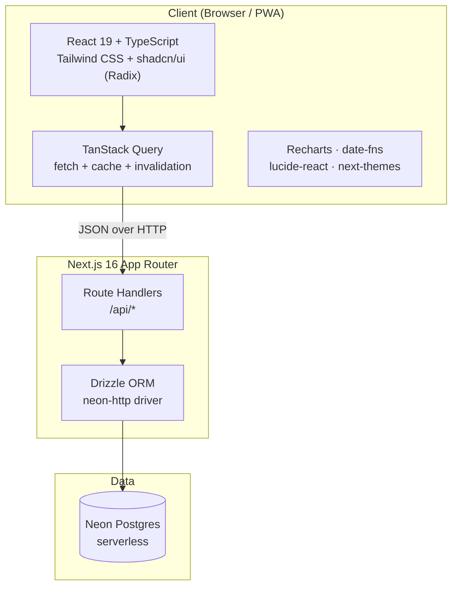

| Layer | Technology |
|---|---|
| Framework | Next.js 16 (App Router), React 19, TypeScript |
| API | Next.js Route Handlers (`app/api/**/route.ts`) |
| ORM | Drizzle ORM 0.45 + drizzle-kit (`db:push`, `db:generate`, `db:studio`) |
| Database | Neon serverless Postgres (`@neondatabase/serverless`, `drizzle-orm/neon-http`) |
| Client data | TanStack React Query v5 (5-min stale time, invalidation on mutation) |
| UI | Tailwind CSS 3 + shadcn/ui (Radix primitives), custom neumorphic shadows |
| Charts | Recharts (pie, donut, horizontal bar) |
| Dates | date-fns |
| Theming | next-themes (light / dark) |
| Toasts | shadcn toast + Sonner |
| PWA | `app/manifest.ts` (installable, shortcuts) |
| Hosting | Vercel |

---

## 📌 Architecture

### High-level Architecture

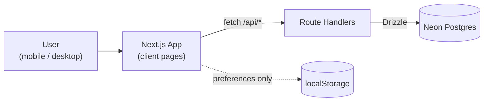

All inventory data lives in Postgres. `localStorage` only holds client preferences such as the app mode and theme.

### System Architecture

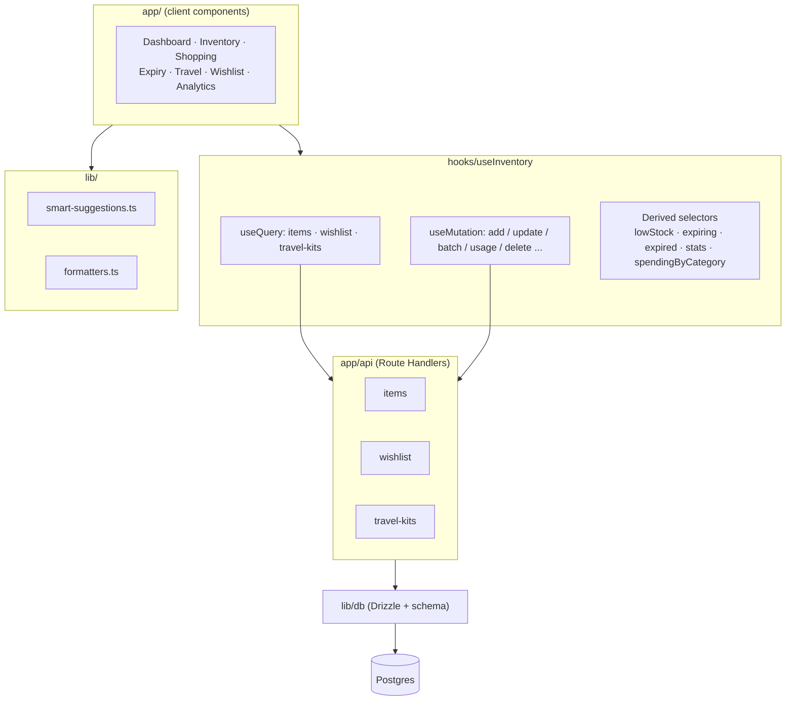

Everything goes through a single hook, `useInventory`. It runs three queries, exposes the mutations, and computes the derived lists (low stock, expiring, travel essentials, stats) with `useMemo`. Every page reads from the same React Query cache, so a mutation followed by an invalidation updates the whole app.

---

## 👤 User Flow

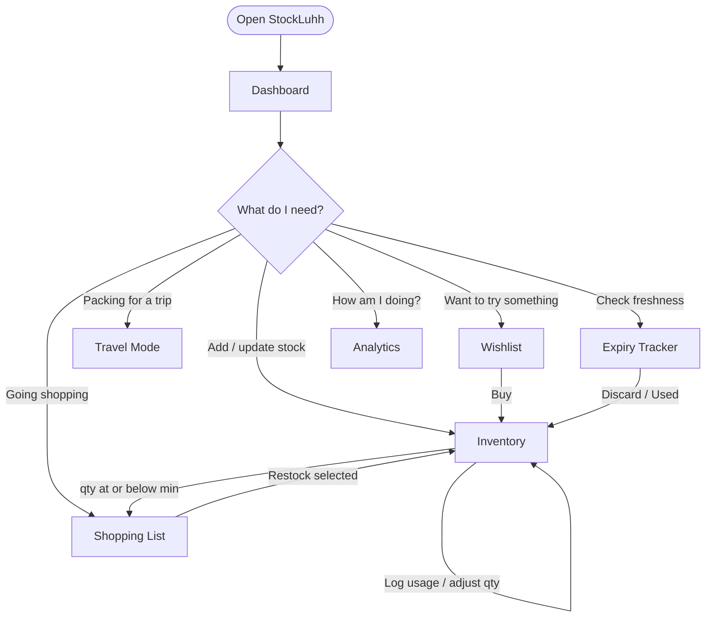

### Page Map

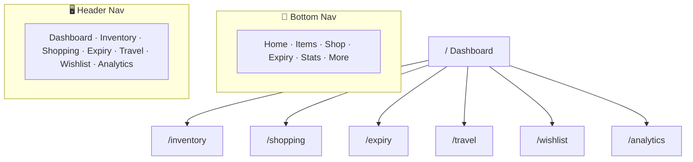

> 🔓 **No auth yet.** There are no login or protected routes; everyone who opens a deployment shares one inventory. Accounts and household sharing are on the roadmap.

---

## 🗄️ Database (ERD)

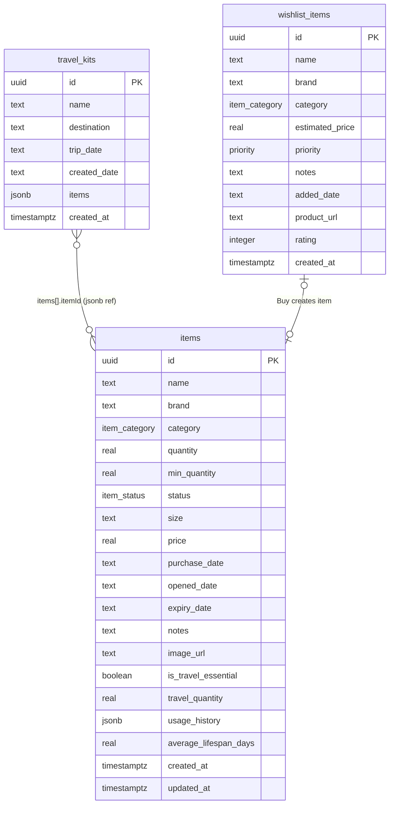

### Enums

| Enum | Values |
|---|---|
| `item_category` | toiletries, skincare, haircare, dental, cleaning, grocery, snacks, beverages, medicine, other |
| `item_status` | new, in-use, low, finished |
| `priority` | low, medium, high |

### JSONB shapes

| Column | Shape |
|---|---|
| `items.usage_history` | `UsageRecord[]`: `{ id, action: once / half / daily / finished / opened / restocked, date, quantityUsed? }` |
| `travel_kits.items` | `TravelKitItem[]`: `{ itemId, itemName, category, quantity, packed }` |

> Dates such as `purchase_date` and `expiry_date` are stored as ISO `YYYY-MM-DD` text. Travel kit items are a denormalised JSONB snapshot rather than a join table, which keeps toggling "packed" to a single-row update.

---

## 🔌 API Structure

### API Overview

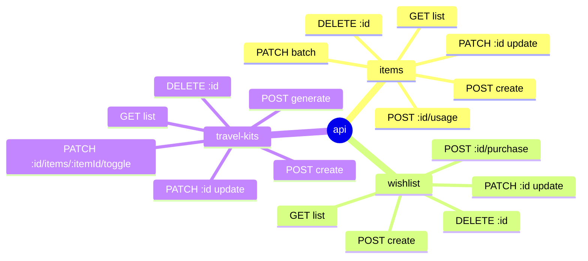

| Method | Route | What it does |
|---|---|---|
| `GET` | `/api/items` | List all items (newest first) |
| `POST` | `/api/items` | Create an item |
| `PATCH` | `/api/items/:id` | Partial update (bumps `updated_at`) |
| `DELETE` | `/api/items/:id` | Delete an item |
| `POST` | `/api/items/:id/usage` | Log usage `{ type: once / half / daily / finished }`, recalculate qty, status and average lifespan |
| `PATCH` | `/api/items/batch` | Apply `[{ id, changes }]` in parallel (used by Restock Selected) |
| `GET` / `POST` | `/api/wishlist` | List / add wishlist items |
| `PATCH` / `DELETE` | `/api/wishlist/:id` | Update / remove a wishlist item |
| `POST` | `/api/wishlist/:id/purchase` | Insert as an inventory item (qty 1, status `new`) and delete from the wishlist |
| `GET` / `POST` | `/api/travel-kits` | List / create kits |
| `POST` | `/api/travel-kits/generate` | Build a kit from every travel essential with `quantity > 0` |
| `PATCH` / `DELETE` | `/api/travel-kits/:id` | Update / delete a kit |
| `PATCH` | `/api/travel-kits/:id/items/:itemId/toggle` | Flip `packed` on one kit item |

### Request/Response Flow

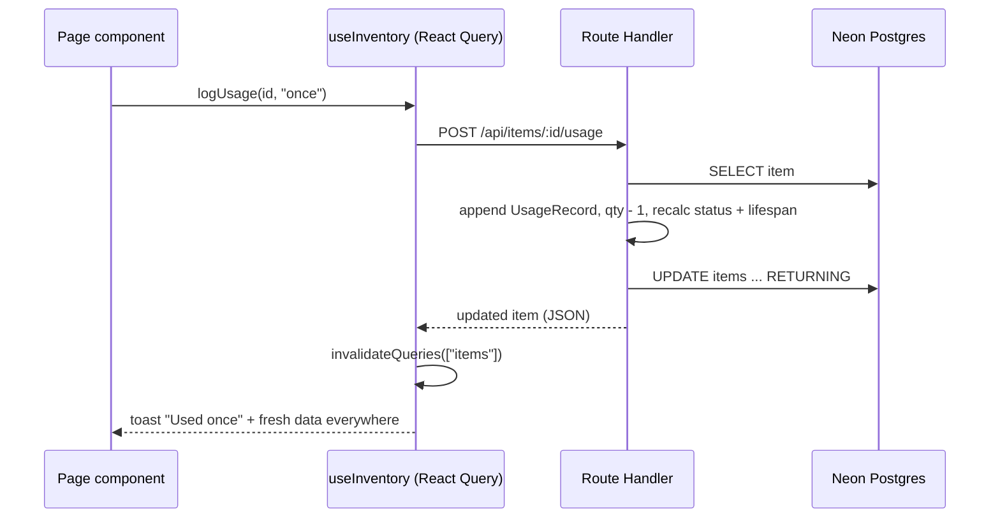

---

## 🧩 Frontend Components

### Component Tree

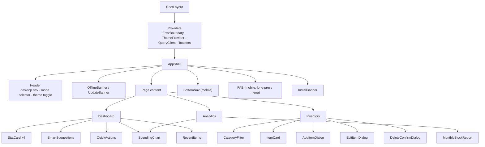

### Key Components & Hooks

| Component / Hook | Purpose |
|---|---|
| `useInventory` | Single source of truth: queries, mutations, undo stack, derived selectors |
| `ItemCard` | Item tile with status badges, qty stepper, usage buttons, expiry highlight, actions menu |
| `AddItemDialog` / `EditItemDialog` | Item forms (category, status, qty, low-stock alert, size, price, expiry, notes, travel essential) |
| `SmartSuggestions` | Shows the top 3 rule-based suggestions, each dismissible |
| `MonthlyStockReport` | 30-day summary: bought, used, expired waste and health score |
| `SpendingChart` | Recharts donut of inventory value by category |
| `StatusBadge` / `CategoryIcon` | Colour-coded status pills and category icons |
| `FAB` | Mobile floating button: tap to add, long-press for Shopping / Travel / Expiry |
| `useUserPreferences` | Simple / Smart / Power mode in localStorage (gating not wired yet) |
| `useOnlineStatus` / `usePWA` | Offline banner, install prompt, update detection |

---

## ⚙️ Feature-specific Flows

### Usage Logging & Status Logic

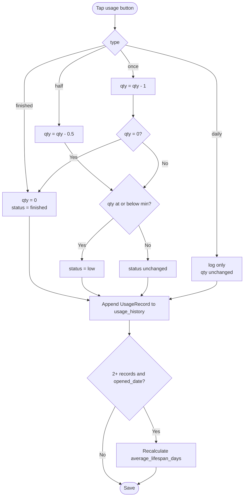

### Smart Suggestions Engine

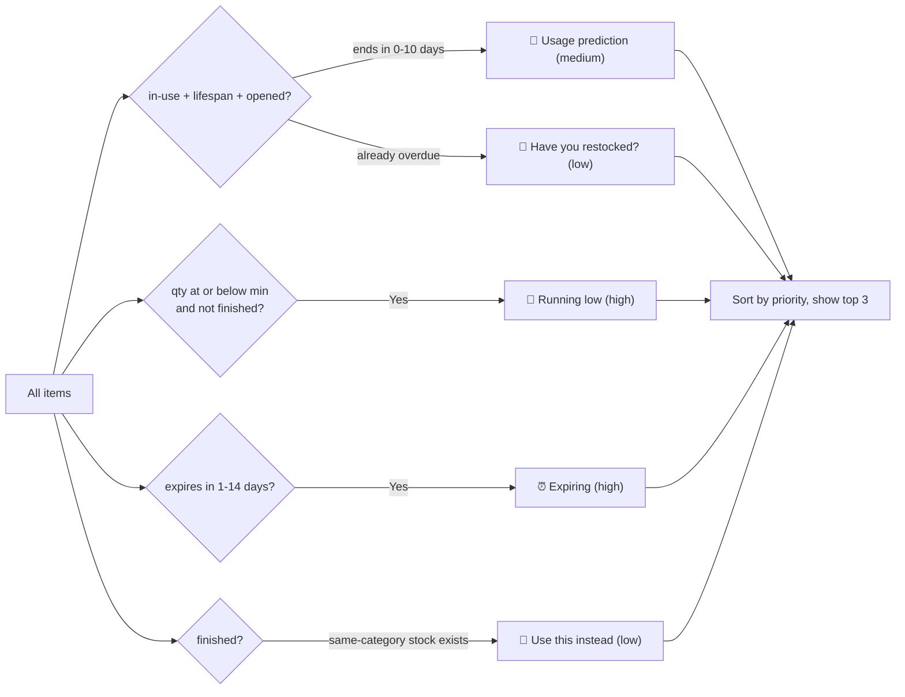

### Shopping List → Restock

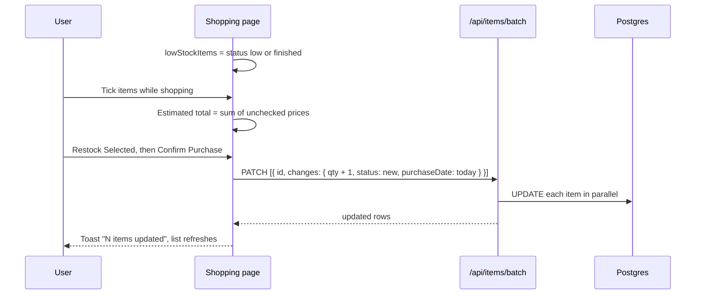

### Travel Kit Generation

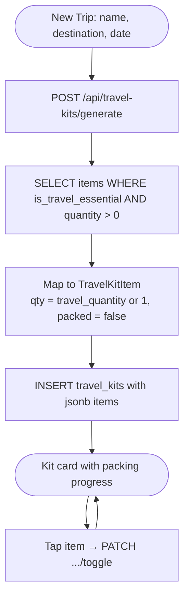

### Expiry Buckets

| Bucket | Rule | Actions |
|---|---|---|
| 🔴 Expired | `expiry_date < today` | Discard (delete) · Used (qty 0, finished) |
| 🟠 Expiring This Week | 0–7 days left | Item card with "N days left" badge |
| 🟢 Coming Up | 8–30 days left | Item card |

### Monthly Report & Health Score

| Metric | How it's computed |
|---|---|
| Items Bought | Items with `purchase_date` in the last 30 days (and their RM spend) |
| Items Used | Items with status `finished` |
| Expired | Items past `expiry_date`, with their price counted as waste |
| Health Score | `100 − (waste ÷ total inventory value × 100)`, clamped to 0–100 |

---

## ☁️ Deployment

| Service | Platform | Purpose |
|---|---|---|
| App + API | Vercel | Next.js pages and Route Handlers |
| Database | Neon | Serverless Postgres (HTTP driver) |

Live: [stockluhh-six.vercel.app](https://stockluhh-six.vercel.app)

---

## 📁 Project Structure

```
StockLuhh/
├── app/
│   ├── layout.tsx            Root layout, metadata, viewport
│   ├── providers.tsx         React Query, theme, toasts, error boundary
│   ├── manifest.ts           PWA manifest + shortcuts
│   ├── page.tsx              Dashboard
│   ├── inventory/            Inventory page
│   ├── shopping/             Shopping list
│   ├── expiry/               Expiry tracker
│   ├── travel/               Travel mode
│   ├── wishlist/             Wishlist
│   ├── analytics/            Analytics
│   └── api/
│       ├── items/            route.ts · [id]/ · [id]/usage/ · batch/
│       ├── wishlist/         route.ts · [id]/ · [id]/purchase/
│       └── travel-kits/      route.ts · [id]/ · generate/ · [id]/items/[itemId]/toggle/
├── components/
│   ├── dashboard/            StatCard, SmartSuggestions, QuickActions, RecentItems, MonthlyReport
│   ├── inventory/            ItemCard, Add/Edit/Delete dialogs, CategoryFilter, StatusBadge
│   ├── charts/               SpendingChart
│   ├── layout/               AppShell, Header, BottomNav
│   ├── common/               FAB, banners, ErrorBoundary, EmptyState, Loading
│   └── ui/                   shadcn/ui primitives
├── hooks/                    useInventory, useUserPreferences, usePWA, useOnlineStatus ...
├── lib/
│   ├── db/                   schema.ts, index.ts (Drizzle client), seed.ts
│   ├── smart-suggestions.ts  Rule-based suggestion engine
│   ├── smart-substitutions.ts
│   ├── formatters.ts         Dates (ms-MY), RM currency, days-until helpers
│   └── constants.ts          App config, nav items, default settings
├── types/                    InventoryItem, WishlistItem, TravelKit, categories
└── drizzle.config.ts
```

---

## 🗺 Roadmap

- [x] Inventory CRUD with categories, search and status auto-calculation
- [x] Usage logging with history and lifespan estimate
- [x] Auto shopping list + batch restock
- [x] Expiry tracker (expired / 7-day / 30-day)
- [x] Travel essentials + generated packing kits
- [x] Wishlist → inventory "Buy" flow
- [x] Analytics + monthly report + health score
- [x] Rule-based smart suggestions
- [x] Migration from Vite SPA (Stockee) to Next.js + Drizzle + Neon
- [ ] Wire up Simple / Smart / Power mode gating and auto-upgrade
- [ ] `?action=add` deep link (FAB + PWA shortcut opens Add Item)
- [ ] Shopping list sharing
- [ ] Service worker / offline caching on Next.js
- [ ] User accounts + per-household inventories
- [ ] Household sharing between family members
- [ ] Proper change history instead of best-effort undo

---

## 📄 License

No license file yet. © 2025–2026 Siti Nursyaqirah. All rights reserved.
