# 🏠 SurveyLuhh

> A collaborative property scraper for Malaysian house hunters. Paste a listing link, get every detail pulled into one shared board, shortlist with your house-hunting squad, then let a bracket tournament settle which unit wins.


---

## 📖 Table of Contents

- [Overview](#-overview)
- [Features](#-features)
- [Tech Stack](#-tech-stack)
- [Architecture](#-architecture)
- [User Flow](#-user-flow)
- [Auth Flow](#-auth--session-flow)
- [Database](#-database-erd)
- [API Structure](#-api-structure)
- [Frontend Components](#-frontend-components)
- [Feature Flows](#-feature-specific-flows)
- [Deployment](#-deployment)
- [Project Structure](#-project-structure)
- [Roadmap](#-roadmap)
- [License](#-license)

---

## 🧭 Overview

House hunting with friends usually means a WhatsApp group full of screenshots, half-copied listing details and "eh which one was the one near the LRT ah?". SurveyLuhh puts all of that in one place. Someone starts a session and shares the link. Each person picks a nickname, pastes listing URLs, and the backend scrapes the title, price, size, rooms, photos, facilities, nearby places and agent contact into a shared board.

From there the squad shortlists or rejects units, opens a printable detail view, or WhatsApps the agent in one tap. When it's time to decide, each person runs a head-to-head **bracket tournament**, and the app shows whose winner matches whose.

There are no accounts. A session is a UUID link, and the session (with everything in it) is deleted automatically by a MongoDB TTL index 30 days after it was created. In the last week before expiry it can be extended, up to 3 times.

**Type:** `Solo`
**Brand:** `Luhh Series`
**Built with:** Independent

---

## ✨ Features

- ✅ One-click start: the landing page generates a session UUID and the hunt URL is the share link
- ✅ Nickname join modal with consent checkbox; pick an existing member name or enter a new one
- ✅ Per-member token (random UUID, stored as a SHA-256 hash) that protects each member's bracket vote
- ✅ Scrape **Mudah.my** listings: title, price (with `/month` detection for rentals), sqft, beds, baths, parking, up to 20 photos, facilities, nearby places, agent name / phone / agency, description
- ✅ Fetch pipeline: `curl_cffi` with Chrome TLS impersonation and a homepage warm-up, then a headless Chrome fallback on 403 / 429 / 503
- ✅ Parsing pipeline: `__NEXT_DATA__` JSON first, BeautifulSoup DOM selectors as fallback
- ✅ reCAPTCHA v3 gate on scraping (score ≥ 0.5), a domain allow-list, and a 20-property cap per session
- ✅ Split-view board: property list with source / status / "added by" badges and a detail panel with gallery and lightbox
- ✅ Swipe right to shortlist, swipe left to reject (touch and mouse)
- ✅ Per-device favourites (heart), saved in localStorage
- ✅ One-tap WhatsApp-the-agent link with a prefilled message
- ✅ Print / save-as-PDF detail view (print stylesheet expands every section)
- ✅ Share panel with member list, online dots (active in the last hour) and copy-link button
- ✅ Bracket tournament: start with all properties or only your hearted ones, BYE slots for odd counts, a hover tooltip with beds / baths / sqft, confetti, and a comparison with friends' winners
- ✅ Bracket progress saved per member in localStorage, so a refresh doesn't lose your picks
- ✅ Expiry countdown in the navbar, plus an extend banner (+7 or +30 days) in the final week, max 3 extensions
- ✅ Floating anonymous feedback button (bug / enhancement / general / testimonial)
- ✅ Public feedback board showing replies the admin chose to publish
- ✅ Token-gated `/admin` panel: unread count, reply, mark public
- ✅ Changelog and privacy policy pages (PDPA-style disclosure of what gets stored)
- ✅ Security headers and a per-request nonce CSP on the frontend, security headers and rate limits (slowapi) on the backend
- ✅ Weekly GitHub Actions backup of MongoDB, AES-256 encrypted before upload
- ✅ Sentry error monitoring on backend and frontend server
- 🚧 **PropertyGuru** scraper (undetected-chromedriver under Xvfb). The code exists, but Cloudflare blocks it from the server, so the UI only accepts Mudah links for now
- 🚧 **iProperty** scraper (Next.js `/_next/data` JSON endpoint, then HTML). The code exists, but Akamai blocks it, so it's disabled in the UI too
- 🚧 Live sync: members and bracket results are polled every 30 s. The property list itself only reloads on page load
- 💡 WebSocket / SSE real-time updates
- 💡 Side-by-side comparison table
- 💡 Per-member shortlist votes (status is currently one shared value per property)
- 💡 Price history and re-scrape

---

## 🛠 Tech Stack

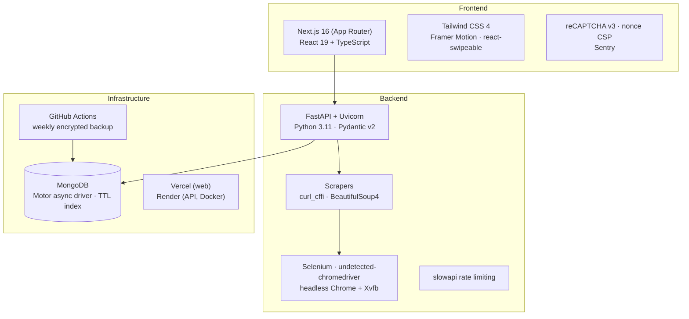

| Layer | Technology |
|---|---|
| Frontend | Next.js 16 (App Router, Turbopack) · React 19 · TypeScript |
| Styling / UI | Tailwind CSS 4 · Framer Motion · react-swipeable · Geist font |
| Bot protection | Google reCAPTCHA v3 (`react-google-recaptcha-v3`) |
| Backend | FastAPI 0.115 · Uvicorn · Pydantic v2 · Python 3.11 |
| Database | MongoDB (Atlas in production) via Motor async driver |
| Scraping | curl_cffi (Chrome TLS impersonation) · BeautifulSoup4 · Selenium 4 · undetected-chromedriver |
| Rate limiting | slowapi (5 req/min default, per-route overrides) |
| Monitoring | Sentry (`sentry-sdk[fastapi]`, `@sentry/nextjs`) |
| Containers | Docker (Python slim + Google Chrome + Xvfb) · Docker Compose for local dev |
| CI / Ops | GitHub Actions weekly pymongo JSON export, OpenSSL AES-256 encrypted |
| Hosting | Vercel (frontend) · Render (API) |

---

## 📌 Architecture

### High-level Architecture

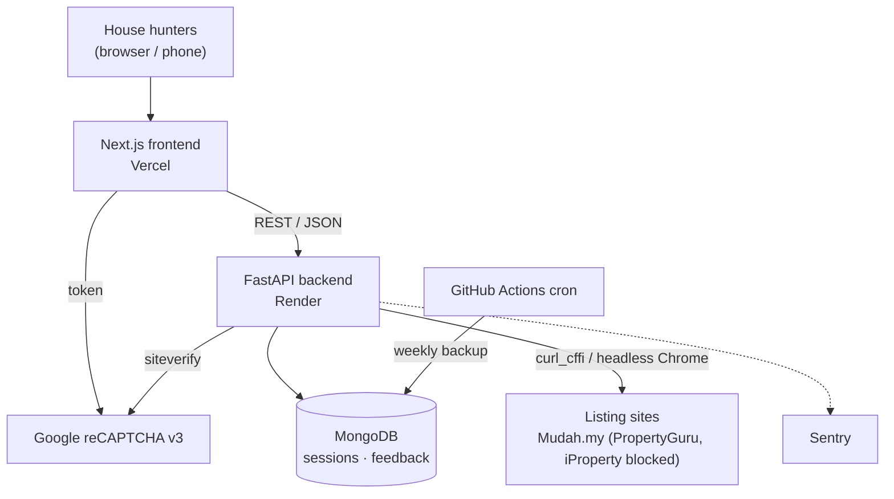

### System Architecture

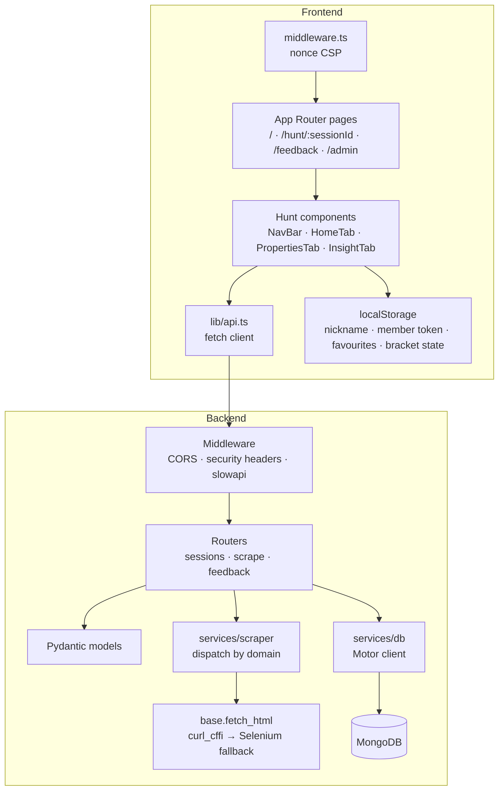

---

## 👤 User Flow

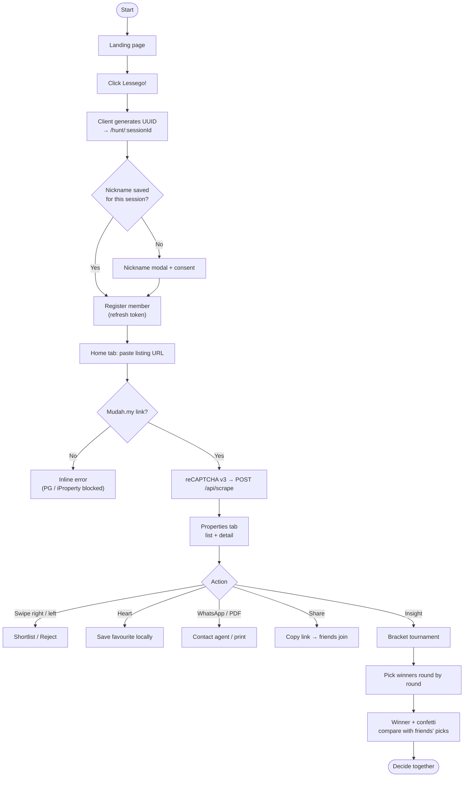

### Page Map

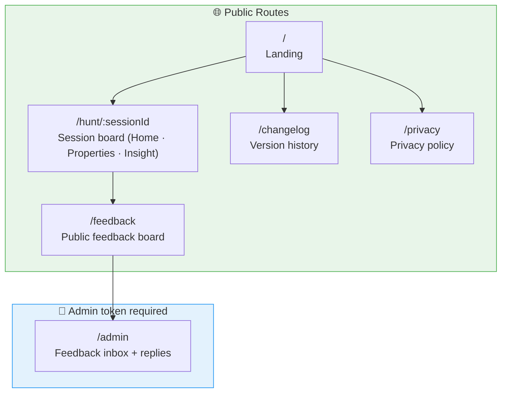

---

## 🔐 Auth & Session Flow

SurveyLuhh has no user accounts. Access works like this:

- **Session link.** Anyone who has the session UUID can view it and add to it.
- **Member token.** Proves "I am this nickname" when saving a bracket result.
- **reCAPTCHA v3.** Gates the expensive scrape endpoint.
- **Bearer admin token.** Protects the feedback inbox and admin session tools.

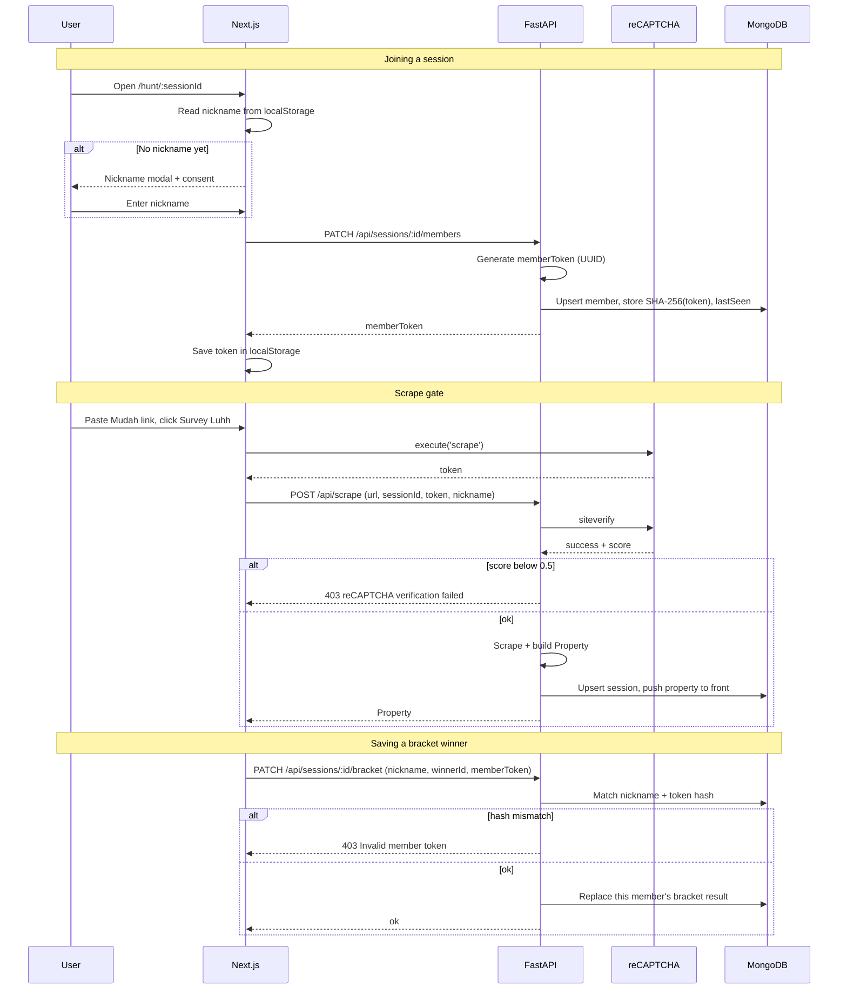

### Admin Access

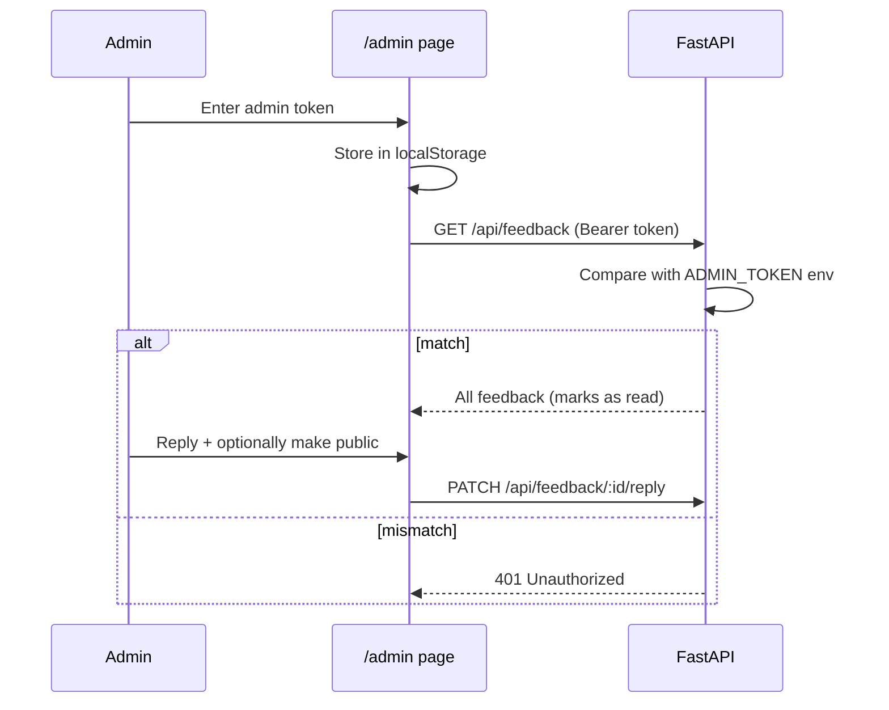

---

## 🗄️ Database (ERD)

MongoDB with two collections. A session is a single document, and its properties, members and bracket results are embedded arrays. The diagram below shows the embedded arrays as separate entities so the relationships are easier to see.

### Core ERD

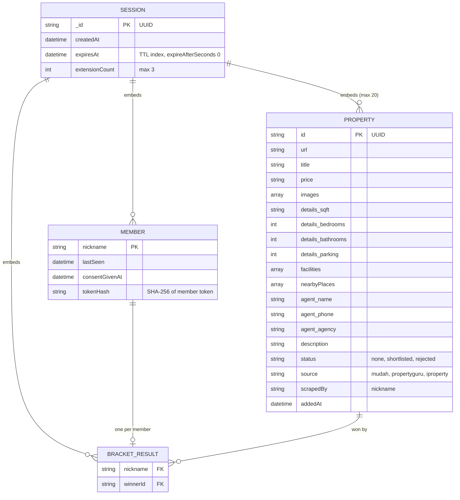

### Feature ERD

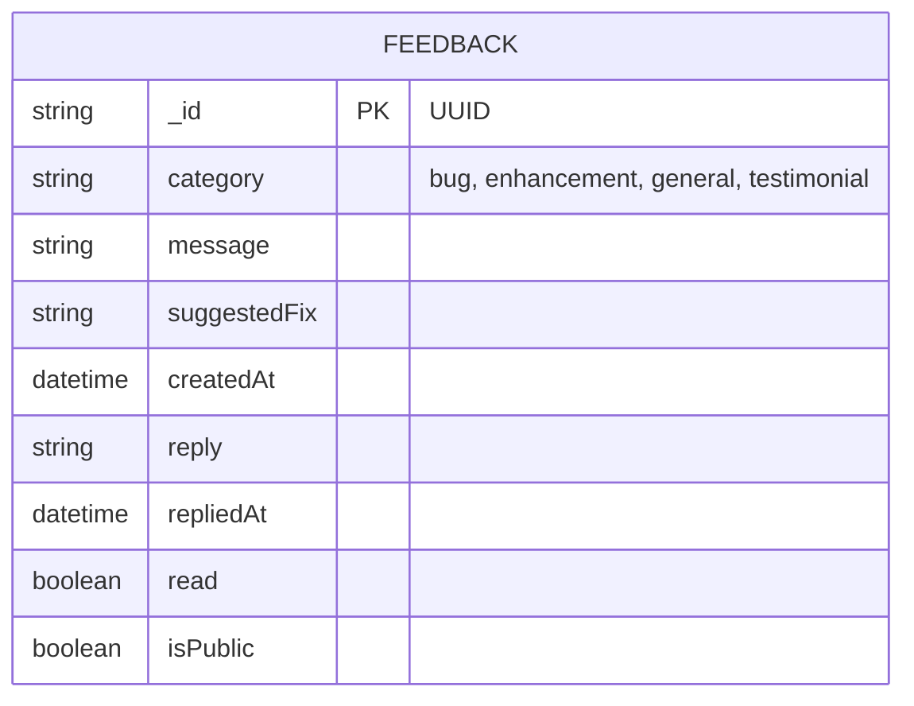

### Database Schema Overview

| Collection / field | Purpose | Notes |
|---|---|---|
| `sessions` | One document per hunt session | `_id` is the UUID in the URL |
| `sessions.expiresAt` | Auto-delete time | TTL index created on startup; legacy `createdAt` TTL index is dropped |
| `sessions.properties[]` | Scraped listings | Newest pushed to position 0, capped at 20 |
| `sessions.members[]` | Nicknames in the session | `tokenHash` + `lastSeen` for presence |
| `sessions.bracketResults[]` | Each member's tournament winner | One entry per nickname (pull then push) |
| `feedback` | Anonymous feedback + admin replies | Shown publicly only if `isPublic` and replied |

---

## 🔌 API Structure

### API Overview

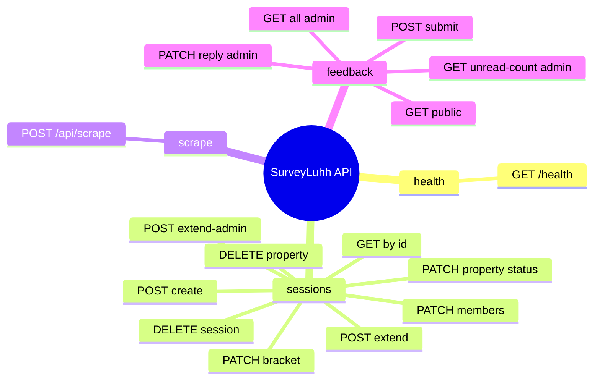

| Group | Endpoint | Guard / limit |
|---|---|---|
| Health | `GET /health` | default 5/min |
| Sessions | `POST /api/sessions` | 10/min |
| | `GET /api/sessions/:id` · `DELETE /api/sessions/:id` | session UUID |
| | `PATCH /api/sessions/:id/properties/:propId` (status) · `DELETE .../:propId` | session UUID |
| | `PATCH /api/sessions/:id/members` | 20/min, returns member token |
| | `PATCH /api/sessions/:id/bracket` | 30/min, member token |
| | `POST /api/sessions/:id/extend` (7 or 30 days) | 10/hour, last 7 days only, max 3 |
| | `POST /api/sessions/:id/extend-admin` | Bearer admin token |
| Scrape | `POST /api/scrape` | 10/min, reCAPTCHA v3, domain allow-list, 20-property cap |
| Feedback | `POST /api/feedback` | 5/min |
| | `GET /api/feedback/public` | 30/min |
| | `GET /api/feedback` · `GET /api/feedback/unread-count` · `PATCH /api/feedback/:id/reply` | Bearer admin token, 3/min |

### Request/Response Flow

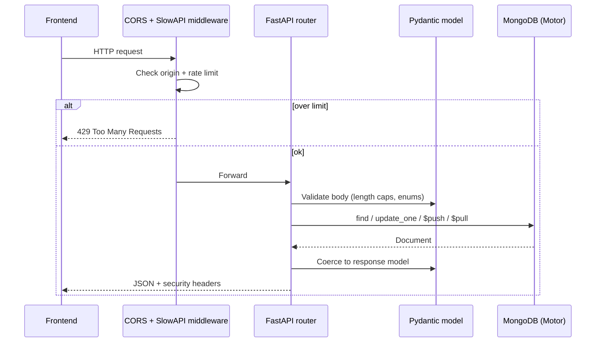

---

## 🧩 Frontend Components

### Component Tree

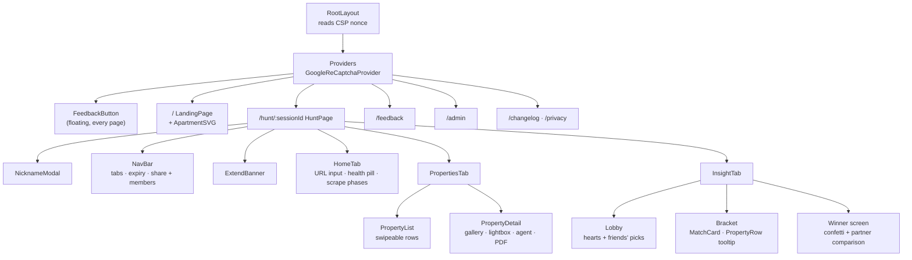

### Key Components

| Component | Purpose |
|---|---|
| `HuntPage` | Owns session state, nickname/member token, 30 s polling of members and bracket results, and the tab switch |
| `NavBar` | Tabs, expiry countdown tooltip, share panel with member list and online dots, copy-link |
| `ExtendBanner` | Shows in the last 7 days: +1 week / +1 month, tracks remaining extensions |
| `HomeTab` | URL validation, supported-site chips, backend wake-up pill (handles Render cold starts), reCAPTCHA + scrape with phase messages |
| `PropertyList` | Rows with thumbnail, price, source / status / added-by badges; swipe right = shortlist, left = reject |
| `PropertyDetail` | Gallery + lightbox, details grid, facilities and nearby, description "read more", agent card with WhatsApp deep link, heart, PDF, delete |
| `InsightTab` | Tournament lobby, bracket builder (power-of-2 with BYEs), round progression, winner screen, friends' picks |
| `NicknameModal` | Join flow with existing-member chips and privacy consent |
| `FeedbackButton` | Category-aware feedback form (bugs get a "suggested fix" field) |
| `middleware.ts` | Generates a per-request nonce and sets a strict CSP |

---

## ⚙️ Feature-specific Flows

### Scraping Pipeline

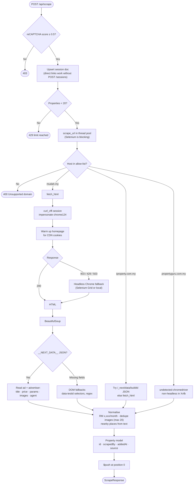

> **Why only Mudah in the UI?** PropertyGuru sits behind Cloudflare and iProperty behind Akamai. Both scrapers are still in the codebase (stealth Chrome, Next.js data endpoint), but they don't work reliably from a cloud IP, so the frontend only accepts Mudah links and labels the other two as blocked.

### Bracket Tournament

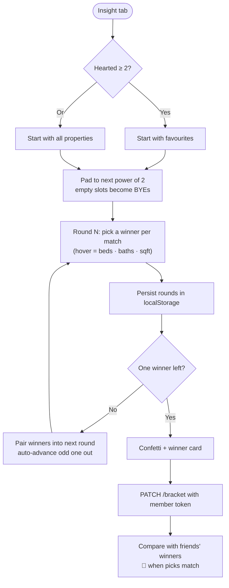

### Session Lifecycle

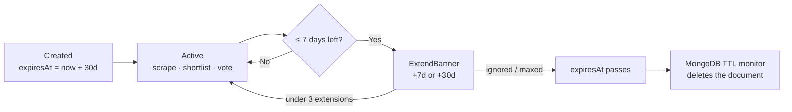

### Feedback Loop

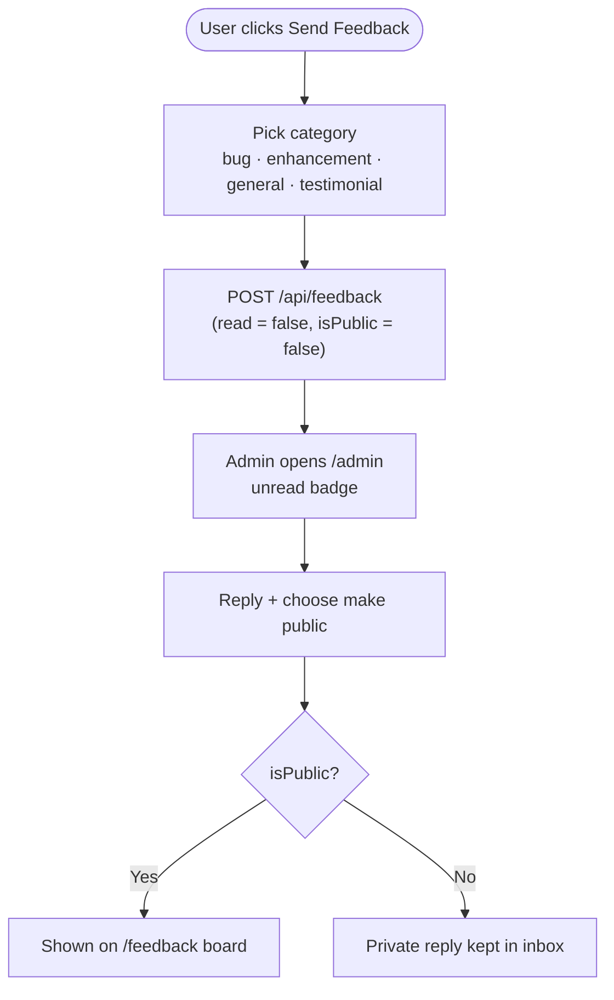

---

## 🚀 Deployment

| Piece | Where |
|---|---|
| Frontend | Vercel: [surveyluhh.vercel.app](https://surveyluhh.vercel.app/) |
| Backend API | Render (Docker image with Google Chrome + Xvfb for the Selenium fallback) |
| Database | MongoDB Atlas, with the `expiresAt` TTL index set up on API startup |
| Backups | GitHub Actions cron every Sunday 02:00 UTC, JSON export encrypted with AES-256-CBC (PBKDF2), kept 90 days as a workflow artifact |
| Monitoring | Sentry (backend + Next.js server) |

---

## 📁 Project Structure

```
SurveyLuhh/
├── docker-compose.yml          MongoDB + Selenium Chrome + API + frontend (local dev)
├── .github/workflows/
│   └── backup.yml              Weekly encrypted MongoDB backup
│
├── backend/
│   ├── Dockerfile              python:3.11-slim + Google Chrome + Xvfb
│   ├── main.py                 FastAPI app, CORS, security headers, TTL index setup
│   ├── limiter.py              slowapi limiter (5/min default)
│   ├── backup.py               Export sessions + feedback to JSON
│   ├── models/
│   │   ├── property.py         Session, Property, Member, BracketResult, requests
│   │   └── feedback.py         Feedback models + categories
│   ├── routers/
│   │   ├── sessions.py         Sessions, members, status, bracket, extend
│   │   ├── scrape.py           reCAPTCHA check, cap, scrape + persist
│   │   └── feedback.py         Submit, public board, admin inbox / reply
│   └── services/
│       ├── db.py               Motor client + collection helpers
│       └── scraper/
│           ├── __init__.py     Domain allow-list + dispatch
│           ├── base.py         curl_cffi fetch, Selenium + stealth drivers
│           ├── mudah.py        Mudah.my parser
│           ├── iproperty.py    iProperty parser (Next.js data endpoint)
│           └── propertyguru.py PropertyGuru parser (stealth Chrome)
│
└── frontend/
    ├── middleware.ts           Per-request nonce CSP
    ├── next.config.ts          Security headers
    ├── app/
    │   ├── page.tsx            Landing
    │   ├── hunt/[sessionId]/   Session board
    │   ├── feedback/ admin/    Feedback board + admin panel
    │   └── changelog/ privacy/
    ├── components/
    │   ├── hunt/               NavBar, HomeTab, PropertiesTab, PropertyList,
    │   │                       PropertyDetail, InsightTab, NicknameModal, ExtendBanner
    │   ├── landing/            ApartmentSVG
    │   ├── FeedbackButton.tsx
    │   └── Providers.tsx       reCAPTCHA provider
    └── lib/                    api.ts (fetch client), types.ts
```

---

## 🗺 Roadmap

- [x] Mudah.my scraping with shareable session dashboard (v0.1)
- [x] Collaborative sessions, shortlist / reject, bracket tournament (v0.2)
- [x] curl_cffi warm-up pipeline, stealth Selenium, iProperty JSON scraper (v0.3)
- [x] Feedback board + admin panel, bracket BYE fix, TTL enforcement (v0.4)
- [x] Member tokens, Sentry, public/private feedback, encrypted backups (v0.5)
- [x] Rate limiting on all public endpoints + pre-launch security review (v0.6)
- [x] 30-day sessions with `expiresAt` TTL and up to 3 extensions (v0.7)
- [x] Price + spec tooltip on bracket cards (v0.7.1)
- [ ] Get PropertyGuru / iProperty working again from the server
- [ ] Real-time sync (WebSocket / SSE) instead of 30 s polling
- [ ] Side-by-side comparison view
- [ ] Per-member shortlist votes
- [ ] Price history / re-scrape
- [ ] Owner controls on destructive actions (delete property / session)

---

## 📄 License

No license file is published yet, so all rights are reserved by the author. © 2026 Siti Nursyaqirah · Source on [GitHub](https://github.com/snsyaqirah/SurveyLuhh)
