# 🚀 TravelLuhh

> A full-stack trip planner and group budget tracker — plan trips, log expenses, split the bill with your travel geng, and keep itineraries and packing lists in one place.


---

## 📖 Table of Contents

- [Overview](#-overview)
- [Features](#-features)
- [Tech Stack](#-tech-stack)
- [Architecture](#-architecture)
- [User Flow](#-user-flow)
- [Auth Flow](#-auth--session-flow)
- [Database](#-database-erd)
- [API Structure](#-api-structure)
- [Frontend Components](#-frontend-components)
- [Feature Flows](#-feature-specific-flows)
- [Project Structure](#-project-structure)
- [Roadmap](#-roadmap)
- [License](#-license)

---

## 🧭 Overview

TravelLuhh is a travel management web app that keeps the whole trip in one place: the budget, every ringgit (or yen) spent, a day-by-day itinerary, a packing checklist, and a "who owes whom" summary at the end. It works for solo trips and for group trips where several people pay for things and need to settle up afterwards.

The backend is a stateless Spring Boot REST API secured with JWT (plus Google OAuth2). PostgreSQL triggers keep each trip's spent amount in sync with its expenses. The React frontend draws analytics charts from the expense data and pulls live exchange rates from the free Frankfurter API.

**Type:** `Solo`
**Brand:** `Luhh Series`
**Built with:** Independent

---

## ✨ Features

- ✅ Email signup in 3 steps (email → 6-digit OTP → name + password) and Google OAuth2 login
- ✅ Forgot-password flow with an emailed OTP
- ✅ JWT auth (24h access / 7d refresh) with an Axios interceptor that queues requests and refreshes silently
- ✅ First-login onboarding modal to pick home country and currency
- ✅ Trip CRUD with status (Planned / Ongoing / Completed), archive flag and filter tabs
- ✅ Expense tracking across 6 categories, plus **bundle** expenses with sub-item breakdown (e.g. a JR Pass package)
- ✅ DB-trigger-maintained `spent_amount` and a generated `remaining_budget` column
- ✅ Budget modes: solo / shared / separated
- ✅ Budget alerts at 75% / 90% / 100% of total budget, plus per-category warnings
- ✅ Analytics bento: top category, daily target, radial budget gauge, category donut, spending trend, top-spend bars
- ✅ Settle Up: equal-share balances with greedy debt simplification (fewest transfers)
- ✅ Day-by-day itinerary planner (time slots, location, category per item)
- ✅ Packing checklist with progress bar and preset packs (general, beach, hiking, business, Umrah/Hajj)
- ✅ Per-trip activity feed (expense added / removed, member joined)
- ✅ Export: expenses CSV, full trip CSV, printable PDF report
- ✅ Live FX: dashboard currency cards (favourite rates, quick convert, all rates) and a per-trip price converter (Frankfurter API)
- ✅ Profile page: name, country, currency, change password
- ✅ Destination notes and quick info per trip *(saved in localStorage)*
- 🚧 Trip member invite / remove / role change *(dialog UI exists, but the backend has no member endpoints yet)*
- 🚧 Separated-budget per-member allocation *(table, trigger and panel scaffolded, not wired)*
- 🚧 Edit expense *(form opens, but there is no update endpoint yet)*
- 🚧 Travel Portfolio: Year in Review, Timeline and Travel Map *(components built, page not routed yet)*
- 💡 Membership checks on every trip sub-resource *(today they cover trip view/update/delete and expense delete)*
- 💡 Notes persistence to the database (`destination_notes` table already exists)
- 💡 Storing expenses in their original currency and converting to the trip currency
- 💡 Refresh-token revocation on logout (`refresh_tokens` table already exists)
- 💡 Real-time collaboration via WebSocket/SSE
- 💡 Trip cover image upload

---

## 🛠 Tech Stack

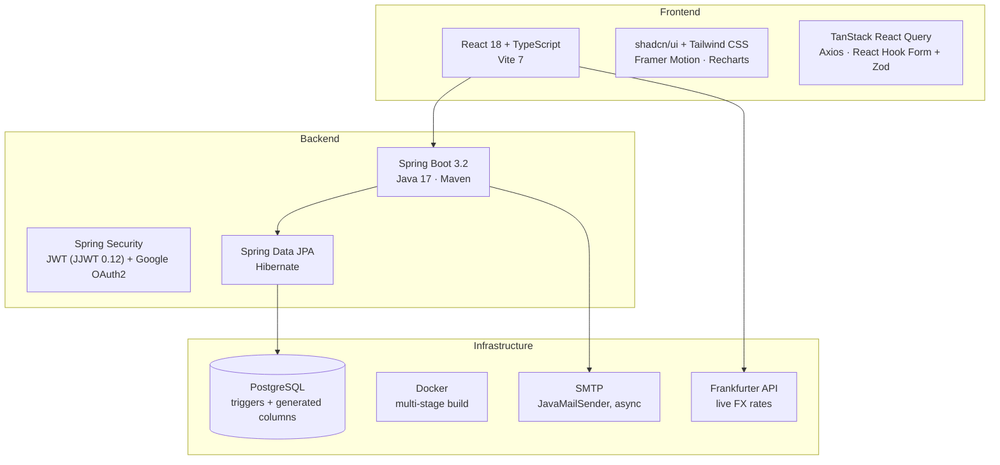

| Layer | Technology |
|---|---|
| Frontend | React 18 + TypeScript + Vite 7 |
| Routing | React Router v6 |
| Server State | TanStack React Query |
| Forms | React Hook Form + Zod |
| UI | Tailwind CSS + shadcn/ui (Radix UI) · Framer Motion · Recharts · Lucide |
| HTTP Client | Axios (request queue + auto token refresh) |
| Backend | Spring Boot 3.2.1 · Java 17 · Maven |
| Security | Spring Security + JWT (JJWT 0.12.3) + Google OAuth2 client |
| ORM | Spring Data JPA + Hibernate |
| Database | PostgreSQL (hosted on Neon in the owner's setup) |
| Email | Spring Mail (`JavaMailSender`, `@Async`) |
| Containerisation | Docker (multi-stage Maven → JRE Alpine) + Docker Compose |
| Currency | Frankfurter API v2 (free, no key) |
| Testing | Vitest + Testing Library (frontend scaffold) |

---

## 📌 Architecture

### High-level Architecture

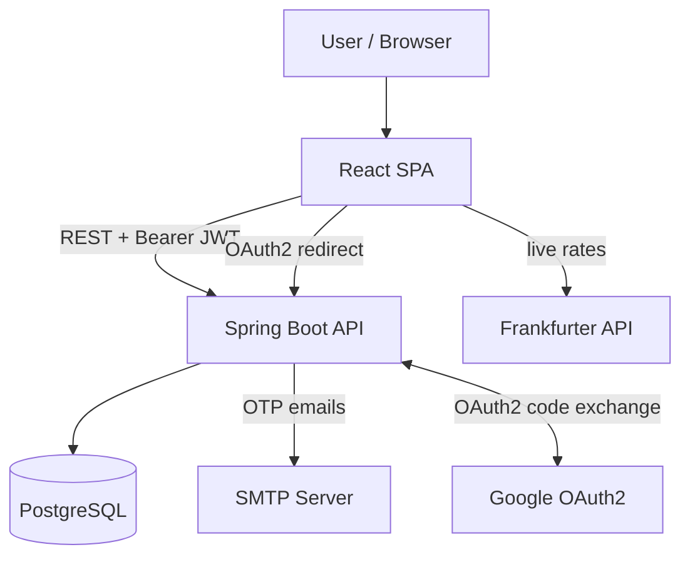

### System Architecture

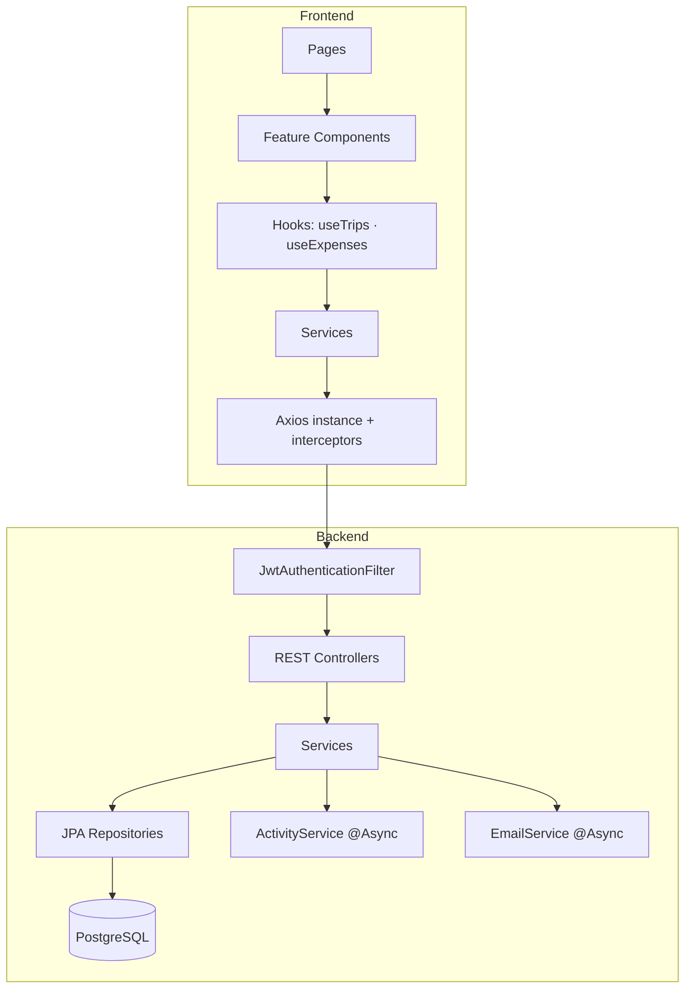

---

## 👤 User Flow

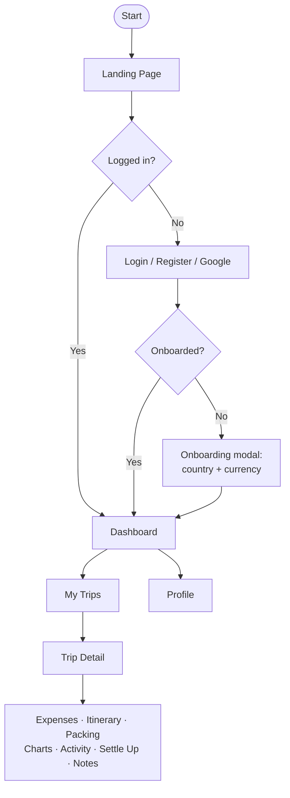

### Page Map

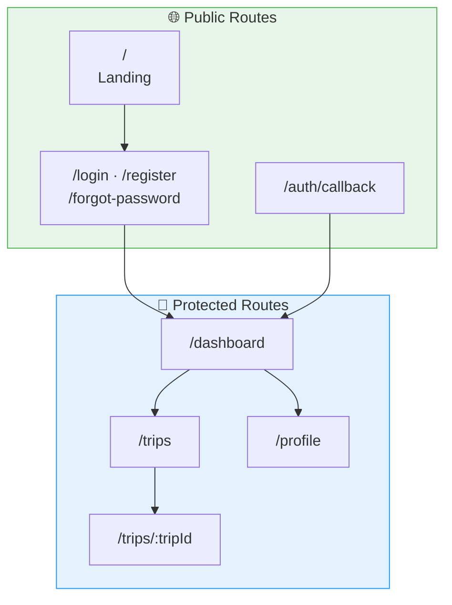

---

## 🔐 Auth & Session Flow

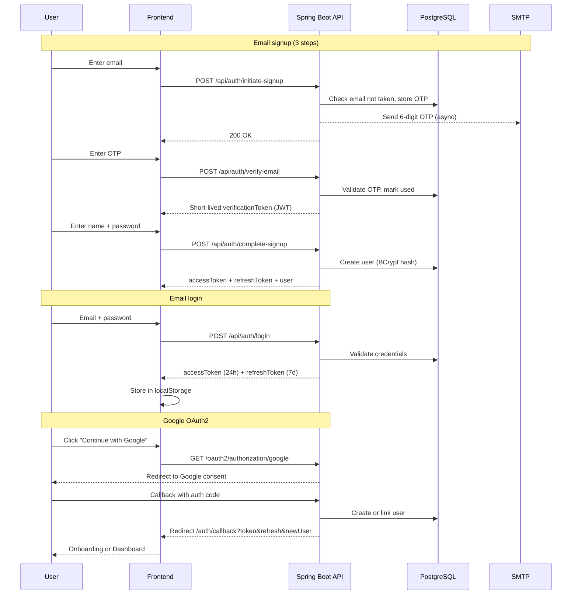

### Token Lifecycle

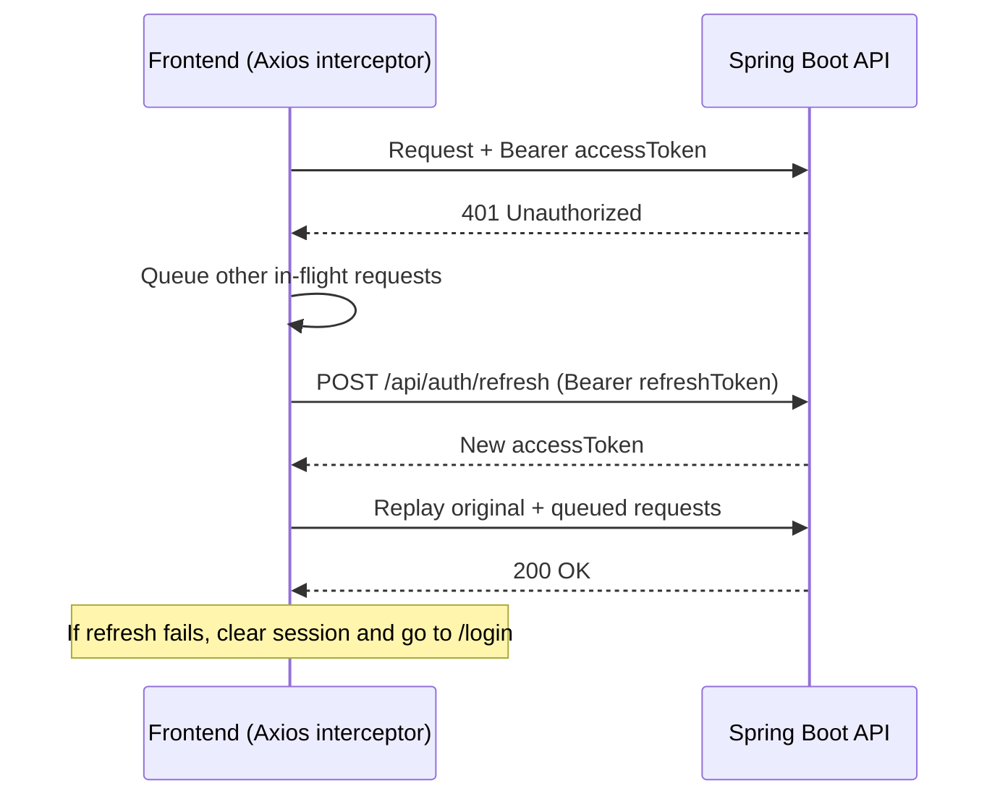

---

## 🗄️ Database (ERD)

### Core ERD

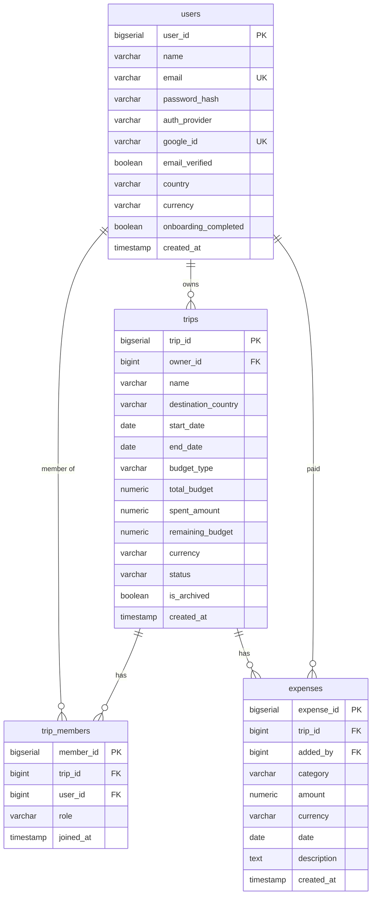

### Feature ERD

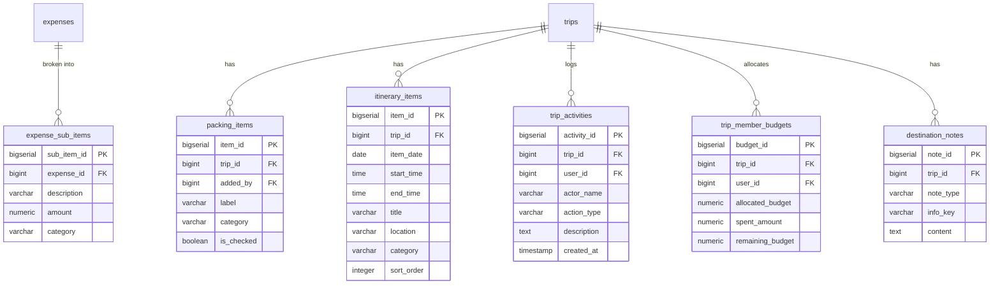

### Database Schema Overview

| Table | Purpose | Key Relations |
|---|---|---|
| `users` | Accounts: local (BCrypt) + Google OAuth | — |
| `email_verification_codes` | OTPs for signup and password reset | — |
| `refresh_tokens` | Reserved for refresh-token revocation *(not used yet)* | belongs to `users` |
| `trips` | Trips with budget, status and archive flag | belongs to `users` |
| `trip_members` | Links users to trips with `owner` / `editor` / `viewer` role | belongs to `users`, `trips` |
| `trip_member_budgets` | Per-member allocation for separated budgets | belongs to `trips`, `users` |
| `expenses` | Expenses per trip, paid by a member | belongs to `trips`, `users` |
| `expense_sub_items` | Breakdown lines for bundle expenses | belongs to `expenses` |
| `packing_items` | Packing checklist items | belongs to `trips` |
| `itinerary_items` | Day-by-day planned activities | belongs to `trips` |
| `trip_activities` | Activity feed entries | belongs to `trips`, `users` |
| `destination_notes` | Reserved for DB-backed notes *(frontend uses localStorage today)* | belongs to `trips` |
| `budget_alerts` | Reserved for persisted alert dismissals | belongs to `users`, `trips` |

> **DB triggers:** `trg_update_trip_spent` recalculates `trips.spent_amount` after any insert/update/delete on `expenses`. `trg_update_member_budget_spent` does the same per member for separated trips. `remaining_budget` is a generated column (`total_budget − spent_amount`), and every table has an `updated_at` trigger.

---

## 🔌 API Structure

### API Overview

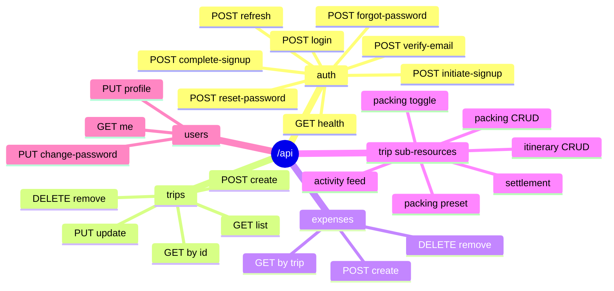

| Group | Endpoints |
|---|---|
| Auth | `POST /api/auth/{initiate-signup, verify-email, complete-signup, login, forgot-password, reset-password, refresh}` · `GET /api/auth/health` |
| Trips | `GET/POST /api/trips` · `GET/PUT/DELETE /api/trips/{tripId}` |
| Expenses | `POST /api/expenses` · `GET /api/expenses/trip/{tripId}` · `DELETE /api/expenses/{expenseId}` |
| Itinerary | `GET/POST /api/trips/{tripId}/itinerary` · `PUT/DELETE /api/trips/{tripId}/itinerary/{itemId}` |
| Packing | `GET/POST /api/trips/{tripId}/packing` · `PATCH .../{itemId}/toggle` · `DELETE .../{itemId}` · `POST .../preset?type=` |
| Activity | `GET /api/trips/{tripId}/activity` |
| Settlement | `GET /api/trips/{tripId}/settlement` |
| Users | `GET /api/users/me` · `PUT /api/users/profile` · `PUT /api/users/change-password` |
| OAuth2 | `GET /oauth2/authorization/google` → `/login/oauth2/code/google` |

### Request/Response Flow

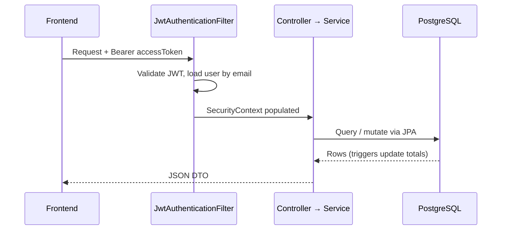

---

## 🧩 Frontend Components

### Component Tree

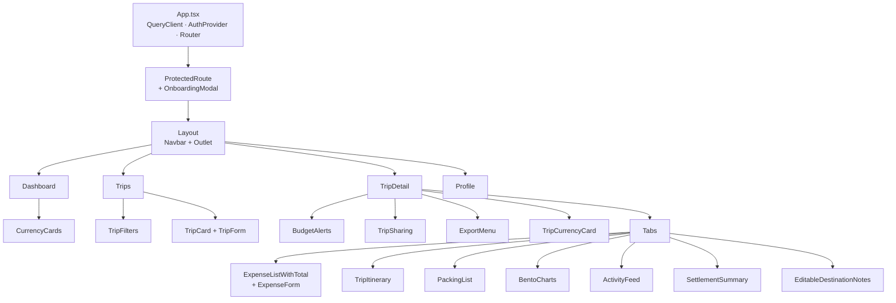

### Key Components

| Component | Purpose |
|---|---|
| `AuthContext` | Global auth state: user, login/logout, Google login, onboarding, profile updates |
| `ProtectedRoute` | Redirects guests to login, shows `OnboardingModal` for new users |
| `lib/axios.ts` | Axios instance with bearer token, 401 refresh and request queue |
| `CurrencyCards` | Dashboard FX widgets: favourite rates, quick convert, all rates |
| `TripForm` | Create/edit trip with country picker, dates, budget type and currency |
| `ExpenseForm` | Add expense, with optional bundle sub-items |
| `ExpenseListWithTotal` | Expense table with expandable bundle rows and running total |
| `BentoCharts` | Analytics bento: KPI tiles, radial gauge, donut, trend, top-spend bars |
| `BudgetAlerts` | 75 / 90 / 100% threshold and category warnings, dismissible |
| `SettlementSummary` | Who paid what + simplified "X → Y" transfers |
| `TripItinerary` | Day-by-day planner generated from the trip's date range |
| `PackingList` | Grouped checklist with progress bar and preset loader |
| `ExportMenu` | Expenses CSV, trip CSV, printable PDF report |
| `TripSharing` | Share link + collaborator list *(invite not wired to backend)* |

---

## ⚙️ Feature-specific Flows

### Trip CRUD Flow

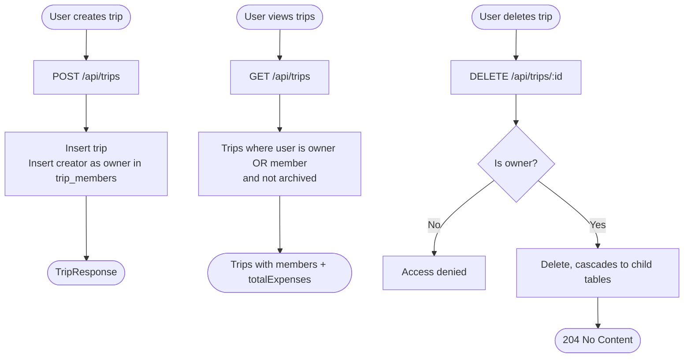

### Expense Flow

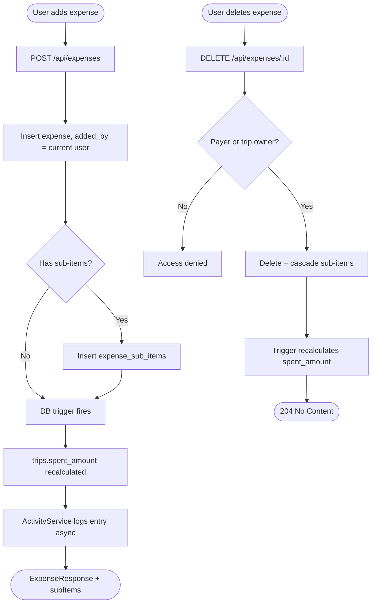

### Settle Up Algorithm

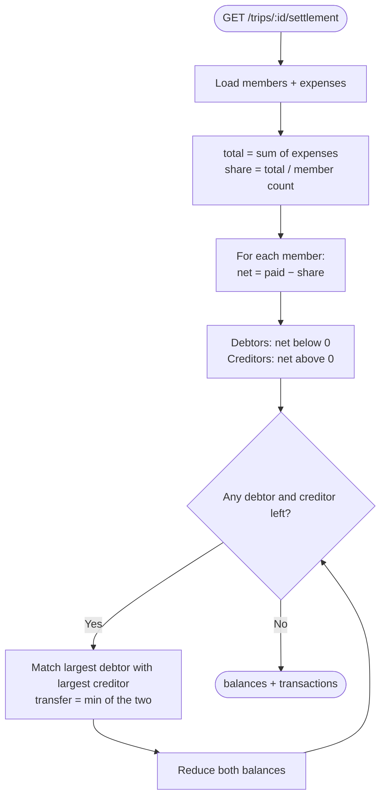

### Budget System

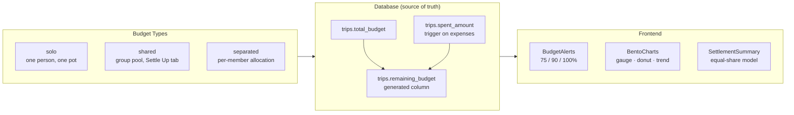

### Role & Permission Matrix

What the backend enforces today:

| Action | Owner | Editor | Viewer |
|---|---|---|---|
| View trip details | ✅ | ✅ | ✅ |
| Edit trip details | ✅ | ✅ | ❌ |
| Delete trip | ✅ | ❌ | ❌ |
| Add expense | ✅ | ✅ | ✅ *(not role-checked yet)* |
| Delete own expense | ✅ | ✅ | ✅ |
| Delete anyone's expense | ✅ | ❌ | ❌ |
| Manage members | 🚧 *(no endpoint yet)* | ❌ | ❌ |

> A `PermissionGate` component exists on the frontend for role-based UI. Stricter membership checks on expenses, itinerary, packing and settlement are on the roadmap.

---

## 📁 Project Structure

```
TravelLuhh/
├── docker-compose.yml          Backend container
├── TravelLuhh.drawio           Architecture diagrams
├── DOCS.pdf                    Long-form technical docs
│
├── backend/
│   ├── Dockerfile              Multi-stage Maven → JRE Alpine
│   ├── schema.sql              Full DDL, triggers, migration notes
│   └── src/main/java/com/travelluhh/
│       ├── controller/         Auth, Trip, Expense, Itinerary, Packing,
│       │                       Activity, Settlement, User
│       ├── service/            Business logic (+ async email / activity)
│       ├── repository/         Spring Data JPA repositories
│       ├── entity/             JPA entities
│       ├── dto/                Request / response DTOs
│       ├── security/           SecurityConfig, JWT filter, OAuth2 handlers
│       ├── util/               JwtUtil
│       └── exception/          Global exception handler
│
└── frontend/src/
    ├── pages/                  Landing, Login, Register, ForgotPassword,
    │                           Dashboard, Trips, TripDetail, Profile, Portfolio
    ├── components/             expenses, charts, settlement, itinerary,
    │                           packing, currency, portfolio, sharing, ui ...
    ├── services/               API call layer + Frankfurter client
    ├── hooks/                  useTrips, useExpenses
    ├── context/                AuthContext
    ├── lib/                    axios.ts, currency.ts, export.ts
    ├── data/                   Countries + currencies
    └── types/                  TypeScript interfaces
```

---

## 🗺 Roadmap

- [x] Email signup with OTP + Google OAuth2
- [x] JWT auth with silent token refresh
- [x] Onboarding (home country + currency)
- [x] Trip CRUD with status and archive
- [x] Expense tracking with bundle sub-items
- [x] DB triggers for spent / remaining budget
- [x] Budget modes (solo / shared / separated)
- [x] Budget alerts (75% / 90% / 100%)
- [x] Analytics bento charts
- [x] Settle Up with debt simplification
- [x] Packing checklist with preset packs
- [x] Day-by-day itinerary planner
- [x] Activity feed
- [x] CSV + printable PDF export
- [x] Live FX currency cards and converter
- [x] Profile settings + change password
- [ ] Member invite / remove / role change (backend endpoints)
- [ ] Membership checks on all trip sub-resources
- [ ] Edit expense
- [ ] Separated budget allocation per member
- [ ] Route the Travel Portfolio page (Year in Review · Timeline · Map)
- [ ] Notes persistence to database
- [ ] Multi-currency expenses converted to the trip currency
- [ ] Refresh-token revocation on logout
- [ ] Real-time collaboration (WebSocket/SSE)
- [ ] Trip image upload
- [ ] Email notifications for budget alerts

---

## 📄 License

MIT © 2025 Siti Nursyaqirah · Source on [GitHub](https://github.com/snsyaqirah/TravelLuhh)
